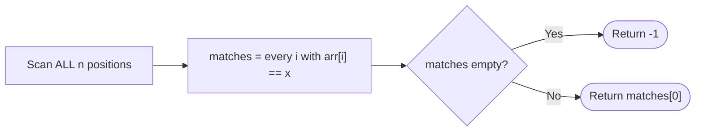
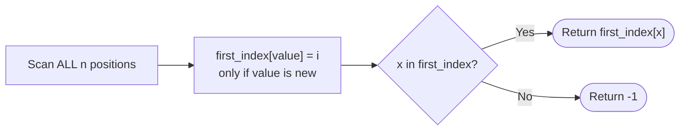
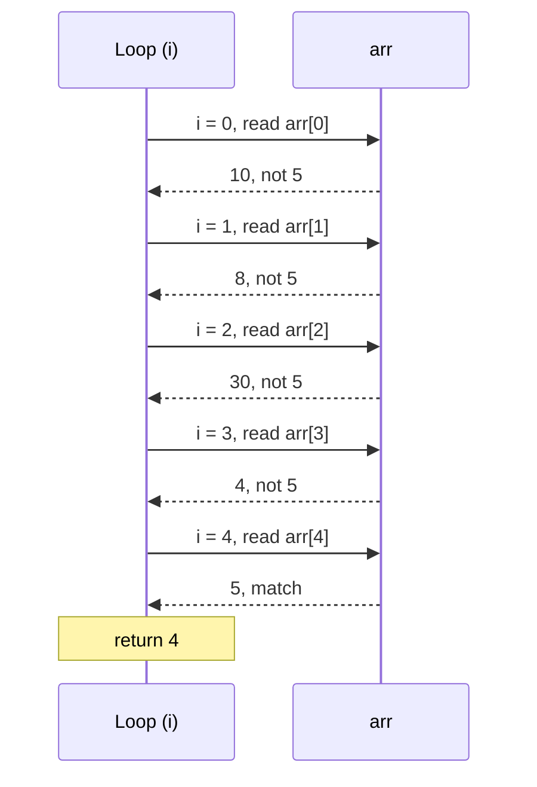
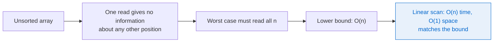
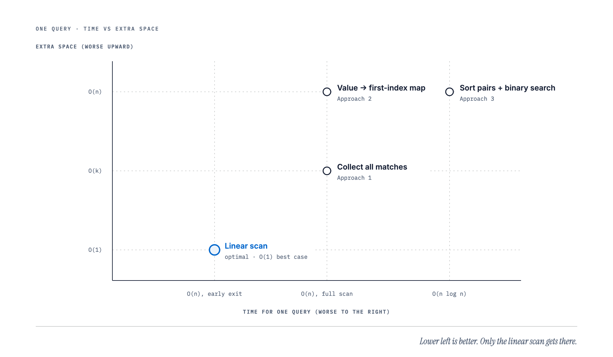
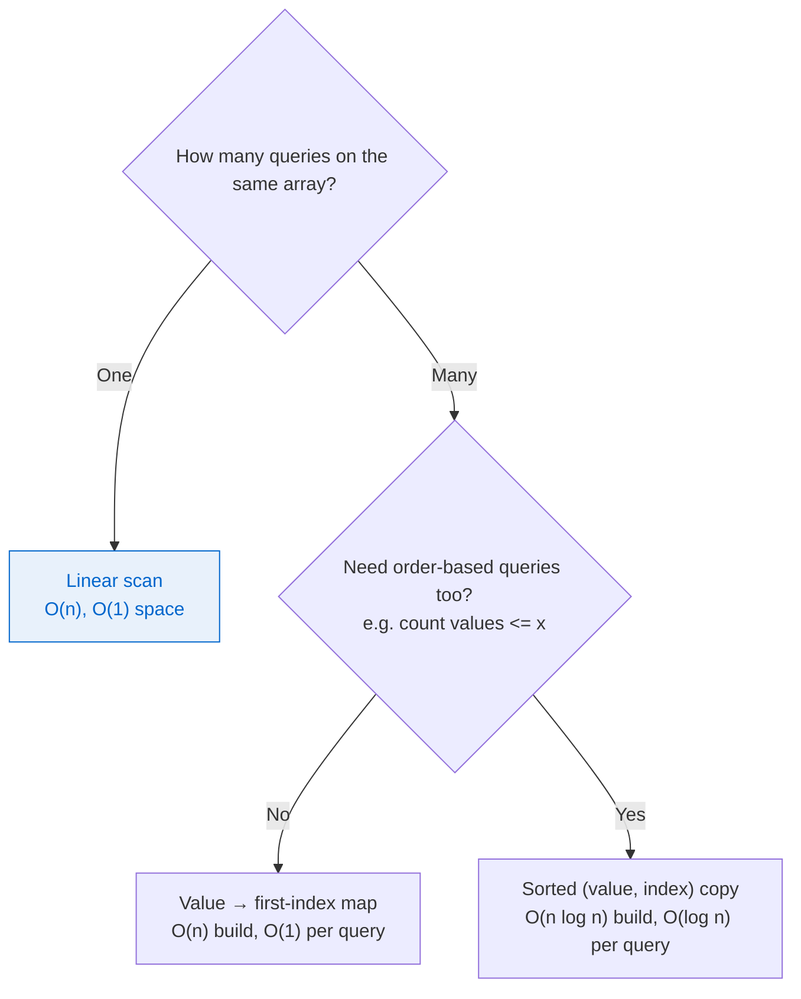
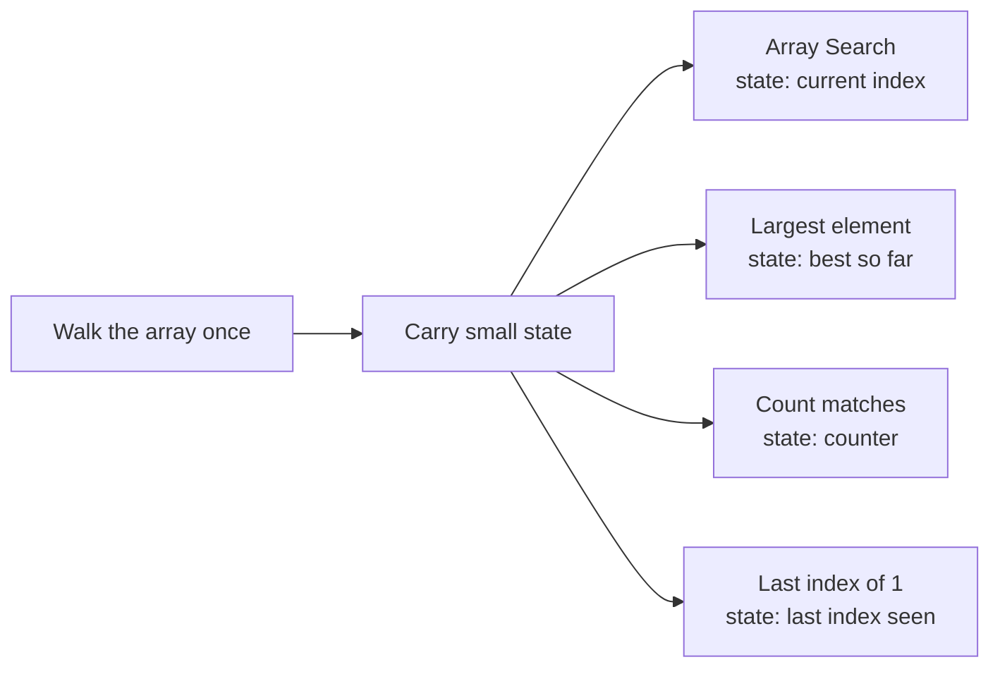

# Array Search

| Topic | Difficulty | Submissions | Accuracy | Companies | Related Tags | Problem Link |
|---|---|---|---|---|---|---|
| Searching | Basics | 763,285 | 40.95% | — | Arrays, Searching | [https://www.geeksforgeeks.org/problems/search-an-element-in-an-array-1587115621/1](https://www.geeksforgeeks.org/problems/search-an-element-in-an-array-1587115621/1) |

> [!IMPORTANT]
> **TL;DR.** The array is unsorted, so no comparison can rule out any other position. Scan from left to right and return the index at the first match; return `-1` after the loop. **Time `O(n)` · Space `O(1)` · Pattern: Linear Scan with Running State.**

## Contents

1. [Problem](#1-problem)
2. [Key Insight](#2-key-insight)
3. [Approaches](#3-approaches)
4. [Walkthrough](#4-walkthrough)
5. [Complexity Analysis](#5-complexity-analysis)
6. [Comparing the Approaches](#6-comparing-the-approaches)
7. [Edge Cases and Pitfalls](#7-edge-cases-and-pitfalls)
8. [Interview Guide](#8-interview-guide)
9. [Pattern: Linear Scan with Running State](#9-pattern-linear-scan-with-running-state)
10. [Summary](#10-summary)

## 1. Problem

> Given an array, `arr[]` of n integers, and an integer element `x`, find whether element `x` is present in the array. Return the index of the first occurrence of `x` in the array, or -1 if it doesn't exist.

*Problem statement, examples and constraints as given on GeeksforGeeks.*

### Examples

```text
Input: arr[] = [1, 2, 3, 4], x = 3
Output: 2
Explanation: For array [1, 2, 3, 4], the element to be searched is 3. Since 3 is present at index 2, the output is 2.
```

```text
Input: arr[] = [10, 8, 30, 4, 5], x = 5
Output: 4
Explanation: For array [10, 8, 30, 4, 5], the element to be searched is 5 and it is at index 4. So, the output is 4.
```

```text
Input: arr[] = [10, 8, 30], x = 6
Output: -1
Explanation: The element to be searched is 6 and it is not present, so we return -1.
```

### Constraints

```text
1 ≤ arr.size() ≤ 10^6
0 ≤ arr[i] ≤ 10^6
0 ≤ x ≤ 10^5
```

### Function Signature

```python
class Solution:

    # Return the 0-based index of the first occurrence of x, or -1 if absent.
    def search(self, arr, x):
        ...
```

Indexing is **0-based**, and the array is **not sorted**.

## 2. Key Insight

The word **unsorted** decides the whole problem. In a sorted array, one comparison tells you which half to discard. In an unsorted array, reading `arr[i]` tells you **nothing** about any other position, so every position stays a candidate until you read it.

```text
arr = [10, 8, 30, 4, 5]        x = 5
             ^
           arr[1] = 8  ->  is 5 to the left or to the right? Unknown.
```

That leaves one safe plan: **read positions from left to right and stop at the first match.** Scanning from the left also handles "first occurrence" for free, because the first match you meet is, by definition, the earliest one.


The loop has exactly two exits:

| Exit | Condition | Return |
|---|---|---|
| Found | `arr[i] == x` for the first time | `i` |
| Not found | `i` reaches `n` with no match | `-1` |

## 3. Approaches

Four approaches, from the most literal to the optimal. All four are tested and correct; they differ in how much work and memory they spend. The three brute-force approaches use the same input so you can compare them directly:

```text
arr = [4, 9, 4, 9, 2]        x = 9        expected output: 1
```

### 3.1 Brute Force: Collect Every Match

**Idea.** Find every index where `arr[i] == x`, then return the smallest one, or `-1` if there are none.



```python
class Solution:

    # Return the first index of x by collecting every matching index first.
    def search(self, arr, x):

        # Store every index where the value equals x.
        matches = []

        # Visit every index of the array, with no early exit.
        for i in range(len(arr)):

            # Check whether the current value equals x.
            if arr[i] == x:

                # Remember this index as a match.
                matches.append(i)

        # If no index matched, x is not in the array.
        if not matches:

            # Report that x was not found.
            return -1

        # Indices were added left to right, so the first one is the smallest.
        return matches[0]
```

**Walkthrough.**

| Step | `i` | `arr[i]` | `arr[i] == 9` | `matches` |
|---|---|---|---|---|
| 1 | 0 | 4 | No | `[]` |
| 2 | 1 | 9 | Yes | `[1]` |
| 3 | 2 | 4 | No | `[1]` |
| 4 | 3 | 9 | Yes | `[1, 3]` |
| 5 | 4 | 2 | No | `[1, 3]` |

The loop ends with `matches = [1, 3]`, so it returns `matches[0] = 1`. ✔

**Cost.** `O(n)` time on every input, even when `x` sits at index `0`, and `O(k)` extra space for `k` matches (`O(n)` if every element equals `x`). The answer was known at step 2; steps 3–5 and the stored index `3` were wasted.

### 3.2 Brute Force: Value → First-Index Map

**Idea.** Preprocess the array into a dictionary that maps each value to the index where it first appears, then look up `x`.



```python
class Solution:

    # Return the first index of x using a value-to-first-index dictionary.
    def search(self, arr, x):

        # Map each value to the first index where it appears.
        first_index = {}

        # Visit every index of the array.
        for i in range(len(arr)):

            # Only record a value the first time it is seen.
            if arr[i] not in first_index:

                # Save the first index of this value.
                first_index[arr[i]] = i

        # If x was never recorded, it is not in the array.
        if x not in first_index:

            # Report that x was not found.
            return -1

        # Return the stored first index of x.
        return first_index[x]
```

**Walkthrough.**

| Step | `i` | `arr[i]` | Already in map? | `first_index` |
|---|---|---|---|---|
| 1 | 0 | 4 | No | `{4: 0}` |
| 2 | 1 | 9 | No | `{4: 0, 9: 1}` |
| 3 | 2 | 4 | Yes, skip | `{4: 0, 9: 1}` |
| 4 | 3 | 9 | Yes, skip | `{4: 0, 9: 1}` |
| 5 | 4 | 2 | No | `{4: 0, 9: 1, 2: 4}` |

Lookup: `9` is in the map, so it returns `first_index[9] = 1`. ✔

**Cost.** `O(n)` time and `O(n)` extra space for a single query. It only pays off for **many** queries on the same array: build once in `O(n)`, then answer each query in `O(1)` on average.

### 3.3 Brute Force: Sort, Then Binary Search

**Idea.** "Searching means binary search" is a common reflex. Sorting moves values and loses their original positions, so sort `(value, index)` pairs instead, then binary search for the **leftmost** pair whose value is `x`. Equal values stay ordered by index because the index is the tie-breaker.


```python
class Solution:

    # Return the first index of x by sorting (value, index) pairs and binary searching.
    def search(self, arr, x):

        # Pair each value with its original index so the index survives sorting.
        pairs = [(arr[i], i) for i in range(len(arr))]

        # Sort by value, and by original index when values are equal.
        pairs.sort()

        # Start the search window at the first pair.
        low = 0

        # End the search window at the last pair.
        high = len(pairs) - 1

        # Hold the best answer found so far.
        answer = -1

        # Keep searching while the window is not empty.
        while low <= high:

            # Pick the middle position of the window.
            mid = (low + high) // 2

            # If the middle value is smaller than x, x can only be to the right.
            if pairs[mid][0] < x:

                # Discard the left half including mid.
                low = mid + 1

            # If the middle value is larger than x, x can only be to the left.
            elif pairs[mid][0] > x:

                # Discard the right half including mid.
                high = mid - 1

            # Otherwise the middle value equals x.
            else:

                # Record this original index as a candidate answer.
                answer = pairs[mid][1]

                # Keep looking left for an earlier pair with the same value.
                high = mid - 1

        # Return the original index of the leftmost match, or -1.
        return answer
```

**Walkthrough.**

```text
pairs before sort: [(4,0), (9,1), (4,2), (9,3), (2,4)]
pairs after sort : [(2,4), (4,0), (4,2), (9,1), (9,3)]
position         :   0      1      2      3      4
```

| Step | `low` | `high` | `mid` | `pairs[mid]` | Action | `answer` |
|---|---|---|---|---|---|---|
| 1 | 0 | 4 | 2 | `(4, 2)` | `4 < 9`, go right | `-1` |
| 2 | 3 | 4 | 3 | `(9, 1)` | equal, record, go left | `1` |
| 3 | 3 | 2 | — | — | window empty, stop | `1` |

It returns `1`. ✔

**Cost.** `O(n log n)` time for the sort plus `O(n)` extra space for the pairs. Sorting costs more than the whole problem; binary search only pays off when the data is **already** sorted or one sorted copy serves many queries.

### 3.4 Optimal: Linear Scan with Early Exit

**Idea.** Keep the brute-force scan and remove everything it did not need. The **first** match is the answer, so return it immediately: no list of matches, no dictionary, no sort.


**Algorithm.**

1. Walk `i` from `0` to `n - 1`.
2. If `arr[i] == x`, return `i` immediately.
3. If the loop finishes, `x` is not in the array: return `-1`.

```python
class Solution:

    # Return the 0-based index of the first occurrence of x, or -1 if absent.
    def search(self, arr, x):

        # Visit every index from left to right.
        for i in range(len(arr)):

            # The first match met while walking left to right is the first occurrence.
            if arr[i] == x:

                # Stop at once and return this index.
                return i

        # The loop finished without a match, so x is not in the array.
        return -1
```

## 4. Walkthrough

### 4.1 `x` Found

```text
arr = [10, 8, 30, 4, 5]        x = 5
```

| Step | `i` | `arr[i]` | `arr[i] == 5` | Action |
|---|---|---|---|---|
| 1 | 0 | 10 | No | move on |
| 2 | 1 | 8 | No | move on |
| 3 | 2 | 30 | No | move on |
| 4 | 3 | 4 | No | move on |
| 5 | 4 | 5 | Yes | **return 4** |

![Linear scan of [10, 8, 30, 4, 5] for x = 5: indices 0 to 3 do not match, index 4 matches and the scan returns 4](assets/array-search-dry-run.png)



### 4.2 `x` Not Found

```text
arr = [10, 8, 30]        x = 6
```

| Step | `i` | `arr[i]` | `arr[i] == 6` | Action |
|---|---|---|---|---|
| 1 | 0 | 10 | No | move on |
| 2 | 1 | 8 | No | move on |
| 3 | 2 | 30 | No | move on |
| — | 3 | — | — | `i = n`, loop ends, **return -1** |

### 4.3 Duplicates

```text
arr = [4, 9, 4, 9, 2]        x = 9
```

| Step | `i` | `arr[i]` | `arr[i] == 9` | Action |
|---|---|---|---|---|
| 1 | 0 | 4 | No | move on |
| 2 | 1 | 9 | Yes | **return 1** |

Index `3` also holds `9`, but the loop never reaches it. On the same input, Approach 3.1 made 5 comparisons and stored 2 indices; the optimal scan made 2 comparisons and stored nothing.

![On [4, 9, 4, 9, 2] with x = 9, collecting all matches reads 5 cells and stores two indices; the early-exit scan reads 2 cells and returns 1](assets/array-search-early-exit.png)

## 5. Complexity Analysis

Let `n = len(arr)`.

| Case | When | Comparisons | Time |
|---|---|---|---|
| Best | `x` at index `0` | 1 | `O(1)` |
| Average | `x` at a random position | about `n / 2` | `O(n)` |
| Worst | `x` at the end, or absent | `n` | `O(n)` |

| Metric | Complexity |
|---|---|
| Time | `O(n)` worst case |
| Extra Space | `O(1)` — one loop variable |

### Why `O(n)` Is Optimal

Any correct algorithm on an unsorted array must read every element in the worst case. Suppose an algorithm returns `-1` without reading position `j`. Place `x` at position `j`: nothing the algorithm read has changed, so it still returns `-1`, which is now wrong. The linear scan reads exactly `n` elements, so it matches this lower bound.



## 6. Comparing the Approaches

| Approach | Time | Extra Space | Stops early? | Best used for |
|---|---|---|---|---|
| 3.1 Collect all matches | `O(n)` always | `O(n)` worst | No | Returning **all** occurrences |
| 3.2 Value → first-index map | `O(n)` build, `O(1)` lookup | `O(n)` | No | Many queries on one array |
| 3.3 Sort pairs + binary search | `O(n log n)` | `O(n)` | No | Many queries that also need order |
| **3.4 Linear scan** | **`O(n)`, best `O(1)`** | **`O(1)`** | **Yes** | **A single query (this problem)** |



The right choice depends on how many queries hit the same array:



## 7. Edge Cases and Pitfalls

### 7.1 Edge Cases

| Case | Input | Expected | What it tests |
|---|---|---|---|
| `x` at the start | `[7, 1, 2]`, `x = 7` | `0` | Loop does not skip index `0`. |
| `x` at the end | `[1, 2, 7]`, `x = 7` | `2` | Loop includes index `n - 1`. |
| Duplicates | `[4, 9, 4, 9]`, `x = 9` | `1` | Returns the **first** index, not the last. |
| Not present | `[1, 2, 3]`, `x = 8` | `-1` | `-1` is returned only after the loop. |
| Single element, match | `[5]`, `x = 5` | `0` | Smallest valid input. |
| Single element, no match | `[5]`, `x = 6` | `-1` | Smallest invalid input. |

> [!NOTE]
> The constraints guarantee `arr.size() >= 1`. The solution still returns `-1` for an empty array, which is the correct answer.

### 7.2 Common Pitfalls

| # | Pitfall | Buggy code | Fix |
|---|---|---|---|
| 1 | Returning `-1` inside the loop | `if arr[i] == x: return i` / `else: return -1` | Return `-1` **after** the loop; otherwise only index `0` is checked. |
| 2 | Returning the last occurrence | `answer = i` on every match, return `answer` at the end | Return at the **first** match. |
| 3 | Off-by-one bound | `for i in range(len(arr) - 1)` | `range(len(arr))` already stops at `n - 1`. |
| 4 | `arr.index(x)` without handling absence | `return arr.index(x)` | It raises `ValueError` when `x` is missing, and it is a linear scan anyway. |
| 5 | Binary search on unsorted data | `mid` comparison on `[10, 8, 30, 4, 5]` | On `x = 5`, the first `mid` is `30 > 5`, so it searches `[10, 8]` and wrongly returns `-1`. |

## 8. Interview Guide

### 8.1 The 30-Second Explanation

> The array is unsorted, so reading one element tells me nothing about the others, and any correct algorithm must read every element in the worst case. I scan from left to right and return the index the moment `arr[i] == x`; because I scan from the left, that is the first occurrence. If the loop finishes without a match, I return `-1`. That is `O(n)` time in the worst case, `O(1)` in the best case, and `O(1)` extra space.

### 8.2 Follow-Up Questions

**Q1. What if the array were sorted?** Use binary search for the leftmost occurrence: `O(log n)` time, `O(1)` space. On a match, record the index and keep searching the left half, exactly as in [3.3](#33-brute-force-sort-then-binary-search).

**Q2. What if there are many queries on the same array?** Build a value → first-index dictionary once in `O(n)`, then answer each query in `O(1)` on average ([3.2](#32-brute-force-value--first-index-map)).

**Q3. How would you return every occurrence?** Collect every matching index ([3.1](#31-brute-force-collect-every-match)). Time stays `O(n)`, and the output needs `O(k)` space for `k` matches.

**Q4. Does knowing the data change the time?** The worst case stays `O(n)`, because an input can always put `x` last or omit it. The **expected** time can be much smaller: if `x` is always among the first 10 positions, each search takes at most 10 comparisons.

<details>
<summary><b>Q5. How would you return the last occurrence?</b></summary>

Scan from right to left and return the first match you meet.

```python
class Solution:

    # Return the 0-based index of the last occurrence of x, or -1 if absent.
    def searchLast(self, arr, x):

        # Visit every index from right to left.
        for i in range(len(arr) - 1, -1, -1):

            # The first match from the right is the last occurrence.
            if arr[i] == x:

                # Stop at once and return this index.
                return i

        # No index matched, so x is not in the array.
        return -1
```

</details>

<details>
<summary><b>Q6. Can you save comparisons inside the loop? (sentinel search)</b></summary>

Append `x` to the end so the scan is guaranteed to stop, which removes the `i < n` check from the loop. A match at the appended position means "not found". In C this halves the comparisons per step; complexity stays `O(n)`, and in Python the gain is negligible.

```python
class Solution:

    # Return the first index of x using a sentinel to drop the bounds check.
    def search(self, arr, x):

        # Remember the original length before adding the sentinel.
        n = len(arr)

        # Place x at the end so the scan always finds a match.
        arr.append(x)

        # Start scanning from the first index.
        i = 0

        # Move right until a match is found; the sentinel guarantees termination.
        while arr[i] != x:

            # Advance to the next index.
            i += 1

        # Remove the sentinel to restore the caller's array.
        arr.pop()

        # A match at index n is the sentinel, which means x was not present.
        if i == n:

            # Report that x was not found.
            return -1

        # Otherwise i is the first real occurrence of x.
        return i
```

</details>

## 9. Pattern: Linear Scan with Running State

**Recognize it when:**

- the data has **no order** you can exploit,
- the answer depends on what you have **seen so far** in one pass,
- each element needs only **`O(1)` work** to update or decide the answer.



Here the running state is the smallest possible: the current index `i`. Later problems in this pattern carry more (a maximum, a counter, a last-seen index), but the loop shape stays the same.

### Practice Next

| Problem | What changes |
|---|---|
| Value Equal to Position | Compare each value with its 1-based index. |
| Last Index of One | Track the last occurrence instead of stopping at the first. |
| Binary Search | Same question on sorted data, in `O(log n)`. |
| Largest Element in Array | A running maximum instead of a running index. |
| Count Occurrences of an Element | A running counter instead of an early exit. |

## 10. Summary

```python
class Solution:

    # Return the 0-based index of the first occurrence of x, or -1 if absent.
    def search(self, arr, x):

        # Visit every index from left to right.
        for i in range(len(arr)):

            # The first match met while walking left to right is the first occurrence.
            if arr[i] == x:

                # Stop at once and return this index.
                return i

        # The loop finished without a match, so x is not in the array.
        return -1
```

**Key takeaways**

1. **Unsorted data has no shortcut.** The worst case must read all `n` elements.
2. **Scan from the left and return at the first match.** That match is the first occurrence.
3. **Return `-1` only after the loop**, never inside it.
4. **Collecting, hashing and sorting all do extra work** for a single query.
5. **Hashing or a sorted copy pays off only for many queries** on the same array.
6. **Time `O(n)` worst, `O(1)` best · Space `O(1)`.**

> [!TIP]
> **On unsorted data, every element is a possible answer until you look at it, so scan once from the left and stop at the first match.**
