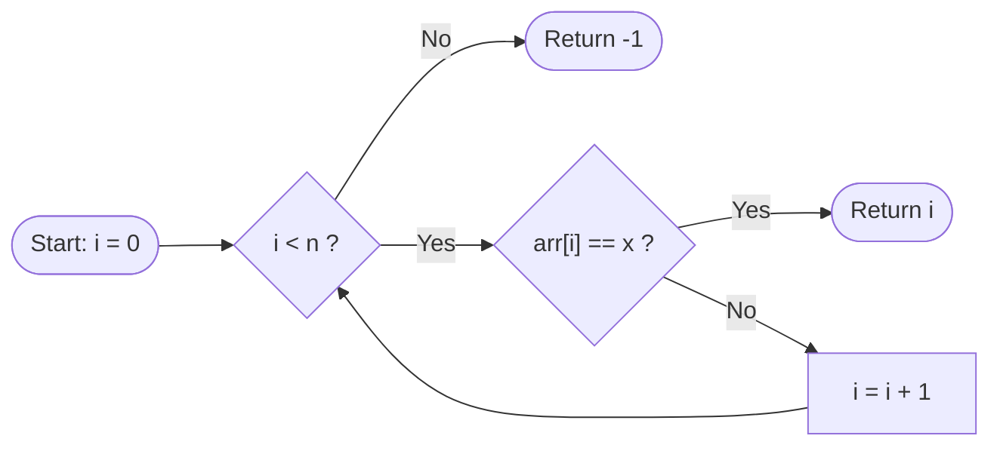
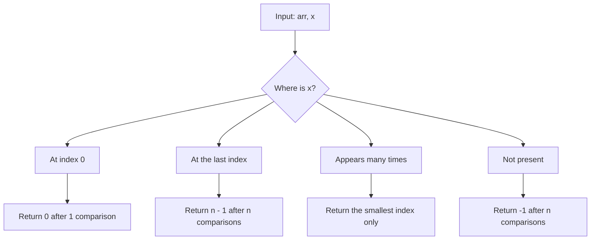
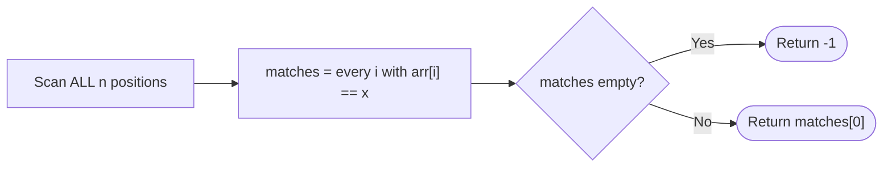
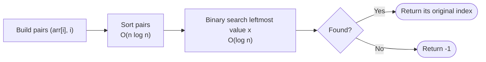
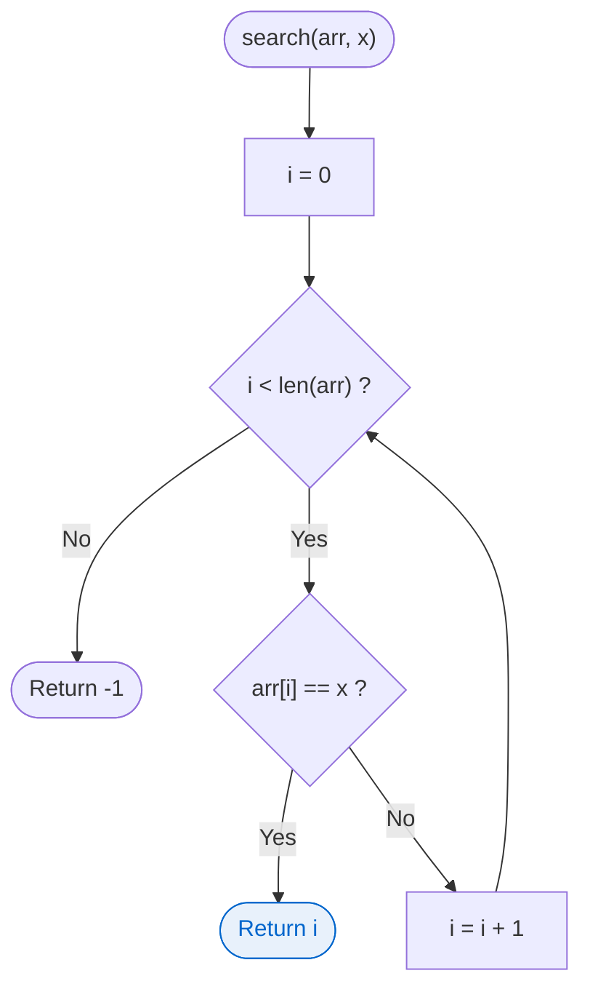
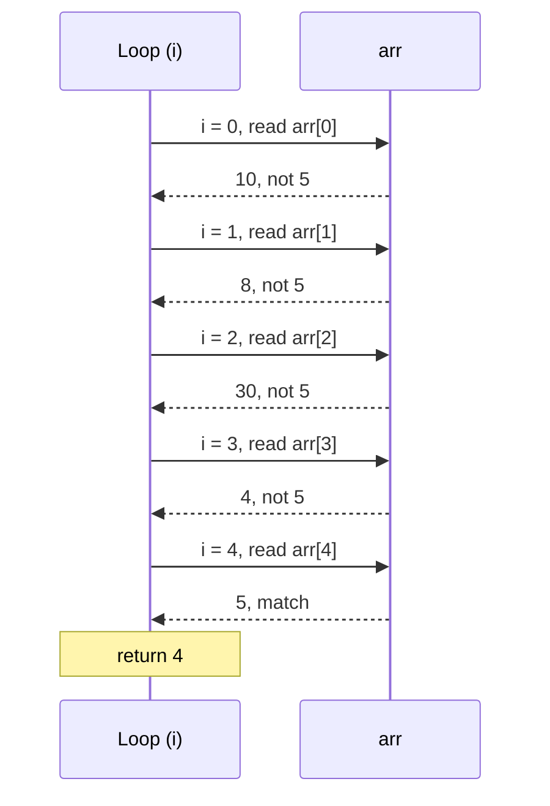
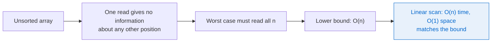
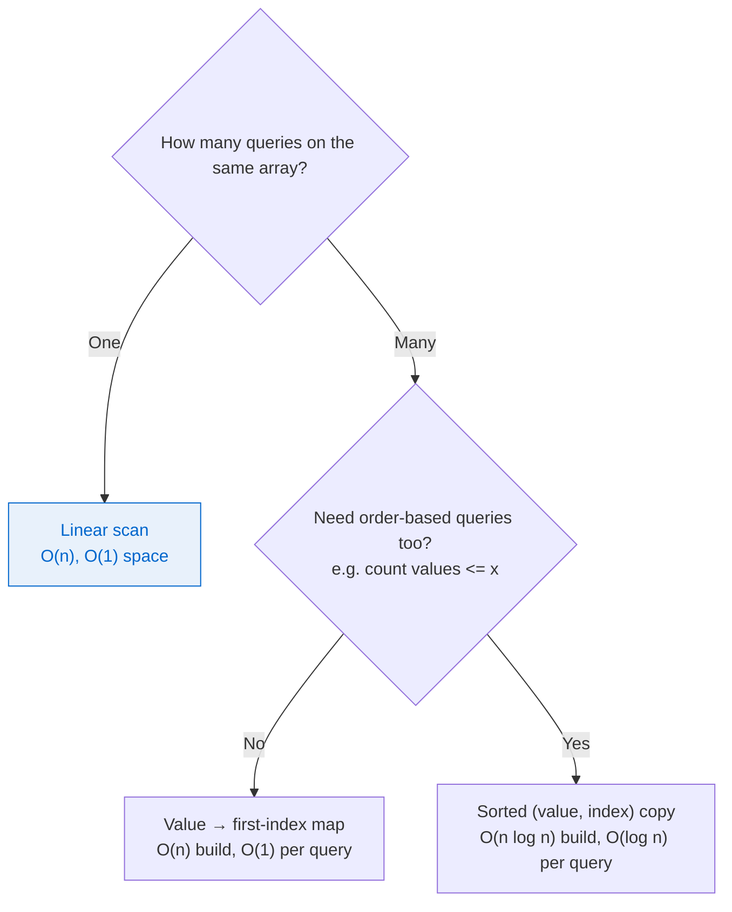
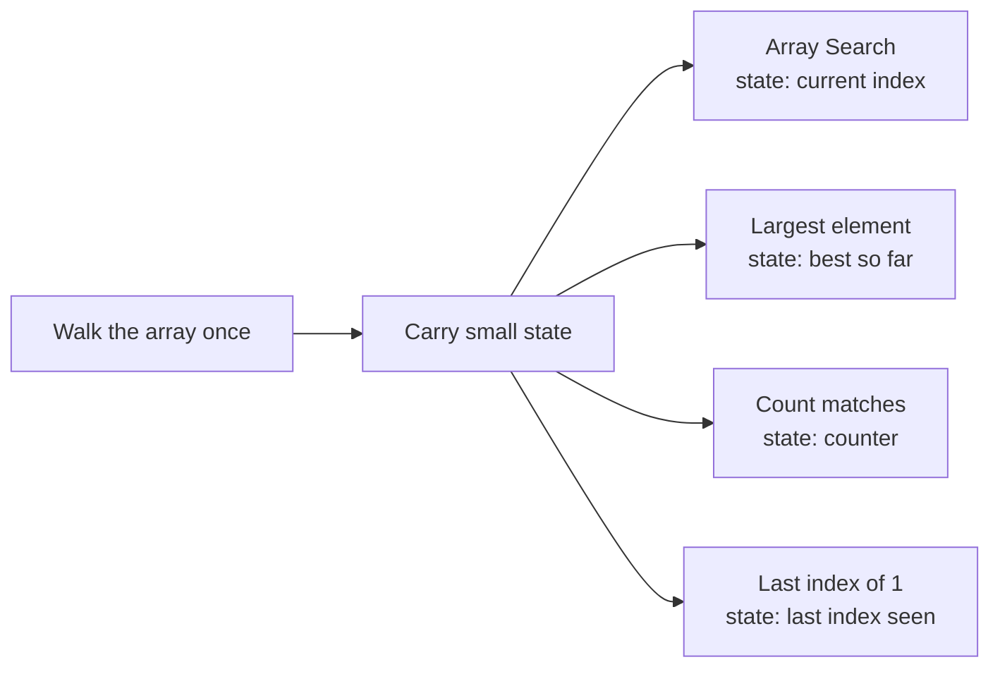

# Array Search

| Topic | Difficulty | Submissions | Accuracy | Companies | Related Tags | Problem Link |
|---|---|---|---|---|---|---|
| Searching | Basics | 763,285 | 40.95% | — | Arrays, Searching | [https://www.geeksforgeeks.org/problems/search-an-element-in-an-array-1587115621/1](https://www.geeksforgeeks.org/problems/search-an-element-in-an-array-1587115621/1) |

## Problem Statement

You are given an array `arr` and an integer `x`.

Return the **index of the first occurrence** of `x` in `arr`, using **0-based** indexing.

If `x` does not appear in `arr`, return `-1`.

The array is **not sorted**.

### Example 1

```text
Input:
arr = [1, 2, 3, 4]
x   = 3

Output:
2

Explanation:
arr[2] = 3, and no earlier index holds 3.
```

### Example 2

```text
Input:
arr = [10, 8, 30, 4, 5]
x   = 5

Output:
4

Explanation:
5 appears only at index 4.
```

### Example 3

```text
Input:
arr = [10, 8, 30]
x   = 6

Output:
-1

Explanation:
6 does not appear in the array.
```

### Constraints

```text
1 <= arr.size() <= 10^6
1 <= arr[i]     <= 10^6
1 <= x          <= 10^5
```

# 1. Interview Intuition

The array is **unsorted**.

That one word decides the whole problem.

In a sorted array, one comparison tells you which half to throw away.

In an unsorted array, one comparison tells you **nothing** about any other position.

```text
arr = [10, 8, 30, 4, 5]
             ^
           arr[1] = 8

Is x = 5 to the left? To the right? Unknown.
Values carry no order, so position 1 says nothing about positions 0, 2, 3, 4.
```

So the only safe plan is:

> Look at every position, **from left to right**, and stop the moment you find `x`.

Left to right matters, because the problem asks for the **first** occurrence.

The first match you meet while walking left to right is, by definition, the first occurrence.

# 2. Core Idea — Linear Scan with Running State

This problem belongs to the **Linear Scan with Running State** pattern.

You walk the array once, and you carry a tiny piece of state while you walk.

Here, the state is just **"the index I am looking at now"**.



Two exits, and only two:

| Exit | When | Return |
|---|---|---|
| Found | `arr[i] == x` for the first time | `i` |
| Not found | `i` reaches `n` with no match | `-1` |

# 3. Edge Cases to Settle Before Coding



| Case | Example | Expected | Why it matters |
|---|---|---|---|
| `x` at the start | `arr = [7, 1, 2]`, `x = 7` | `0` | Best case. Loop must not skip index 0. |
| `x` at the end | `arr = [1, 2, 7]`, `x = 7` | `2` | Loop must include index `n - 1`. |
| Duplicates | `arr = [4, 9, 4, 9]`, `x = 9` | `1` | Return the **first** index, not the last. |
| Not present | `arr = [1, 2, 3]`, `x = 8` | `-1` | Return `-1` only **after** the loop ends. |
| Single element, match | `arr = [5]`, `x = 5` | `0` | Smallest valid input. |
| Single element, no match | `arr = [5]`, `x = 6` | `-1` | Smallest invalid input. |

The constraints say `arr.size() >= 1`, so an empty array never arrives. The code below still returns `-1` for it, which is the correct answer anyway.

# 4. Approach 1 — Brute Force: Collect Every Match, Then Pick the First

The most literal reading of the problem:

1. Find **all** indices where `arr[i] == x`.
2. If the list is empty, return `-1`.
3. Otherwise, return the smallest index in the list.



### Brute Force Python Solution

```python
class Solution:

    # Return the first index of x by collecting every matching index first.
    def search(self, arr, x):

        # Store every index where the value equals x.
        matches = []

        # Visit every index of the array, with no early exit.
        for i in range(len(arr)):

            # Check whether the current value equals x.
            if arr[i] == x:

                # Remember this index as a match.
                matches.append(i)

        # If no index matched, x is not in the array.
        if not matches:

            # Report that x was not found.
            return -1

        # Indices were added left to right, so the first one is the smallest.
        return matches[0]
```

### End-to-End Example

```text
arr = [4, 9, 4, 9, 2]
x   = 9
```

| Step | `i` | `arr[i]` | `arr[i] == x` | `matches` after step |
|---|---|---|---|---|
| 1 | 0 | 4 | No | `[]` |
| 2 | 1 | 9 | Yes | `[1]` |
| 3 | 2 | 4 | No | `[1]` |
| 4 | 3 | 9 | Yes | `[1, 3]` |
| 5 | 4 | 2 | No | `[1, 3]` |

The loop ends. `matches = [1, 3]` is not empty.

```text
Return matches[0] = 1
```

Correct answer: `1`.

### What Is Wrong With It?

The answer was known at **step 2**.

Steps 3, 4 and 5 did nothing useful, and the `matches` list kept index `3`, which was never needed.

| Metric | Value |
|---|---|
| Time | `O(n)` always, even when `x` is at index 0 |
| Extra Space | `O(k)` for `k` matches, `O(n)` worst case (all elements equal `x`) |

# 5. Approach 2 — Brute Force: Build a Value → First-Index Map

Another common first idea: preprocess the array into a dictionary.

1. Walk the array once.
2. For each value, store the index where it **first** appears.
3. Look up `x` in the dictionary.


### Hash Map Python Solution

```python
class Solution:

    # Return the first index of x using a value-to-first-index dictionary.
    def search(self, arr, x):

        # Map each value to the first index where it appears.
        first_index = {}

        # Visit every index of the array.
        for i in range(len(arr)):

            # Only record a value the first time it is seen.
            if arr[i] not in first_index:

                # Save the first index of this value.
                first_index[arr[i]] = i

        # If x was never recorded, it is not in the array.
        if x not in first_index:

            # Report that x was not found.
            return -1

        # Return the stored first index of x.
        return first_index[x]
```

### End-to-End Example

```text
arr = [4, 9, 4, 9, 2]
x   = 9
```

| Step | `i` | `arr[i]` | Already in map? | `first_index` after step |
|---|---|---|---|---|
| 1 | 0 | 4 | No | `{4: 0}` |
| 2 | 1 | 9 | No | `{4: 0, 9: 1}` |
| 3 | 2 | 4 | Yes, skip | `{4: 0, 9: 1}` |
| 4 | 3 | 9 | Yes, skip | `{4: 0, 9: 1}` |
| 5 | 4 | 2 | No | `{4: 0, 9: 1, 2: 4}` |

Lookup:

```text
x = 9 is in first_index
Return first_index[9] = 1
```

Correct answer: `1`.

### When Is This Worth It?

For **one** query, never. You pay a full scan plus `O(n)` memory to answer a question a plain scan answers with no memory.

For **many** queries on the same array, it wins: build once in `O(n)`, then each query is `O(1)` on average.

| Metric | One query | `q` queries |
|---|---|---|
| Time | `O(n)` | `O(n + q)` |
| Extra Space | `O(n)` | `O(n)` |

# 6. Approach 3 — Brute Force: Sort, Then Binary Search

"Searching means binary search" is a frequent reflex. Here is what it really costs.

Sorting moves values, so the original indices are lost. To keep them, sort `(value, index)` pairs.

1. Build pairs `(arr[i], i)`.
2. Sort the pairs. Equal values stay ordered by index, because the index is the tie-breaker.
3. Binary search for the **leftmost** pair whose value is `x`.
4. Return that pair's index, or `-1`.



### Sort + Binary Search Python Solution

```python
class Solution:

    # Return the first index of x by sorting (value, index) pairs and binary searching.
    def search(self, arr, x):

        # Pair each value with its original index so the index survives sorting.
        pairs = [(arr[i], i) for i in range(len(arr))]

        # Sort by value, and by original index when values are equal.
        pairs.sort()

        # Start the search window at the first pair.
        low = 0

        # End the search window at the last pair.
        high = len(pairs) - 1

        # Hold the best answer found so far.
        answer = -1

        # Keep searching while the window is not empty.
        while low <= high:

            # Pick the middle position of the window.
            mid = (low + high) // 2

            # If the middle value is smaller than x, x can only be to the right.
            if pairs[mid][0] < x:

                # Discard the left half including mid.
                low = mid + 1

            # If the middle value is larger than x, x can only be to the left.
            elif pairs[mid][0] > x:

                # Discard the right half including mid.
                high = mid - 1

            # Otherwise the middle value equals x.
            else:

                # Record this original index as a candidate answer.
                answer = pairs[mid][1]

                # Keep looking left for an earlier pair with the same value.
                high = mid - 1

        # Return the original index of the leftmost match, or -1.
        return answer
```

### End-to-End Example

```text
arr = [4, 9, 4, 9, 2]
x   = 9
```

Build and sort pairs:

```text
pairs before sort: [(4,0), (9,1), (4,2), (9,3), (2,4)]
pairs after sort : [(2,4), (4,0), (4,2), (9,1), (9,3)]
position         :   0      1      2      3      4
```

Binary search for the leftmost value `9`:

| Step | `low` | `high` | `mid` | `pairs[mid]` | Action | `answer` |
|---|---|---|---|---|---|---|
| 1 | 0 | 4 | 2 | `(4, 2)` | `4 < 9`, go right | `-1` |
| 2 | 3 | 4 | 3 | `(9, 1)` | equal, record, go left | `1` |
| 3 | 3 | 2 | — | — | window empty, stop | `1` |

```text
Return 1
```

Correct answer: `1`.

### Why It Loses

| Metric | Value |
|---|---|
| Time | `O(n log n)` for the sort, which is worse than the `O(n)` scan |
| Extra Space | `O(n)` for the pairs |

Sorting costs more than the problem itself. Binary search only pays off when the data is **already** sorted, or when the same sorted copy answers many queries.

# 7. Optimal Approach — Linear Scan With Early Exit

Keep the brute-force scan. Remove everything it did not need:

- No list of matches: the **first** match is the answer, so return it at once.
- No dictionary: one query does not need preprocessing.
- No sort: order is irrelevant to a scan.



### Algorithm

1. Walk `i` from `0` to `n - 1`.
2. If `arr[i] == x`, return `i` immediately.
3. If the loop finishes, `x` is not in the array, so return `-1`.

# 8. Optimal Python Solution

```python
class Solution:

    # Return the 0-based index of the first occurrence of x, or -1 if absent.
    def search(self, arr, x):

        # Visit every index from left to right.
        for i in range(len(arr)):

            # The first match met while walking left to right is the first occurrence.
            if arr[i] == x:

                # Stop at once and return this index.
                return i

        # The loop finished without a match, so x is not in the array.
        return -1
```

# 9. Complete Dry Run — `x` Found

```text
arr = [10, 8, 30, 4, 5]
x   = 5
```



| Step | `i` | `arr[i]` | `arr[i] == 5` | Action |
|---|---|---|---|---|
| 1 | 0 | 10 | No | move on |
| 2 | 1 | 8 | No | move on |
| 3 | 2 | 30 | No | move on |
| 4 | 3 | 4 | No | move on |
| 5 | 4 | 5 | Yes | **return 4** |

![Linear scan of [10, 8, 30, 4, 5] for x = 5: indices 0 to 3 do not match, index 4 matches and the scan returns 4](assets/array-search-dry-run.png)

Output: `4`.

# 10. Dry Run — `x` Not Found

```text
arr = [10, 8, 30]
x   = 6
```

| Step | `i` | `arr[i]` | `arr[i] == 6` | Action |
|---|---|---|---|---|
| 1 | 0 | 10 | No | move on |
| 2 | 1 | 8 | No | move on |
| 3 | 2 | 30 | No | move on |
| — | 3 | — | — | `i = 3 = n`, loop ends |

```text
index:   0    1    2
arr  : [10,   8,  30]
         x    x    x
no match, return -1
```

Output: `-1`.

# 11. Dry Run — Duplicates

```text
arr = [4, 9, 4, 9, 2]
x   = 9
```

| Step | `i` | `arr[i]` | `arr[i] == 9` | Action |
|---|---|---|---|---|
| 1 | 0 | 4 | No | move on |
| 2 | 1 | 9 | Yes | **return 1** |

Index `3` also holds `9`, but the loop never reaches it.

Compare with Approach 1 on the same input: it made 5 comparisons and stored 2 indices. The optimal scan made 2 comparisons and stored nothing.

![On [4, 9, 4, 9, 2] with x = 9, collecting all matches reads 5 cells and stores two indices; the early-exit scan reads 2 cells and returns 1](assets/array-search-early-exit.png)

Output: `1`.

# 12. Complexity Analysis

Let `n = len(arr)`.

| Case | When | Comparisons | Time |
|---|---|---|---|
| Best | `x` at index 0 | 1 | `O(1)` |
| Average | `x` at a random position | about `n / 2` | `O(n)` |
| Worst | `x` at the end, or absent | `n` | `O(n)` |

Extra space: one loop variable `i`.

| Metric | Complexity |
|---|---|
| Time | `O(n)` worst case |
| Extra Space | `O(1)` |

# 13. Why This Is Optimal

Any correct algorithm on an **unsorted** array must, in the worst case, look at every element.

Proof sketch: suppose an algorithm returns `-1` without reading position `j`. Put `x` at position `j`. Nothing the algorithm read has changed, so it still returns `-1`, which is now wrong.

So `n` reads are unavoidable in the worst case, and the linear scan does exactly `n`.



# 14. All Approaches Compared

| Approach | Time | Extra Space | Stops early? | Good for |
|---|---|---|---|---|
| 1. Collect all matches | `O(n)` always | `O(n)` worst | No | Nothing, it does wasted work |
| 2. Value → first-index map | `O(n)` build + `O(1)` lookup | `O(n)` | No | Many queries on one array |
| 3. Sort pairs + binary search | `O(n log n)` | `O(n)` | No | Many queries, when a sorted copy is kept |
| **Optimal: linear scan** | **`O(n)`, best `O(1)`** | **`O(1)`** | **Yes** | **A single query (this problem)** |


Which approach to pick depends on how many queries hit the same array:



# 15. Common Mistakes

## Mistake 1 — Returning `-1` Inside the Loop

```python
for i in range(len(arr)):
    if arr[i] == x:
        return i
    else:
        return -1
```

This returns after looking at **only** index 0. Return `-1` **after** the loop, once every index has been checked.

## Mistake 2 — Returning the Last Occurrence

```python
answer = -1
for i in range(len(arr)):
    if arr[i] == x:
        answer = i
return answer
```

`answer` is overwritten by every later match, so this returns the **last** index. Return at the first match instead.

## Mistake 3 — Off-by-One Loop Bounds

```python
for i in range(len(arr) - 1):
```

This never checks the last element, so `x` at index `n - 1` is reported as missing. `range(len(arr))` already stops at `n - 1`.

## Mistake 4 — Using `arr.index(x)` Without Handling Absence

```python
return arr.index(x)
```

`list.index` raises `ValueError` when `x` is missing, instead of returning `-1`. It is also a linear scan underneath, so it gives no speed-up.

## Mistake 5 — Binary Search on an Unsorted Array

Binary search assumes order. On `[10, 8, 30, 4, 5]` with `x = 5`, the first middle is `30 > 5`, so it searches only the left half `[10, 8]` and wrongly returns `-1`.

# 16. Visual Cheat Sheet

```text
Found:

index:  0    1    2    3    4
arr  : [10,  8,  30,  4,   5]      x = 5
        x    x    x    x    ^
                            return 4


Not found:

index:  0    1    2
arr  : [10,  8,  30]               x = 6
        x    x    x
                     return -1


Duplicates:

index:  0    1    2    3    4
arr  : [4,   9,   4,   9,   2]     x = 9
        x    ^
             return 1   (index 3 is never visited)
```

# 17. Interview Explanation in 30 Seconds

> The array is unsorted, so reading one element tells me nothing about the others, and any correct algorithm must read every element in the worst case. I scan from left to right and return the index the moment `arr[i] == x`. Because I scan left to right, that is the first occurrence. If the loop finishes without a match, I return `-1`. That is `O(n)` time in the worst case, `O(1)` in the best case, and `O(1)` extra space.

# 18. Interviewer Follow-Up Questions

## Q1. What if the array were sorted?

Use binary search for the leftmost occurrence: `O(log n)` time, `O(1)` space. On a match, record the index and keep searching the left half, exactly as in Approach 3.

## Q2. What if there are many queries on the same array?

Build a value → first-index dictionary once in `O(n)`, then answer each query in `O(1)` on average (Approach 2).

## Q3. How would you return the last occurrence instead?

Scan from right to left and return the first match you meet:

```python
class Solution:

    # Return the 0-based index of the last occurrence of x, or -1 if absent.
    def searchLast(self, arr, x):

        # Visit every index from right to left.
        for i in range(len(arr) - 1, -1, -1):

            # The first match from the right is the last occurrence.
            if arr[i] == x:

                # Stop at once and return this index.
                return i

        # No index matched, so x is not in the array.
        return -1
```

## Q4. How would you return every occurrence?

Approach 1 already does it: collect every matching index into a list. Time stays `O(n)`, and the output itself needs `O(k)` space for `k` matches.

## Q5. Can you save comparisons in the loop?

Yes, with a **sentinel**. Append `x` to the end, so the scan is guaranteed to stop and the loop no longer needs an `i < n` check. Then a match at the appended position means "not found". It halves the comparisons per step in languages like C, but complexity stays `O(n)`, and in Python the gain is negligible.

```python
class Solution:

    # Return the first index of x using a sentinel to drop the bounds check.
    def search(self, arr, x):

        # Remember the original length before adding the sentinel.
        n = len(arr)

        # Place x at the end so the scan always finds a match.
        arr.append(x)

        # Start scanning from the first index.
        i = 0

        # Move right until a match is found; the sentinel guarantees termination.
        while arr[i] != x:

            # Advance to the next index.
            i += 1

        # Remove the sentinel to restore the caller's array.
        arr.pop()

        # A match at index n is the sentinel, which means x was not present.
        if i == n:

            # Report that x was not found.
            return -1

        # Otherwise i is the first real occurrence of x.
        return i
```

## Q6. Is the time `O(n)` even if `x` is usually near the front?

Worst case stays `O(n)`, since the input can always place `x` last or omit it. If you know the data, the **expected** time can be much smaller. For example, if `x` is always in the first 10 positions, each search takes at most 10 comparisons.

# 19. Pattern Recognition — Linear Scan with Running State

Use this pattern when:

- the data has **no order** you can exploit,
- the answer depends on what you have **seen so far** while walking once,
- you can decide or update the answer with **`O(1)` work per element**.



In this problem the running state is the smallest it can be: the current index `i`. Later problems in this pattern carry more (a maximum, a counter, a last-seen index), but the loop shape stays the same.

# 20. Final Solution

```python
class Solution:

    # Return the 0-based index of the first occurrence of x, or -1 if absent.
    def search(self, arr, x):

        # Visit every index from left to right.
        for i in range(len(arr)):

            # The first match met while walking left to right is the first occurrence.
            if arr[i] == x:

                # Stop at once and return this index.
                return i

        # The loop finished without a match, so x is not in the array.
        return -1
```

# 21. Interview Takeaways

```text
1. Unsorted array  ->  no shortcut; worst case must read all n elements.

2. Scan left to right, return at the FIRST match  ->  that is the first occurrence.

3. Return -1 only AFTER the loop, never inside it.

4. Collecting all matches, hashing, or sorting all do more work for one query.

5. Hashing or a sorted copy only pays off for MANY queries on the same array.

6. Time  = O(n) worst, O(1) best
   Space = O(1)
```

The key sentence to remember is:

> **On unsorted data, every element is a possible answer until you look at it, so scan once from the left and stop at the first match.**

## Related Problems to Practice

1. Value Equal to Position — scan and compare each value with its 1-based index.
2. Last Index of One — scan for the last occurrence instead of the first.
3. Binary Search — the same question on sorted data, in `O(log n)`.
4. Largest Element in Array — a running maximum instead of a running index.
5. Count Occurrences of an Element — a running counter instead of an early exit.
