# Binary Search

| Topic | Difficulty | Submissions | Accuracy | Companies | Related Tags | Problem Link |
|---|---|---|---|---|---|---|
| Searching | Basics | 411,331 | 48.03% | Paytm | Searching, Binary Search | [https://www.geeksforgeeks.org/problems/who-will-win-1587115621/1](https://www.geeksforgeeks.org/problems/who-will-win-1587115621/1) |

> [!IMPORTANT]
> **TL;DR.** The array is sorted, so comparing `k` with the middle element tells you which half cannot contain `k`. Keep a window `[low, high]`, probe the middle, discard half, and repeat until you find `k` or the window is empty. **Time `O(log n)` · Space `O(1)` · Pattern: Lower / Upper Bound Binary Search.**

## Contents

1. [Problem](#1-problem)
2. [Key Insight](#2-key-insight)
3. [Approaches](#3-approaches)
4. [Walkthrough](#4-walkthrough)
5. [Complexity Analysis](#5-complexity-analysis)
6. [Comparing the Approaches](#6-comparing-the-approaches)
7. [Edge Cases and Pitfalls](#7-edge-cases-and-pitfalls)
8. [Interview Guide](#8-interview-guide)
9. [Pattern: Lower / Upper Bound Binary Search](#9-pattern-lower--upper-bound-binary-search)
10. [Summary](#10-summary)

## 1. Problem

> Given a sorted array `arr[]` of distinct integers and an integer `k`, return the 0-based index of `k` if it is present in the array. Otherwise, return -1.

*Problem statement, examples and constraints as given on GeeksforGeeks.*

### Examples

```text
Input: arr[] = [1, 2, 3, 4, 6], k = 6
Output: 4
Explanation: 6 is present at index 4.
```

```text
Input: arr[] = [1, 2, 4, 5, 6], k = 3
Output: -1
Explanation: 3 is not present in the array.
```

### Constraints

```text
1 ≤ arr.size() ≤ 10^6
1 ≤ arr[i], k ≤ 10^9
All elements of arr are distinct.
arr is sorted in non-decreasing order.
```

### Function Signature

```python
class Solution:

    # Return the 0-based index of k in the sorted array arr, or -1 if absent.
    def binarySearch(self, arr: list[int], k: int) -> int:
        ...
```

Indexing is **0-based**. The array is **sorted** and its elements are **distinct**, so `k` appears at most once.

## 2. Key Insight

Sorted order turns one comparison into information about **half** the array. Compare `k` with the middle element `arr[mid]`:

| Comparison | What it proves | Keep searching |
|---|---|---|
| `arr[mid] == k` | Found. | Stop, return `mid`. |
| `arr[mid] < k` | Everything at or left of `mid` is `< k` too. | Right half: `low = mid + 1`. |
| `arr[mid] > k` | Everything at or right of `mid` is `> k` too. | Left half: `high = mid - 1`. |

```text
arr = [1, 3, 5, 7, 9, 11, 13]        k = 11
                ^
           arr[3] = 7 < 11  ->  indices 0..3 can never hold 11; search 4..6
```

Each probe halves the window, so a window of `n` elements shrinks to empty in about `log2(n)` probes. One million elements need at most 20 probes.

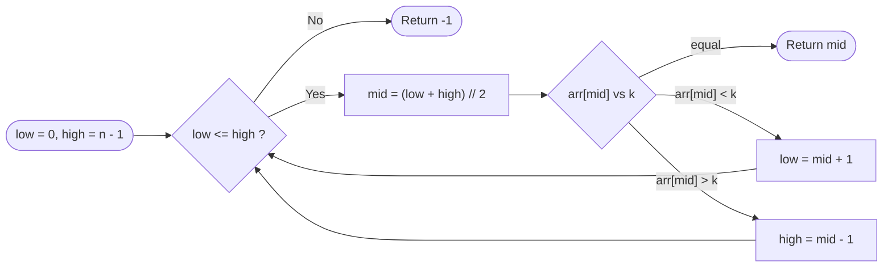

> [!NOTE]
> **Loop invariant.** If `k` is in the array, it lies inside `[low, high]`. Every update keeps this true, and the loop ends only when `k` is found or the window is empty, which proves `k` is absent.

## 3. Approaches

Three approaches: two that ignore or barely use the sorted order, then binary search. All three use the same input:

```text
arr = [1, 3, 5, 7, 9, 11, 13]        k = 11        expected output: 5
```

### 3.1 Brute Force: Linear Scan

**Idea.** Ignore the sorted order. Check every index from left to right and return the first one that holds `k`.

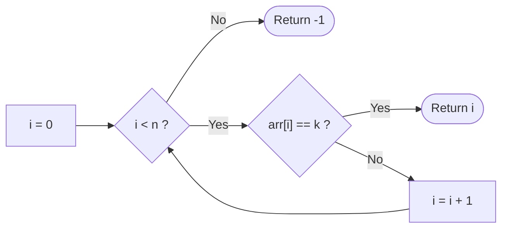

```python
class Solution:

    # Return the index of k by checking every element from left to right.
    def binarySearch(self, arr: list[int], k: int) -> int:

        # Visit every index from left to right.
        for i in range(len(arr)):

            # Check whether the current element is k.
            if arr[i] == k:

                # Return the index where k was found.
                return i

        # No element matched, so k is not in the array.
        return -1
```

**Walkthrough.**

| Step | `i` | `arr[i]` | `arr[i] == 11` | Action |
|---|---|---|---|---|
| 1 | 0 | 1 | No | move on |
| 2 | 1 | 3 | No | move on |
| 3 | 2 | 5 | No | move on |
| 4 | 3 | 7 | No | move on |
| 5 | 4 | 9 | No | move on |
| 6 | 5 | 11 | Yes | **return 5** ✔ |

**Cost.** `O(n)` time, `O(1)` space. Correct, but it throws away the one fact the problem gives you: the array is sorted.

### 3.2 Brute Force: Linear Scan with Early Stop

**Idea.** Use the sorted order a little. Once `arr[i] > k`, every later element is larger still, so `k` cannot appear: stop and return `-1`.

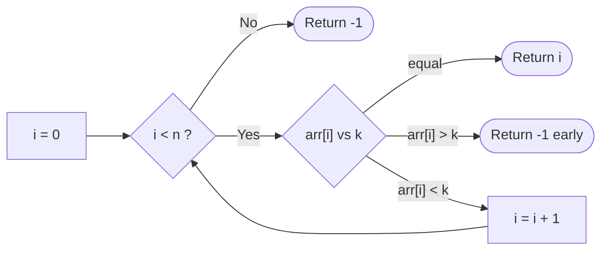

```python
class Solution:

    # Return the index of k, stopping as soon as the values pass k.
    def binarySearch(self, arr: list[int], k: int) -> int:

        # Visit every index from left to right.
        for i in range(len(arr)):

            # Check whether the current element is k.
            if arr[i] == k:

                # Return the index where k was found.
                return i

            # Sorted order: once a value exceeds k, k cannot appear later.
            if arr[i] > k:

                # Stop early and report that k is absent.
                return -1

        # Every element was smaller than k, so k is not in the array.
        return -1
```

**Walkthrough.**

| Step | `i` | `arr[i]` | Compare with `11` | Action |
|---|---|---|---|---|
| 1 | 0 | 1 | smaller | move on |
| 2 | 1 | 3 | smaller | move on |
| 3 | 2 | 5 | smaller | move on |
| 4 | 3 | 7 | smaller | move on |
| 5 | 4 | 9 | smaller | move on |
| 6 | 5 | 11 | equal | **return 5** ✔ |

For a missing value it helps: with `k = 6` it stops at `arr[3] = 7 > 6` after 4 reads instead of 7.

**Cost.** Still `O(n)` worst case (for example, `k` larger than every element). It uses sortedness only to stop early, never to skip ahead.

### 3.3 Optimal: Iterative Binary Search

**Idea.** Use the sorted order fully. Probe the middle of the window and discard the half that cannot contain `k`.

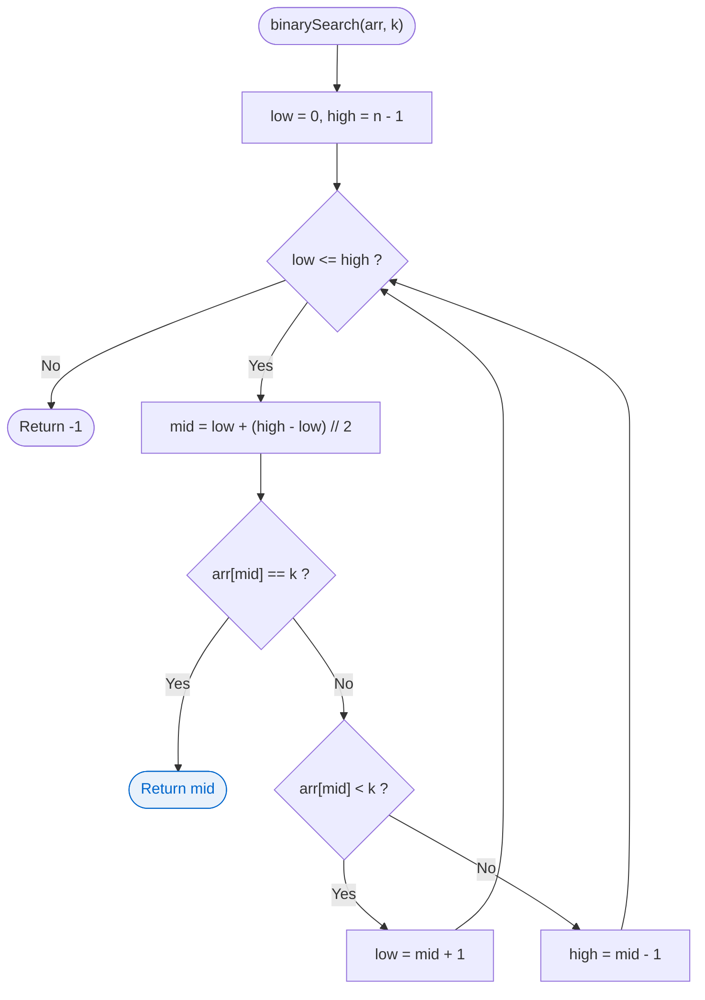

**Algorithm.**

1. Set `low = 0` and `high = n - 1`.
2. While `low <= high`, compute `mid = low + (high - low) // 2`.
3. If `arr[mid] == k`, return `mid`.
4. If `arr[mid] < k`, set `low = mid + 1`; otherwise set `high = mid - 1`.
5. When the window is empty, return `-1`.

```python
class Solution:

    # Return the 0-based index of k in the sorted array arr, or -1 if absent.
    def binarySearch(self, arr: list[int], k: int) -> int:

        # Start the window at the first index.
        low = 0

        # End the window at the last index.
        high = len(arr) - 1

        # Keep searching while the window still holds at least one element.
        while low <= high:

            # Pick the middle index without risking overflow in fixed-width languages.
            mid = low + (high - low) // 2

            # The middle element is k, so the search is done.
            if arr[mid] == k:

                # Return the index of k.
                return mid

            # The middle element is too small, so k can only be to the right.
            if arr[mid] < k:

                # Discard the left half including mid.
                low = mid + 1

            # Otherwise the middle element is too large, so k can only be to the left.
            else:

                # Discard the right half including mid.
                high = mid - 1

        # The window is empty, so k is not in the array.
        return -1
```

**Walkthrough.**

| Step | `low` | `high` | `mid` | `arr[mid]` | Compare with `11` | Action |
|---|---|---|---|---|---|---|
| 1 | 0 | 6 | 3 | 7 | smaller | `low = 4` |
| 2 | 4 | 6 | 5 | 11 | equal | **return 5** ✔ |

Two probes instead of six.

> [!TIP]
> `mid = low + (high - low) // 2` equals `(low + high) // 2`, but never forms the sum `low + high`. Python integers cannot overflow, so both work here; in C++ or Java the sum can overflow a 32-bit `int` for large indices, which is why the safer form is the habit to keep.

## 4. Walkthrough

### 4.1 GfG Example 1: `k` Found

```text
arr = [1, 2, 3, 4, 6]        k = 6
```

| Step | `low` | `high` | `mid` | `arr[mid]` | Compare with `6` | Action |
|---|---|---|---|---|---|---|
| 1 | 0 | 4 | 2 | 3 | smaller | `low = 3` |
| 2 | 3 | 4 | 3 | 4 | smaller | `low = 4` |
| 3 | 4 | 4 | 4 | 6 | equal | **return 4** |

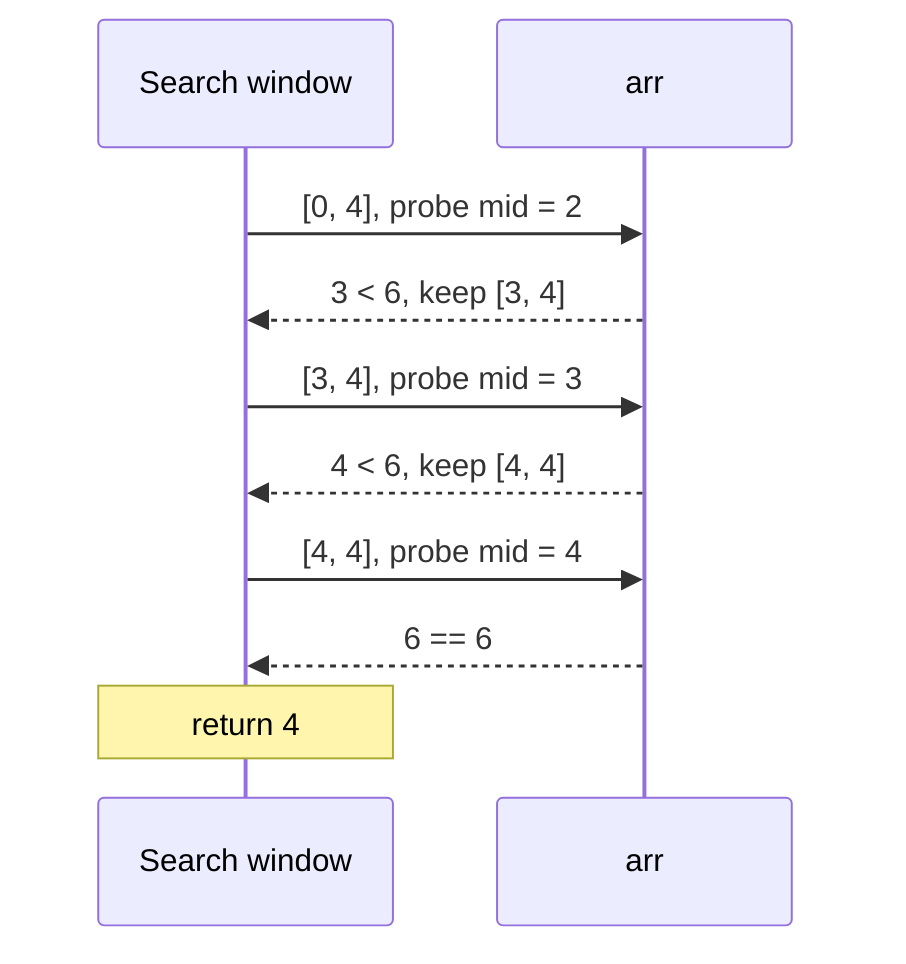

### 4.2 GfG Example 2: `k` Not Found

```text
arr = [1, 2, 4, 5, 6]        k = 3
```

| Step | `low` | `high` | `mid` | `arr[mid]` | Compare with `3` | Action |
|---|---|---|---|---|---|---|
| 1 | 0 | 4 | 2 | 4 | larger | `high = 1` |
| 2 | 0 | 1 | 0 | 1 | smaller | `low = 1` |
| 3 | 1 | 1 | 1 | 2 | smaller | `low = 2` |
| — | 2 | 1 | — | — | `low > high` | **return -1** |

The window closes between index `1` (value `2`) and index `2` (value `4`): exactly where `3` would sit if it existed.

### 4.3 A Larger Array

On 15 values the window shrinks `15 → 7 → 3 → 1` and the answer appears on the fourth probe.

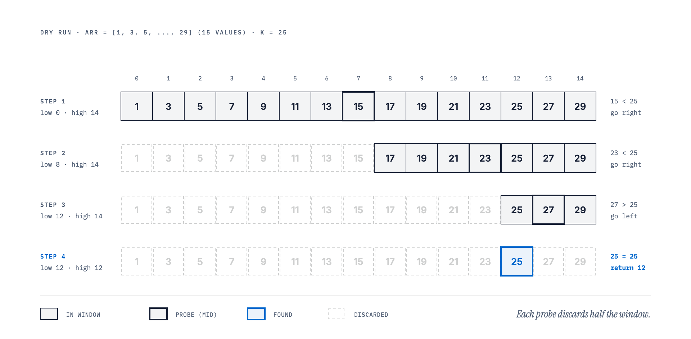

The linear scan on the same input reads 13 cells; binary search reads 4.

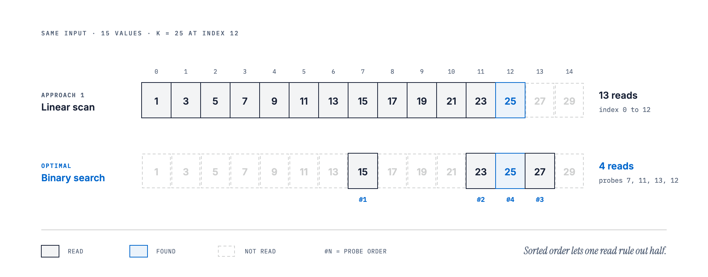

## 5. Complexity Analysis

Let `n = len(arr)`. After `t` probes the window holds at most `n / 2^t` elements, so the loop runs at most `⌊log2 n⌋ + 1` times.

| Case | When | Probes | Time |
|---|---|---|---|
| Best | `k` is the first middle element | 1 | `O(1)` |
| Average | `k` at a random position | about `log2 n` | `O(log n)` |
| Worst | `k` absent, or found on the last probe | `⌊log2 n⌋ + 1` | `O(log n)` |

| `n` | Worst-case probes |
|---|---|
| 1,000 | 10 |
| 1,000,000 | 20 |
| 1,000,000,000 | 30 |

| Metric | Complexity |
|---|---|
| Time | `O(log n)` |
| Extra Space | `O(1)` — three integers: `low`, `high`, `mid` |

### Why `O(log n)` Is Optimal

Any algorithm that only compares `k` with array elements can be drawn as a decision tree: each comparison has a few outcomes, and each leaf is one answer. There are `n + 1` possible answers (index `0` to `n - 1`, or `-1`), so the tree needs at least `n + 1` leaves. A binary tree with that many leaves has height at least `log2(n + 1)`. So **every** comparison-based search needs `Ω(log n)` comparisons in the worst case, and binary search matches that bound.

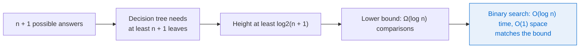

## 6. Comparing the Approaches

| Approach | Time | Extra Space | Uses sorted order? | Best used for |
|---|---|---|---|---|
| 3.1 Linear scan | `O(n)` | `O(1)` | No | Unsorted data |
| 3.2 Linear scan with early stop | `O(n)` worst | `O(1)` | Only to stop | Tiny arrays, or `k` usually near the front |
| **3.3 Iterative binary search** | **`O(log n)`** | **`O(1)`** | **Fully** | **Sorted arrays (this problem)** |
| Recursive binary search (Q4) | `O(log n)` | `O(log n)` stack | Fully | When recursion reads more clearly |

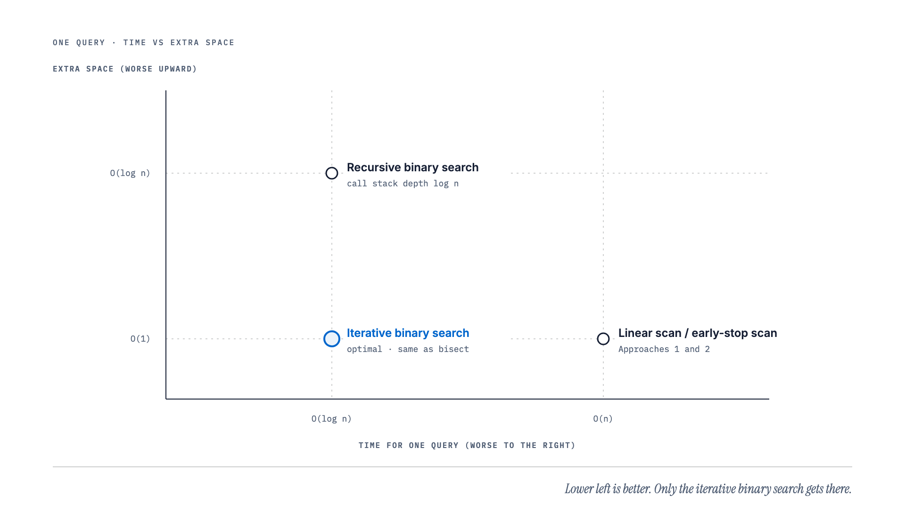

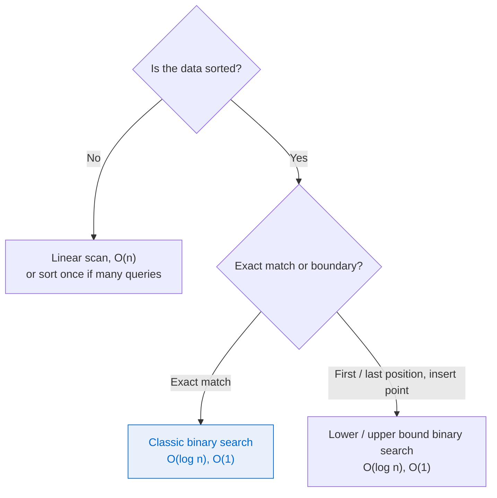

## 7. Edge Cases and Pitfalls

### 7.1 Edge Cases

| Case | Input | Expected | What it tests |
|---|---|---|---|
| Single element, match | `[5]`, `k = 5` | `0` | Window `[0, 0]` is still searched (`low <= high`). |
| Single element, no match | `[5]`, `k = 4` | `-1` | Window closes after one probe. |
| `k` at the first index | `[2, 4, 6, 8]`, `k = 2` | `0` | Repeated `high = mid - 1` reaches index `0`. |
| `k` at the last index | `[2, 4, 6, 8]`, `k = 8` | `3` | Repeated `low = mid + 1` reaches index `n - 1`. |
| `k` smaller than all | `[2, 4, 6]`, `k = 1` | `-1` | `high` drops below `0`. |
| `k` larger than all | `[2, 4, 6]`, `k = 9` | `-1` | `low` rises past `n - 1`. |
| `k` between two values | `[2, 4, 6]`, `k = 5` | `-1` | Window closes between `4` and `6`. |

### 7.2 Common Pitfalls

| # | Pitfall | Buggy code | Fix |
|---|---|---|---|
| 1 | Loop stops one element early | `while low < high:` | Use `low <= high`; with `<` a one-element window `[i, i]` is never checked. |
| 2 | Infinite loop | `low = mid` or `high = mid` | Move past `mid`: `low = mid + 1`, `high = mid - 1`. `mid` was already checked. |
| 3 | Wrong initial `high` | `high = len(arr)` | With a closed window `[low, high]`, start at `len(arr) - 1`; otherwise `arr[mid]` can go out of range. |
| 4 | Overflow in other languages | `mid = (low + high) / 2` in C++/Java | `mid = low + (high - low) / 2`. |
| 5 | Running it on unsorted data | binary search on `[10, 8, 30, 4, 5]` | Binary search needs sorted input; sort first or scan linearly. |
| 6 | Returning `low` instead of `-1` | `return low` after the loop | `low` is the insertion point, not a match; return `-1` when absent. |

## 8. Interview Guide

### 8.1 The 30-Second Explanation

> The array is sorted, so comparing `k` with the middle element tells me which half cannot contain it. I keep a window `[low, high]`, probe the middle, and move `low` to `mid + 1` if the middle is too small or `high` to `mid - 1` if it is too large. The invariant is that `k`, if present, stays inside the window; when the window is empty, `k` is absent and I return `-1`. Each probe halves the window, so it is `O(log n)` time and `O(1)` space, which matches the `Ω(log n)` lower bound for comparison-based search.

### 8.2 Follow-Up Questions

**Q1. What if the array had duplicates and you needed the first occurrence?** On a match, record `mid` and keep searching the **left** half (`high = mid - 1`). That is the lower-bound variant, covered in *First 1 in a Sorted Binary Array*.

**Q2. What if `k` is absent and you need where it would be inserted?** Return `low` after the loop. The window always closes with `low` at the first index whose value is greater than `k`.

**Q3. Can Python do this for me?** Yes. `bisect.bisect_left(arr, k)` returns the leftmost insertion point in `O(log n)`; `k` is present exactly when that index is `< n` and `arr[index] == k`. In an interview, write the loop yourself first.

<details>
<summary><b>Q4. Write it recursively. What does it cost?</b></summary>

Same logic, with the window passed as arguments. Each call halves the window, so the recursion depth is `O(log n)`, which costs `O(log n)` stack space instead of `O(1)`.

```python
class Solution:

    # Return the index of k using recursion over the window [low, high].
    def binarySearch(self, arr: list[int], k: int) -> int:

        # Search the whole array to begin with.
        return self.search(arr, k, 0, len(arr) - 1)

    # Search for k inside arr[low..high], both ends included.
    def search(self, arr, k, low, high):

        # An empty window means k is not present.
        if low > high:

            # Report that k was not found.
            return -1

        # Pick the middle index of the window.
        mid = low + (high - low) // 2

        # The middle element is k.
        if arr[mid] == k:

            # Return its index.
            return mid

        # The middle element is too small, so search the right half.
        if arr[mid] < k:

            # Recurse on the window to the right of mid.
            return self.search(arr, k, mid + 1, high)

        # Otherwise search the left half.
        return self.search(arr, k, low, mid - 1)
```

</details>

<details>
<summary><b>Q5. Show the library version with bisect.</b></summary>

```python
from bisect import bisect_left


class Solution:

    # Return the index of k using the standard library's binary search.
    def binarySearch(self, arr: list[int], k: int) -> int:

        # Find the leftmost position where k could be inserted.
        index = bisect_left(arr, k)

        # k is present only if that position is inside the array and holds k.
        if index < len(arr) and arr[index] == k:

            # Return the index of k.
            return index

        # Otherwise k is not in the array.
        return -1
```

</details>

**Q6. What if the array is sorted but rotated, like `[4, 5, 6, 1, 2, 3]`?** At every `mid`, one half is still sorted. Check whether `k` lies inside the sorted half's range and search that half, otherwise the other one. Still `O(log n)`.

## 9. Pattern: Lower / Upper Bound Binary Search

**Recognize it when:**

- the input is **sorted**, or more generally a yes/no question flips **once** across the indices (all "no", then all "yes"),
- you need an exact position, the **first** or **last** position of something, or an insertion point,
- an `O(n)` scan is too slow for the constraints (here `n` up to `10^6`).

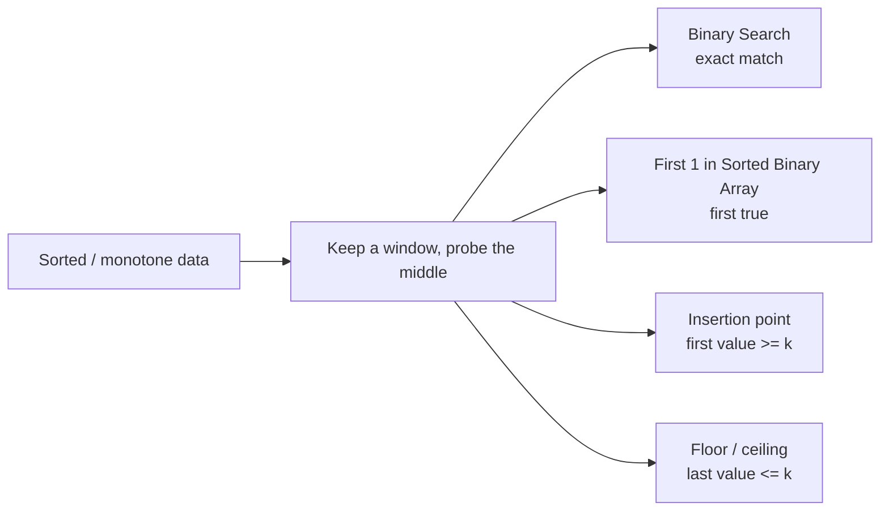

This problem is the classic exact-match form. The bound variants keep the same loop and change only what happens on a match: record the answer and keep going left (lower bound) or right (upper bound).

### Practice Next

| Problem | What changes |
|---|---|
| First 1 in a Sorted Binary Array | Find the first index where a condition becomes true (lower bound). |
| Number of Occurrences | Lower bound and upper bound, then subtract. |
| Floor in a Sorted Array | Last element `<= k`. |
| Search in a Rotated Sorted Array | Decide which half is sorted before discarding. |
| Square Root (integer) | Binary search on the answer instead of an array. |

## 10. Summary

```python
class Solution:

    # Return the 0-based index of k in the sorted array arr, or -1 if absent.
    def binarySearch(self, arr: list[int], k: int) -> int:

        # Start the window at the first index.
        low = 0

        # End the window at the last index.
        high = len(arr) - 1

        # Keep searching while the window still holds at least one element.
        while low <= high:

            # Pick the middle index without risking overflow in fixed-width languages.
            mid = low + (high - low) // 2

            # The middle element is k, so the search is done.
            if arr[mid] == k:

                # Return the index of k.
                return mid

            # The middle element is too small, so k can only be to the right.
            if arr[mid] < k:

                # Discard the left half including mid.
                low = mid + 1

            # Otherwise the middle element is too large, so k can only be to the left.
            else:

                # Discard the right half including mid.
                high = mid - 1

        # The window is empty, so k is not in the array.
        return -1
```

**Key takeaways**

1. **Sorted input means one comparison rules out half the array.**
2. **Invariant:** if `k` exists, it is inside `[low, high]`.
3. **Loop while `low <= high`**, and always move past `mid` (`mid + 1`, `mid - 1`).
4. **`mid = low + (high - low) // 2`** is the overflow-safe habit for other languages.
5. **Iterative beats recursive on space:** `O(1)` vs `O(log n)`.
6. **Time `O(log n)` · Space `O(1)`**, matching the `Ω(log n)` lower bound.

> [!TIP]
> **On sorted data, never read an element that cannot change the answer: probe the middle, keep the half that can still hold `k`, and stop when the window is empty.**
