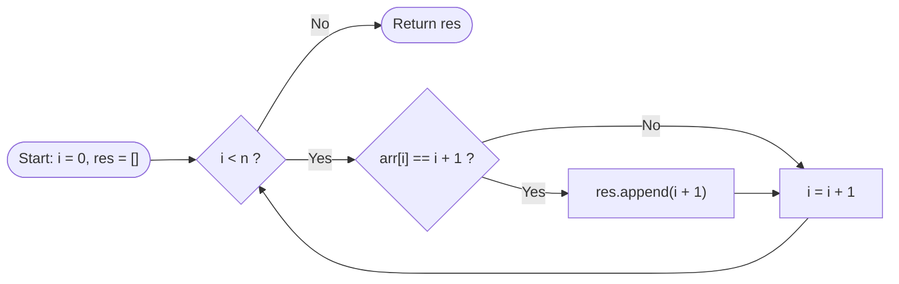
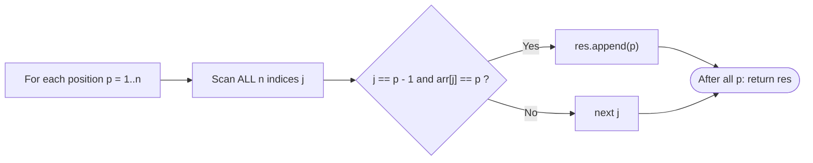
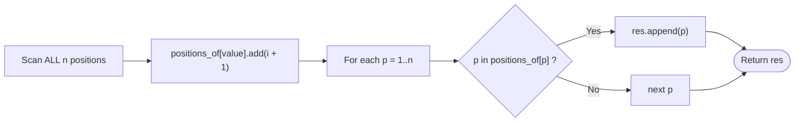
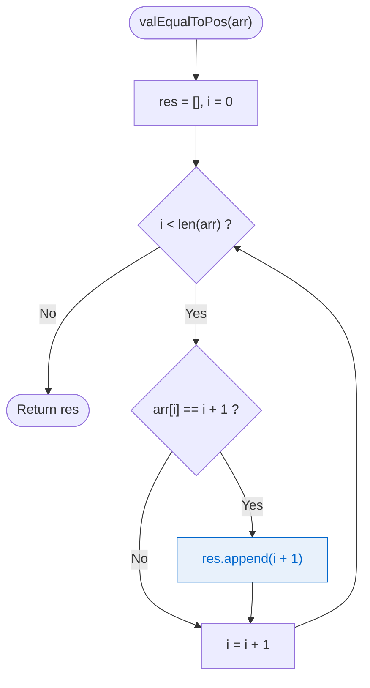
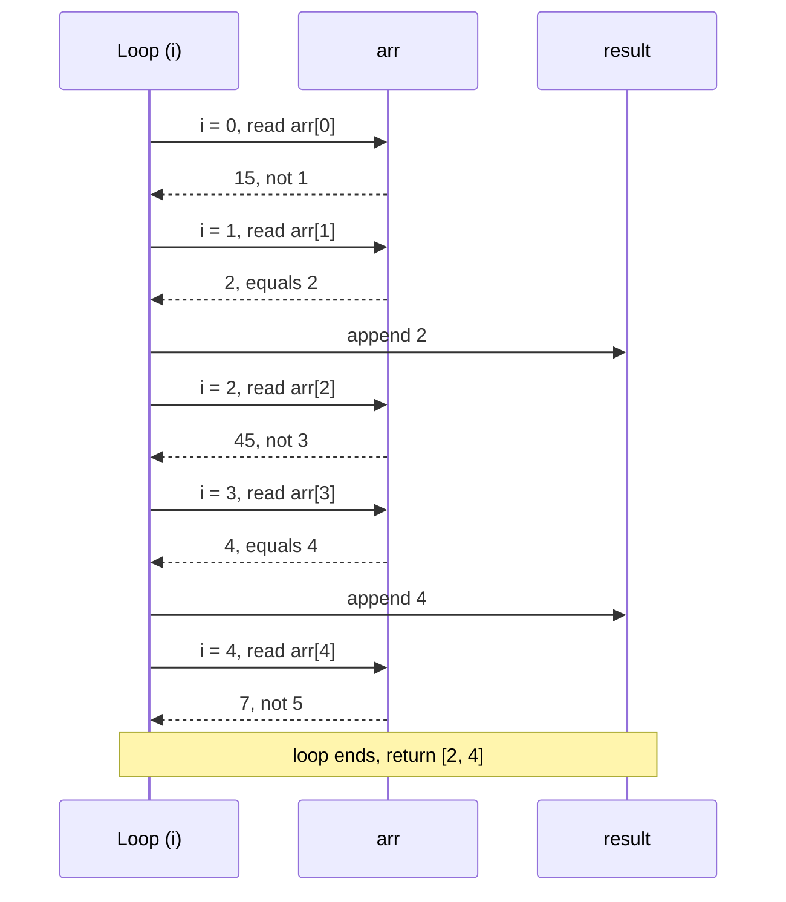
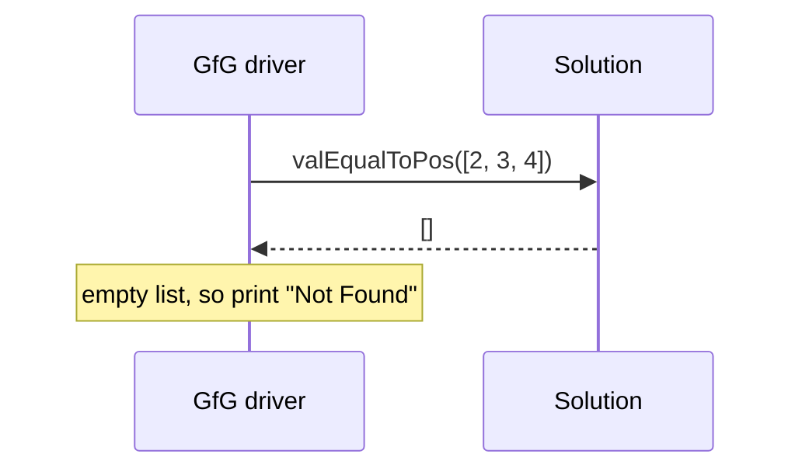
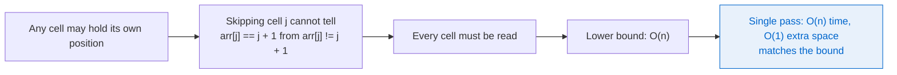
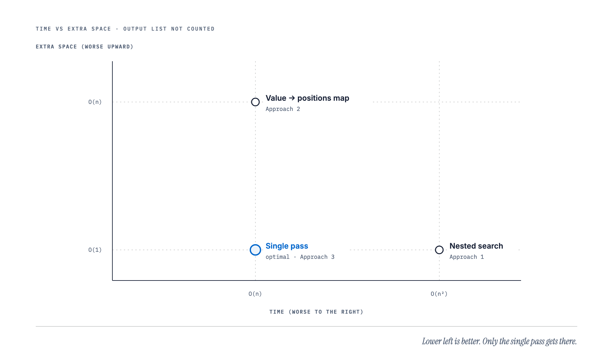
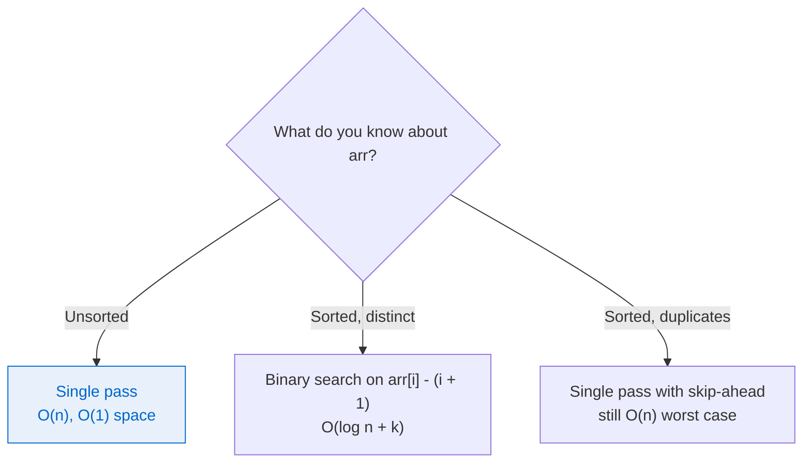
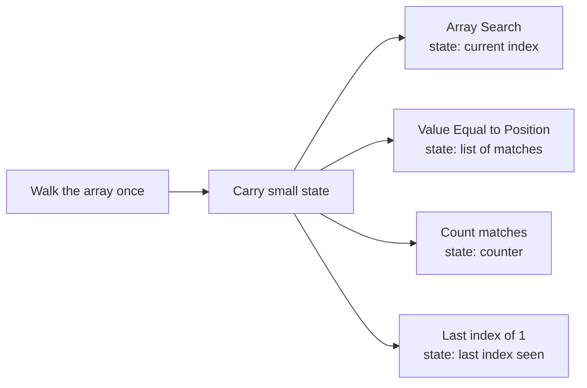

# Value Equal to Position

| Topic | Difficulty | Submissions | Accuracy | Companies | Related Tags | Problem Link |
|---|---|---|---|---|---|---|
| Searching | Basics | 249,787 | 54.83% | Flipkart, Amazon, FactSet, Hike | Arrays, Searching | [https://www.geeksforgeeks.org/problems/value-equal-to-index-value1330/1](https://www.geeksforgeeks.org/problems/value-equal-to-index-value1330/1) |

> [!IMPORTANT]
> **TL;DR.** Position `p` (1-based) lives at index `p - 1`, so each position has exactly one cell to check. Walk the array once, compare `arr[i]` with `i + 1`, and append `i + 1` on every match; never stop early, because every match must be reported. **Time `O(n)` · Space `O(1)` extra · Pattern: Linear Scan with Running State.**

## Contents

1. [Problem](#1-problem)
2. [Key Insight](#2-key-insight)
3. [Approaches](#3-approaches)
4. [Walkthrough](#4-walkthrough)
5. [Complexity Analysis](#5-complexity-analysis)
6. [Comparing the Approaches](#6-comparing-the-approaches)
7. [Edge Cases and Pitfalls](#7-edge-cases-and-pitfalls)
8. [Interview Guide](#8-interview-guide)
9. [Pattern: Linear Scan with Running State](#9-pattern-linear-scan-with-running-state)
10. [Summary](#10-summary)

## 1. Problem

> Given an array **arr[]**, find the elements whose value is equal to the position where they appear.
>
> **Note:** There can be more than one element in the array which have the same value as its position. You need to include the position of every such element.

*Problem statement, examples and constraints as given on GeeksforGeeks.*

### Examples

```text
Input: arr[] = [15, 2, 45, 4, 7]
Output: [2, 4]
Explanation: Here, arr[2] = 2 exists here and arr[4] = 4 exists.
```

```text
Input: arr[] = [1]
Output: [1]
Explanation: Here arr[1] = 1 exists.
```

### Constraints

```text
1 ≤ arr.size() ≤ 10^5
1 ≤ arr[i] ≤ 10^6
```

### Function Signature

```python
class Solution:

    # Return every 1-based position p with arr[p] == p, in increasing order.
    def valEqualToPos(self, arr):
        ...
```

Positions are **1-based** (the first element is at position `1`), while Python lists are 0-based. Return the matching positions in **increasing order**; if there are none, return an **empty list**, and the GfG driver prints `Not Found` for it.

## 2. Key Insight

The problem looks like a search ("find the elements whose value is ..."), but there is nothing to search for. A position `p` has exactly **one** cell, index `p - 1`, so asking "does position `p` qualify?" costs one comparison. The only real trap is the off-by-one between Python's 0-based index `i` and the problem's 1-based position `i + 1`.

```text
index i     :   0    1    2    3    4
position i+1:   1    2    3    4    5
arr         : [15,   2,  45,   4,   7]
                     ^         ^
               2 == 2     4 == 4      ->  [2, 4]
```

That gives one plan: **walk the array once, compare `arr[i]` with `i + 1`, and append `i + 1` on every match.** The running state is the output list itself. Unlike Array Search there is no early exit: the answer is *every* match, so the scan always reaches the end.



Each cell ends in one of two states:

| Cell state | Condition | Effect on `res` |
|---|---|---|
| Match | `arr[i] == i + 1` | append position `i + 1` |
| No match | `arr[i] != i + 1` | unchanged |

A useful side fact: a value larger than `n` can never match, because no position is larger than `n`. With `arr[i]` up to `10^6` and `n` up to `10^5`, many cells fail for that reason alone, but you still have to read them to know.

## 3. Approaches

Three approaches, from the most literal to the optimal. All three are tested and correct; they differ in how much work and memory they spend. The two brute-force approaches use the same input so you can compare them directly:

```text
arr = [1, 3, 3, 5]        expected output: [1, 3]
```

### 3.1 Brute Force: Nested Search per Position

**Idea.** Read the statement literally: for each candidate position `p` from `1` to `n`, search the whole array for a cell that sits at position `p` **and** holds the value `p`. The inner search looks at every index `j`, even though only `j = p - 1` can ever qualify.



```python
class Solution:

    # Return every matching position by checking each position against every index.
    def valEqualToPos(self, arr):

        # Store the matching positions.
        result = []

        # Remember the array length.
        n = len(arr)

        # Try every candidate position from 1 to n.
        for p in range(1, n + 1):

            # Search the whole array for a cell that proves position p qualifies.
            for j in range(n):

                # The cell must sit at position p (index p - 1) and hold the value p.
                if j == p - 1 and arr[j] == p:

                    # Record position p.
                    result.append(p)

        # Positions were tried in increasing order, so the list is already sorted.
        return result
```

**Walkthrough.** Each row is one value of `p`; the inner loop reads all 4 cells every time.

| Step | `p` | Cells read | Cells holding value `p` | Cell at index `p - 1` | Qualifies? | `result` |
|---|---|---|---|---|---|---|
| 1 | 1 | `j = 0..3` | `j = 0` | `arr[0] = 1` | Yes | `[1]` |
| 2 | 2 | `j = 0..3` | none | `arr[1] = 3` | No | `[1]` |
| 3 | 3 | `j = 0..3` | `j = 1`, `j = 2` | `arr[2] = 3` | Yes | `[1, 3]` |
| 4 | 4 | `j = 0..3` | none | `arr[3] = 5` | No | `[1, 3]` |

It returns `[1, 3]`. ✔ Note step 3: the value `3` also appears at `j = 1` (position 2), which must **not** count. Checking the index as well as the value is what keeps this approach correct.

**Cost.** `O(n²)` time, always: `n` positions times `n` reads, 16 reads here when 4 would do. `O(1)` extra space besides the output. At `n = 10^5` that is `10^10` comparisons, far too slow.

### 3.2 Brute Force: Value → Positions Map

**Idea.** Fix the nested loop by preprocessing: build a dictionary from each value to the set of 1-based positions where it appears. Then position `p` qualifies exactly when the value `p` was seen at position `p`.



```python
class Solution:

    # Return every matching position using a value-to-positions dictionary.
    def valEqualToPos(self, arr):

        # Map each value to the set of 1-based positions where it appears.
        positions_of = {}

        # Visit every index of the array.
        for i in range(len(arr)):

            # Create an empty set the first time this value is seen.
            if arr[i] not in positions_of:

                # Start the set of positions for this value.
                positions_of[arr[i]] = set()

            # Record the 1-based position of this value.
            positions_of[arr[i]].add(i + 1)

        # Store the matching positions.
        result = []

        # Try every candidate position from 1 to n.
        for p in range(1, len(arr) + 1):

            # Position p qualifies if the value p was seen at position p.
            if p in positions_of and p in positions_of[p]:

                # Record position p.
                result.append(p)

        # Positions were tried in increasing order, so the list is already sorted.
        return result
```

**Walkthrough.** Build phase:

| Step | `i` | `arr[i]` | Position `i + 1` | `positions_of` |
|---|---|---|---|---|
| 1 | 0 | 1 | 1 | `{1: {1}}` |
| 2 | 1 | 3 | 2 | `{1: {1}, 3: {2}}` |
| 3 | 2 | 3 | 3 | `{1: {1}, 3: {2, 3}}` |
| 4 | 3 | 5 | 4 | `{1: {1}, 3: {2, 3}, 5: {4}}` |

Check phase:

| `p` | `positions_of.get(p)` | `p` in it? | `result` |
|---|---|---|---|
| 1 | `{1}` | Yes | `[1]` |
| 2 | missing | No | `[1]` |
| 3 | `{2, 3}` | Yes | `[1, 3]` |
| 4 | missing | No | `[1, 3]` |

It returns `[1, 3]`. ✔

**Cost.** `O(n)` average time and `O(n)` extra space for the dictionary and its sets. It is fast enough, but the dictionary only answers a question that `arr[p - 1]` already answers directly: the value at position `p` is stored at index `p - 1`, so no lookup structure is needed.

### 3.3 Optimal: Single Pass

**Idea.** Both brute forces end up asking one question per position: "is the value at position `p` equal to `p`?" The array answers it with a single read, `arr[p - 1]`. So walk the indices once, compare `arr[i]` with `i + 1`, and append the position on every match. No nested loop, no dictionary.



**Algorithm.**

1. Start with an empty list `result`.
2. Walk `i` from `0` to `n - 1`. If `arr[i] == i + 1`, append `i + 1`.
3. After the loop, return `result`. It is already in increasing order, and it is empty when nothing matched.

```python
class Solution:

    # Return every 1-based position whose value equals the position, in increasing order.
    def valEqualToPos(self, arr):

        # Collect the matching positions as the scan goes.
        result = []

        # Visit every 0-based index from left to right.
        for i in range(len(arr)):

            # Index i is position i + 1, so compare the value with i + 1.
            if arr[i] == i + 1:

                # Record the 1-based position, not the 0-based index.
                result.append(i + 1)

        # Positions were appended left to right, so they are already increasing.
        return result
```

## 4. Walkthrough

### 4.1 Example 1: Two Matches

```text
arr = [15, 2, 45, 4, 7]
```

| Step | `i` | Position `i + 1` | `arr[i]` | `arr[i] == i + 1` | `result` |
|---|---|---|---|---|---|
| 1 | 0 | 1 | 15 | No | `[]` |
| 2 | 1 | 2 | 2 | Yes | `[2]` |
| 3 | 2 | 3 | 45 | No | `[2]` |
| 4 | 3 | 4 | 4 | Yes | `[2, 4]` |
| 5 | 4 | 5 | 7 | No | `[2, 4]` |

It returns `[2, 4]`. ✔

![Single pass over [15, 2, 45, 4, 7]: each cell shows its 0-based index and 1-based position; positions 2 and 4 hold their own position, so the result list grows to [2, 4] after 5 comparisons](assets/value-equal-to-position-dry-run.png)



### 4.2 Example 2: Single Element

```text
arr = [1]
```

| Step | `i` | Position `i + 1` | `arr[i]` | `arr[i] == i + 1` | `result` |
|---|---|---|---|---|---|
| 1 | 0 | 1 | 1 | Yes | `[1]` |

It returns `[1]`. ✔

### 4.3 No Match

```text
arr = [2, 3, 4]
```

| Step | `i` | Position `i + 1` | `arr[i]` | `arr[i] == i + 1` | `result` |
|---|---|---|---|---|---|
| 1 | 0 | 1 | 2 | No | `[]` |
| 2 | 1 | 2 | 3 | No | `[]` |
| 3 | 2 | 3 | 4 | No | `[]` |

Every value is one more than its position, so nothing matches and the method returns `[]`. Printing is the driver's job, not yours:



### 4.4 Duplicates (the Shared Input)

```text
arr = [1, 3, 3, 5]
```

| Step | `i` | Position `i + 1` | `arr[i]` | `arr[i] == i + 1` | `result` |
|---|---|---|---|---|---|
| 1 | 0 | 1 | 1 | Yes | `[1]` |
| 2 | 1 | 2 | 3 | No | `[1]` |
| 3 | 2 | 3 | 3 | Yes | `[1, 3]` |
| 4 | 3 | 4 | 5 | No | `[1, 3]` |

The value `3` appears twice, but only the copy at position `3` counts. On the same input, Approach 3.1 made 16 reads; the single pass made 4.

![On [1, 3, 3, 5] the nested search reads all 16 (position, index) pairs, but only the 4 diagonal pairs with index = position - 1 can match; the single pass reads exactly those 4 cells and returns [1, 3]](assets/value-equal-to-position-brute-vs-optimal.png)

## 5. Complexity Analysis

Let `n = len(arr)` and `k` = the number of matching positions.

| Case | When | Comparisons | Time |
|---|---|---|---|
| Best | any input | `n` | `O(n)` |
| Average | any input | `n` | `O(n)` |
| Worst | any input | `n` | `O(n)` |

There is no early exit, so every input costs exactly `n` comparisons. Only the number of appends (`k`) changes.

| Metric | Complexity |
|---|---|
| Time | `O(n)` |
| Extra Space | `O(1)` — one loop variable |
| Output Space | `O(k)`, up to `O(n)` when every position matches |

### Why `O(n)` Is Optimal

Any correct algorithm must read every element. Suppose an algorithm never reads index `j`. Run it twice: once with `arr[j] = j + 1` and once with any other value. Everything it read is identical, so it returns the same list both times, but position `j + 1` must be in one answer and not the other. One of the two outputs is wrong. Reading `n` elements takes `O(n)`, and the single pass reads each element once with `O(1)` extra space, so it matches this lower bound.



## 6. Comparing the Approaches

| Approach | Time | Extra Space | Reads per position | Best used for |
|---|---|---|---|---|
| 3.1 Nested search per position | `O(n²)` | `O(1)` | `n` | Never; it only shows the literal reading |
| 3.2 Value → positions map | `O(n)` average | `O(n)` | 1 lookup after a full build | Answering "where does value `v` appear?" for many `v` |
| **3.3 Single pass** | **`O(n)`** | **`O(1)`** | **1** | **This problem** |



The single pass is the answer for this problem as stated. Extra structure in the data changes the picture:



## 7. Edge Cases and Pitfalls

### 7.1 Edge Cases

| Case | Input | Expected | What it tests |
|---|---|---|---|
| Single element, match | `[1]` | `[1]` | Smallest valid input. |
| Single element, no match | `[5]` | `[]` | Empty result, printed as `Not Found` by the driver. |
| Every position matches | `[1, 2, 3, 4]` | `[1, 2, 3, 4]` | No early exit; output size `n`. |
| No position matches | `[2, 3, 4]` | `[]` | Each value is one more than its position; nothing is appended. |
| Duplicates | `[3, 3, 3]` | `[3]` | Only the copy at position `3` counts. |
| Values larger than `n` | `[100, 200]` | `[]` | Such values can never match. |
| Match at the last position | `[9, 9, 3]` | `[3]` | Loop includes index `n - 1`. |

> [!NOTE]
> The constraints guarantee `arr.size() >= 1` and `arr[i] >= 1`. The solution still returns `[]` for an empty array, which is the correct answer.

### 7.2 Common Pitfalls

| # | Pitfall | Buggy code | Fix |
|---|---|---|---|
| 1 | Comparing with the 0-based index | `if arr[i] == i:` | On `[15, 2, 45, 4, 7]` it returns `[]`. Compare with `i + 1`. |
| 2 | Appending the index instead of the position | `result.append(i)` | On `[15, 2, 45, 4, 7]` it returns `[1, 3]`. Append `i + 1`. |
| 3 | Stopping at the first match | `return [i + 1]` inside the loop | Copied from Array Search; it returns `[2]` instead of `[2, 4]`. Append and keep going. |
| 4 | Returning a sentinel for "none" | `return -1` or `return ["Not Found"]` | Return `[]`; the driver prints `Not Found`. |
| 5 | Looking up the value instead of the cell | `if p in arr and arr.index(p) == p - 1:` | `index` finds the **first** copy: on `[3, 3, 3]` it sees index `0` for `p = 3` and misses position `3`. Read `arr[p - 1]` directly. |
| 6 | Binary search on unsorted data | `mid` comparison on `[15, 2, 45, 4, 7]` | `arr[i] - (i + 1)` is only monotonic when the array is sorted with distinct values. |

## 8. Interview Guide

### 8.1 The 30-Second Explanation

> Position `p` is 1-based, so it lives at index `p - 1`, and each position has exactly one cell to check. I scan the array once and append `i + 1` whenever `arr[i] == i + 1`. I cannot stop early, because the problem wants every match, and any skipped cell could be a match, so every correct solution reads all `n` cells. The list comes out in increasing order for free, and it is empty when nothing matches. That is `O(n)` time and `O(1)` extra space besides the output.

### 8.2 Follow-Up Questions

**Q1. What changes if positions were 0-based?** Only the comparison and the appended value: `arr[i] == i`, append `i`. This is the classic "fixed point" problem.

**Q2. What if you only need the count?** Keep a counter instead of a list: same `O(n)` time, `O(1)` space including the output.

**Q3. Why not the dictionary approach?** It answers a question the array already answers. The value at position `p` is `arr[p - 1]`, a direct read, so the dictionary costs `O(n)` space for nothing ([3.2](#32-brute-force-value--positions-map)).

**Q4. What if the array is sorted but may contain duplicates?** Binary search no longer works: `arr[i] - (i + 1)` stops being monotonic. On `[1, 1, 3]` it is `[0, -1, 0]`, so the matches at positions `1` and `3` do not form one block. You can skip ahead (if `arr[i] > i + 1`, jump to index `arr[i] - 1`), but the worst case stays `O(n)`.

<details>
<summary><b>Q5. What if the array is sorted with distinct values?</b></summary>

With sorted distinct integers, `arr[i + 1] >= arr[i] + 1`, so `d(i) = arr[i] - (i + 1)` never decreases. The matches are exactly the indices where `d(i) == 0`, and they form one contiguous block. Two binary searches find the block's ends in `O(log n)`, and listing the `k` positions costs `O(k)`.

```python
class Solution:

    # Return every matching position in a sorted array of distinct values.
    def valEqualToPosSorted(self, arr):

        # Find the first index where arr[i] - (i + 1) is at least 0.
        low, high = 0, len(arr)

        # Shrink the window until it closes on that index.
        while low < high:

            # Pick the middle index of the window.
            mid = (low + high) // 2

            # A negative difference means the block starts further right.
            if arr[mid] - (mid + 1) < 0:

                # Discard the left half including mid.
                low = mid + 1

            # Otherwise the block starts at mid or to its left.
            else:

                # Keep mid in the window.
                high = mid

        # Remember where the zero block can start.
        start = low

        # Find the first index where arr[i] - (i + 1) is greater than 0.
        low, high = start, len(arr)

        # Shrink the window until it closes on that index.
        while low < high:

            # Pick the middle index of the window.
            mid = (low + high) // 2

            # A difference of at most 0 means the block ends further right.
            if arr[mid] - (mid + 1) <= 0:

                # Discard the left half including mid.
                low = mid + 1

            # Otherwise the block ends before mid.
            else:

                # Keep mid in the window.
                high = mid

        # Every index in [start, low) has difference 0, so list their positions.
        return [i + 1 for i in range(start, low)]
```

</details>

<details>
<summary><b>Q6. Can you write it in one line?</b></summary>

`enumerate(arr, start=1)` hands you the 1-based position directly, which removes the `i + 1` arithmetic. It is the same single pass with the same complexity.

```python
class Solution:

    # Return every 1-based position whose value equals the position.
    def valEqualToPos(self, arr):

        # Pair each value with its 1-based position and keep the positions that match.
        return [pos for pos, value in enumerate(arr, start=1) if value == pos]
```

</details>

## 9. Pattern: Linear Scan with Running State

**Recognize it when:**

- the data has **no order** you can exploit,
- the answer depends on what you have **seen so far** in one pass,
- each element needs only **`O(1)` work** to update or decide the answer.



Here the running state is the output list, and the per-element decision is one comparison against the position `i + 1`. Compared with Array Search, the loop shape is the same but the early exit disappears, because the question is "all matches", not "the first match".

### Practice Next

| Problem | What changes |
|---|---|
| Array Search | Stop at the first match instead of collecting all. |
| Last Index of One | Track the last occurrence of a value. |
| Count Occurrences of an Element | A running counter instead of a running list. |
| Fixed Point in a Sorted Array | Sorted distinct values allow binary search on `arr[i] - i`. |
| Largest Element in Array | A running maximum instead of a running list. |

## 10. Summary

```python
class Solution:

    # Return every 1-based position whose value equals the position, in increasing order.
    def valEqualToPos(self, arr):

        # Collect the matching positions as the scan goes.
        result = []

        # Visit every 0-based index from left to right.
        for i in range(len(arr)):

            # Index i is position i + 1, so compare the value with i + 1.
            if arr[i] == i + 1:

                # Record the 1-based position, not the 0-based index.
                result.append(i + 1)

        # Positions were appended left to right, so they are already increasing.
        return result
```

**Key takeaways**

1. **Position `p` lives at index `p - 1`.** Each position has exactly one cell to check.
2. **Compare with `i + 1` and append `i + 1`.** Almost every bug here is an off-by-one.
3. **No early exit.** The problem wants every match, so the scan always reaches the end.
4. **The output is sorted for free**, because positions are appended left to right.
5. **Return `[]` when nothing matches**; the driver prints `Not Found`.
6. **Time `O(n)` · Space `O(1)` extra**, and `O(n)` is a lower bound.

> [!TIP]
> **Every position has exactly one cell that can match it, so read each cell once, compare it with `i + 1`, and keep every hit.**
