# Last Index of One

| Topic | Difficulty | Submissions | Accuracy | Companies | Related Tags | Problem Link |
|---|---|---|---|---|---|---|
| Searching | Basics | 123,379 | 49.01% | InMobi | Searching, Strings | [https://www.geeksforgeeks.org/problems/last-index-of-15847/1](https://www.geeksforgeeks.org/problems/last-index-of-15847/1) |

> [!IMPORTANT]
> **TL;DR.** The string has no order, so every position could hold the last `'1'`. Scan from right to left and return the index of the first `'1'` you meet; return `-1` after the loop. **Time `O(n)` · Space `O(1)` · Pattern: Linear Scan with Running State.**

## Contents

1. [Problem](#1-problem)
2. [Key Insight](#2-key-insight)
3. [Approaches](#3-approaches)
4. [Walkthrough](#4-walkthrough)
5. [Complexity Analysis](#5-complexity-analysis)
6. [Comparing the Approaches](#6-comparing-the-approaches)
7. [Edge Cases and Pitfalls](#7-edge-cases-and-pitfalls)
8. [Interview Guide](#8-interview-guide)
9. [Pattern: Linear Scan with Running State](#9-pattern-linear-scan-with-running-state)
10. [Summary](#10-summary)

## 1. Problem

> Given a string s consisting only of '0' and '1', find the last index at which '1' occurs. If '1' is not present in the string, return -1.

*Problem statement, examples and constraints as given on GeeksforGeeks.*

### Examples

```text
Input: s = "01001"
Output: 4
Explanation: Last index of  1 in given string is 4.
```

```text
Input: s = "0"
Output: -1
Explanation: Since, 1 is not present, so output is -1.
```

### Constraints

```text
1 ≤ s.size() ≤ 10^6
```

### Function Signature

```python
class Solution:

    # Return the 0-based index of the last '1' in s, or -1 if s has no '1'.
    def lastIndex(self, s: str) -> int:
        ...
```

Indexing is **0-based**, the characters are the strings `'0'` and `'1'` (not the integers `0` and `1`), and the string is **not sorted**.

## 2. Key Insight

This is [Array Search](../01.%20Array%20Search/README.md) turned around. Array Search wants the **first** occurrence, so it scans from the left and stops at the first match. Here we want the **last** occurrence, so the mirror image works: **scan from the right and stop at the first `'1'` you meet.** Nothing to the right of that `'1'` is a `'1'` (you just read all of it), so it is the last one by definition.

```text
s = "0101100"
         ^  <-  <-
     read s[6] = '0', s[5] = '0', s[4] = '1'  ->  return 4
     s[0..3] are never read
```

There is a second, equally correct way to think about it: scan from the **left** and carry one piece of running state, `last`, the index of the most recent `'1'`. When the loop ends, `last` holds the answer. That version never stops early, because a later `'1'` can always replace the current one, so it reads all `n` characters on every input.

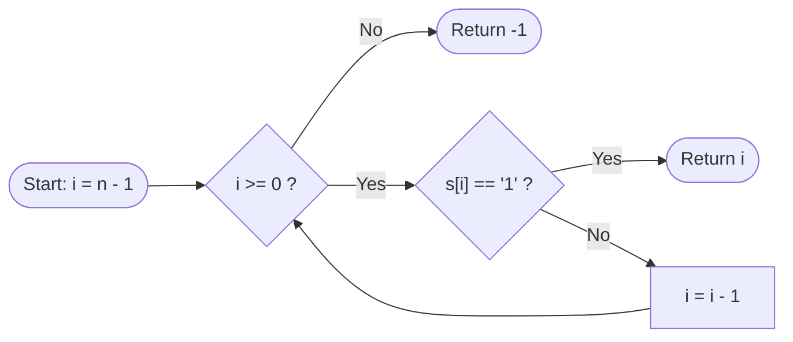

The reverse loop has exactly two exits:

| Exit | Condition | Return |
|---|---|---|
| Found | `s[i] == '1'` for the first time, reading from the right | `i` |
| Not found | `i` drops below `0` with no `'1'` | `-1` |

## 3. Approaches

Four approaches, from the most literal to the optimal. All four are tested and correct; they differ in how many characters they read and how much memory they use. The three non-optimal approaches use the same input so you can compare them directly:

```text
s = "0101100"        expected output: 4
```

### 3.1 Brute Force: Collect Every Index

**Idea.** Find every index where `s[i] == '1'`, then return the largest one, or `-1` if there are none.

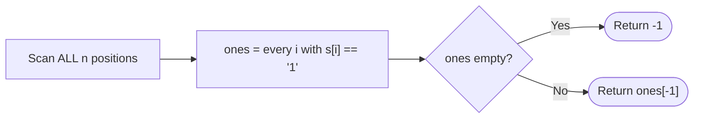

```python
class Solution:

    # Return the last index of '1' by collecting every index of '1' first.
    def lastIndex(self, s: str) -> int:

        # Store every index where the character is '1'.
        ones = []

        # Visit every index of the string, with no early exit.
        for i in range(len(s)):

            # Check whether the current character is '1'.
            if s[i] == '1':

                # Remember this index.
                ones.append(i)

        # If no index was stored, the string has no '1'.
        if not ones:

            # Report that '1' was not found.
            return -1

        # Indices were added left to right, so the last one is the largest.
        return ones[-1]
```

**Walkthrough.**

| Step | `i` | `s[i]` | `s[i] == '1'` | `ones` |
|---|---|---|---|---|
| 1 | 0 | `'0'` | No | `[]` |
| 2 | 1 | `'1'` | Yes | `[1]` |
| 3 | 2 | `'0'` | No | `[1]` |
| 4 | 3 | `'1'` | Yes | `[1, 3]` |
| 5 | 4 | `'1'` | Yes | `[1, 3, 4]` |
| 6 | 5 | `'0'` | No | `[1, 3, 4]` |
| 7 | 6 | `'0'` | No | `[1, 3, 4]` |

The loop ends with `ones = [1, 3, 4]`, so it returns `ones[-1] = 4`. ✔

**Cost.** `O(n)` time on every input and `O(k)` extra space for `k` ones (`O(n)` for a string of all `'1'`s). Only the last stored index is ever used; `1` and `3` were stored for nothing.

### 3.2 Brute Force: Forward Scan, Track the Last One

**Idea.** Drop the list. Walk left to right and keep a single variable `last`, overwritten every time a `'1'` appears. This is the textbook **running state** version: one variable summarizes everything seen so far.

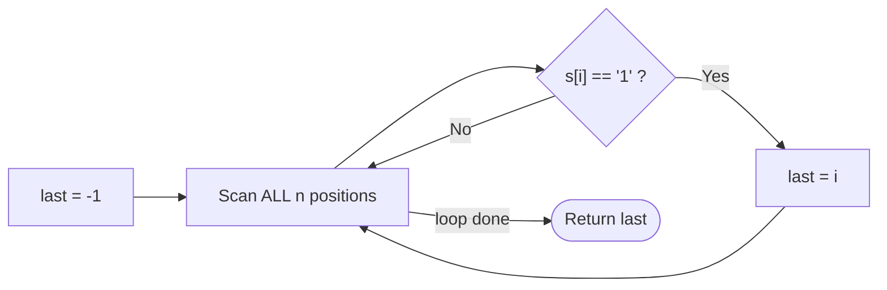

```python
class Solution:

    # Return the last index of '1' by tracking the most recent '1' in a forward scan.
    def lastIndex(self, s: str) -> int:

        # No '1' seen yet, so the answer so far is -1.
        last = -1

        # Visit every index from left to right.
        for i in range(len(s)):

            # A '1' here is later than any '1' seen before.
            if s[i] == '1':

                # Overwrite the running answer with this index.
                last = i

        # After the loop, last holds the index of the final '1', or -1.
        return last
```

**Walkthrough.**

| Step | `i` | `s[i]` | `s[i] == '1'` | `last` |
|---|---|---|---|---|
| 1 | 0 | `'0'` | No | `-1` |
| 2 | 1 | `'1'` | Yes | `1` |
| 3 | 2 | `'0'` | No | `1` |
| 4 | 3 | `'1'` | Yes | `3` |
| 5 | 4 | `'1'` | Yes | `4` |
| 6 | 5 | `'0'` | No | `4` |
| 7 | 6 | `'0'` | No | `4` |

It returns `last = 4`. ✔

**Cost.** `O(n)` time and `O(1)` extra space. The space is already optimal, but the scan can never stop early: at index `4` the loop cannot know that no `'1'` follows, so it must read indices `5` and `6` too. It does have one real strength: it works on a **stream** that you can only read forward (see Q4 in [8.2](#82-follow-up-questions)).

### 3.3 Built-In: rfind

**Idea.** Python already has this search: `s.rfind('1')` returns the highest index of `'1'`, or `-1` if there is none, which is exactly the required contract.

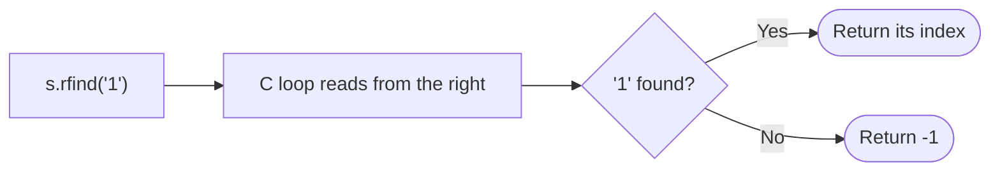

```python
class Solution:

    # Return the last index of '1' using the built-in reverse search.
    def lastIndex(self, s: str) -> int:

        # rfind returns the highest index of '1', or -1 when '1' is absent.
        return s.rfind('1')
```

**Walkthrough.** CPython searches for a single character from the end of the string, so on our input it reads the same cells as the optimal loop:

| Step | Position read | `s[pos]` | Action |
|---|---|---|---|
| 1 | 6 | `'0'` | move left |
| 2 | 5 | `'0'` | move left |
| 3 | 4 | `'1'` | **return 4** |

It returns `4`. ✔

**Cost.** `O(n)` worst case and `O(1)` extra space, with a much smaller constant because the loop runs in C. Use it in production. In an interview, state that you know it and then write the loop, since the loop is what is being tested. Avoid `s.rindex('1')`: it raises `ValueError` when there is no `'1'`.

### 3.4 Optimal: Reverse Scan with Early Exit

**Idea.** Keep the single-variable discipline of 3.2, but flip the direction. Reading from the right, the **first** `'1'` you meet is the **last** `'1'` in the string, so return it immediately: no list, no running variable, no wasted reads after the answer is known.

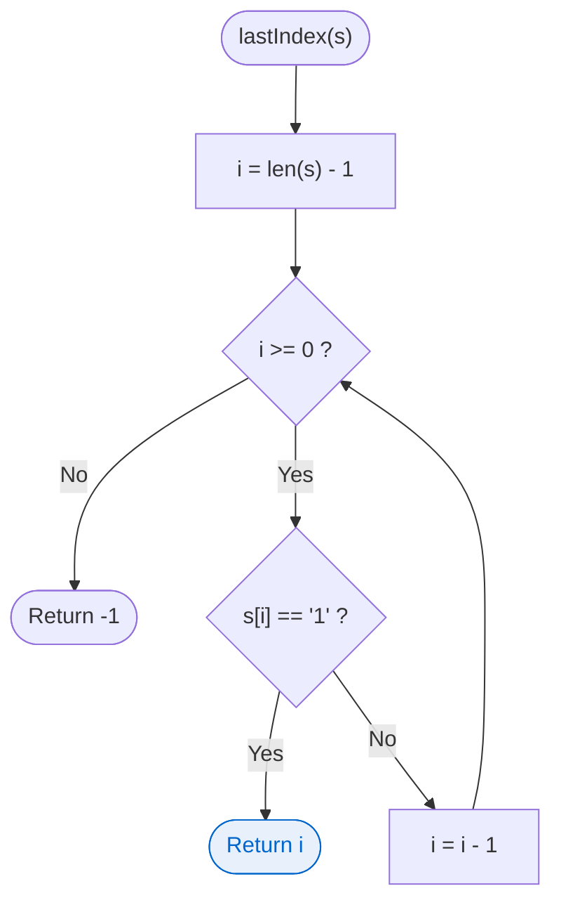

**Algorithm.**

1. Walk `i` from `n - 1` down to `0`.
2. If `s[i] == '1'`, return `i` immediately.
3. If the loop finishes, the string has no `'1'`: return `-1`.

```python
class Solution:

    # Return the 0-based index of the last '1' in s, or -1 if s has no '1'.
    def lastIndex(self, s: str) -> int:

        # Visit every index from right to left, down to and including 0.
        for i in range(len(s) - 1, -1, -1):

            # The first '1' met while walking right to left is the last '1'.
            if s[i] == '1':

                # Stop at once and return this index.
                return i

        # The loop finished without a '1', so there is none.
        return -1
```

## 4. Walkthrough

### 4.1 Shared Input

```text
s = "0101100"
```

| Step | `i` | `s[i]` | `s[i] == '1'` | Action |
|---|---|---|---|---|
| 1 | 6 | `'0'` | No | move left |
| 2 | 5 | `'0'` | No | move left |
| 3 | 4 | `'1'` | Yes | **return 4** |

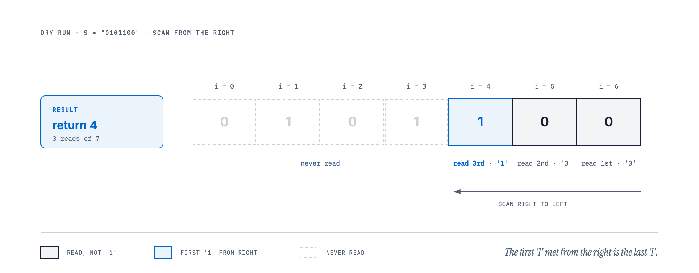

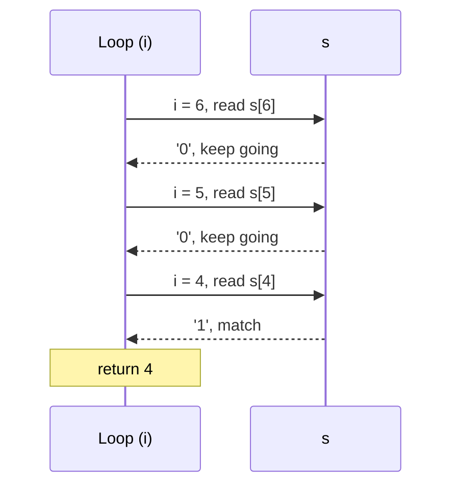

On the same input, Approach 3.2 read all 7 characters and overwrote `last` three times; the reverse scan read 3 characters and kept no state beyond `i`.

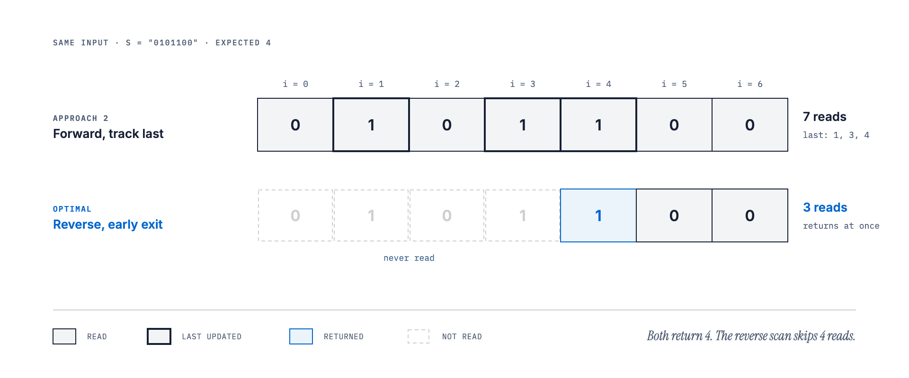

### 4.2 `'1'` at the Last Position (GfG Example 1)

```text
s = "01001"
```

| Step | `i` | `s[i]` | `s[i] == '1'` | Action |
|---|---|---|---|---|
| 1 | 4 | `'1'` | Yes | **return 4** |

One read. This is the best case: the forward scan would still read all 5 characters.

### 4.3 No `'1'` (GfG Example 2)

```text
s = "0"
```

| Step | `i` | `s[i]` | `s[i] == '1'` | Action |
|---|---|---|---|---|
| 1 | 0 | `'0'` | No | move left |
| — | -1 | — | — | `i < 0`, loop ends, **return -1** |

## 5. Complexity Analysis

Let `n = len(s)`.

| Case | When | Reads | Time |
|---|---|---|---|
| Best | `s[n - 1] == '1'` | 1 | `O(1)` |
| Typical | last `'1'` is `t` positions from the end | `t + 1` | `O(t)` |
| Worst | only `s[0]` is `'1'`, or there is no `'1'` | `n` | `O(n)` |

| Metric | Complexity |
|---|---|
| Time | `O(n)` worst case |
| Extra Space | `O(1)` — one loop variable |

### Why `O(n)` Is Optimal

Any correct algorithm must read every character in the worst case. Take the all-zero string `"000…0"`: the answer is `-1`. Suppose an algorithm returns `-1` without reading position `j`. Change `s[j]` to `'1'`: nothing the algorithm read has changed, so it still returns `-1`, which is now wrong (the answer is `j`). So on an all-zero string every one of the `n` characters must be read, and the reverse scan, which reads exactly `n` there, matches the bound.

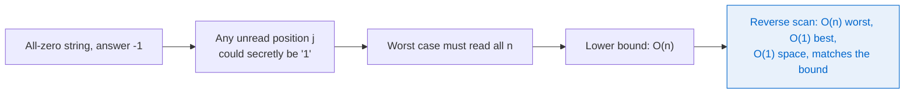

## 6. Comparing the Approaches

| Approach | Time | Extra Space | Stops early? | Best used for |
|---|---|---|---|---|
| 3.1 Collect every index | `O(n)` always | `O(k)`, `O(n)` worst | No | Returning **all** positions of `'1'` |
| 3.2 Forward scan, track last | `O(n)` always | `O(1)` | No | A stream you can only read forward |
| 3.3 `s.rfind('1')` | `O(n)` worst, fast C loop | `O(1)` | Yes | Production code |
| **3.4 Reverse scan** | **`O(n)`, best `O(1)`** | **`O(1)`** | **Yes** | **Interviews and this problem** |

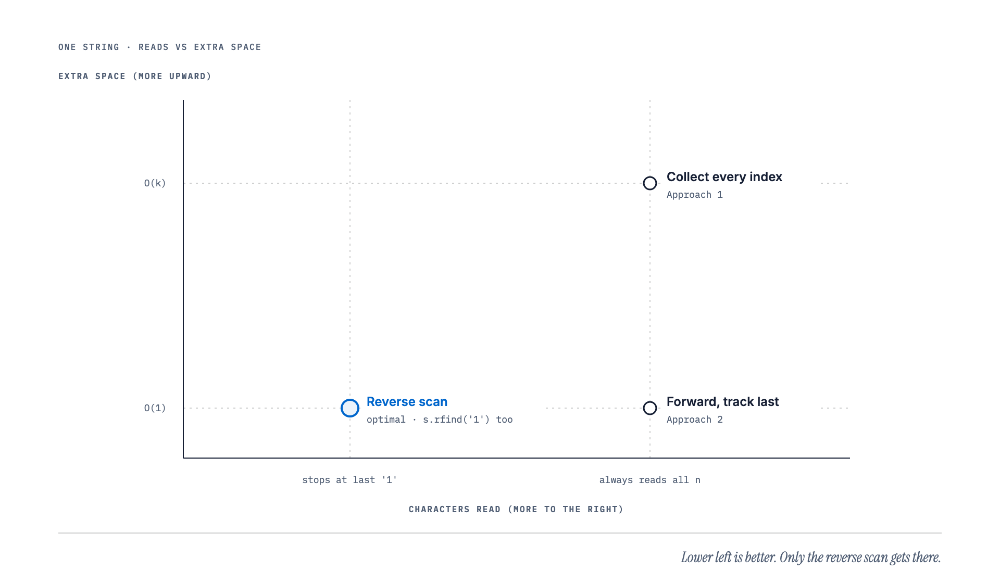

The right choice depends on how the input arrives and what you need back:

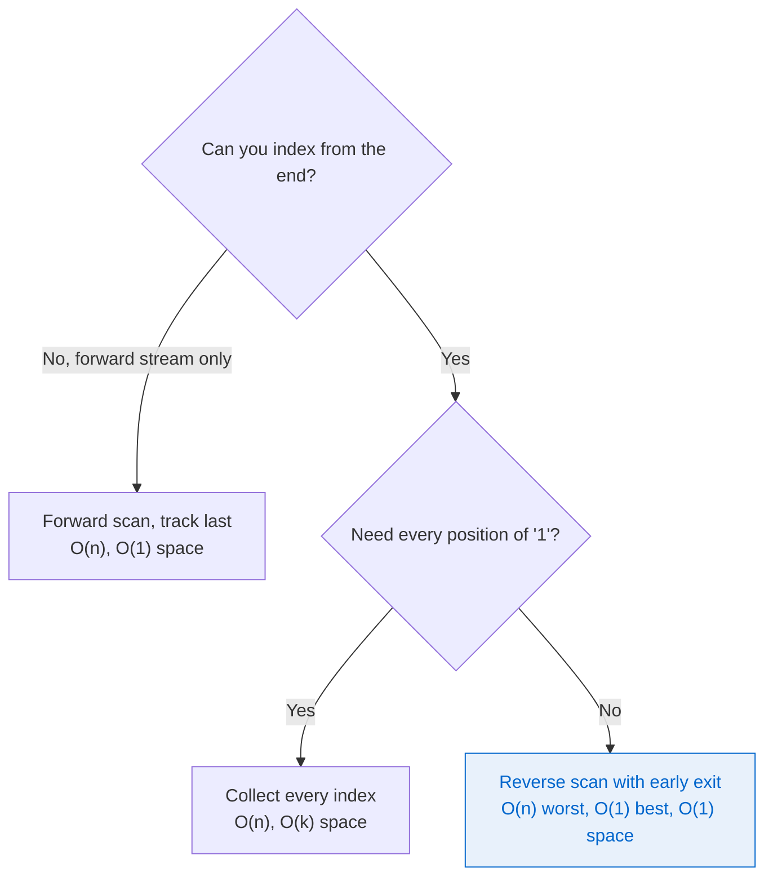

## 7. Edge Cases and Pitfalls

### 7.1 Edge Cases

| Case | Input | Expected | What it tests |
|---|---|---|---|
| `'1'` at the end | `"0001"` | `3` | Loop starts at `n - 1`, best case. |
| `'1'` only at the start | `"1000"` | `0` | Loop reaches index `0`. |
| No `'1'` | `"0000"` | `-1` | `-1` is returned only after the loop. |
| All `'1'` | `"111"` | `2` | Returns the **last** index, not the first. |
| Single `'1'` | `"1"` | `0` | Smallest input with a match. |
| Single `'0'` | `"0"` | `-1` | Smallest input without a match. |

> [!NOTE]
> The constraints guarantee `s.size() >= 1`. The solution still returns `-1` for an empty string, because `range(-1, -1, -1)` is empty.

### 7.2 Common Pitfalls

| # | Pitfall | Buggy code | Fix |
|---|---|---|---|
| 1 | Stopping before index `0` | `range(len(s) - 1, 0, -1)` | The stop value is exclusive, so use `-1`: `range(len(s) - 1, -1, -1)`. Otherwise `"1000"` returns `-1`. |
| 2 | Comparing with an integer | `if s[i] == 1:` | `s[i]` is a one-character string; compare with `'1'`. The integer test is always `False`. |
| 3 | Returning `-1` inside the loop | `if s[i] == '1': return i` / `else: return -1` | Return `-1` **after** the loop; otherwise only `s[n - 1]` is checked. |
| 4 | Using the first occurrence | `return s.find('1')` or `s.index('1')` | `find` and `index` search from the left; the last one needs `rfind`. |
| 5 | Reversing and forgetting to map back | `return s[::-1].find('1')` | That is the distance from the end. Map it with `n - 1 - j` (keep `-1` as `-1`), and note the reversed copy costs `O(n)` space. |
| 6 | `rindex` on a string without `'1'` | `return s.rindex('1')` | It raises `ValueError`; `rfind` returns `-1`. |

## 8. Interview Guide

### 8.1 The 30-Second Explanation

> The string is not sorted, so any position could hold the last `'1'`, and on an all-zero string I must read every character to be sure the answer is `-1`. I scan from right to left and return the index the moment `s[i] == '1'`; because I scan from the right, that is the last `'1'`. If the loop finishes, I return `-1`. That is `O(n)` time in the worst case, `O(1)` in the best case, and `O(1)` extra space. The forward version with a `last` variable is also `O(n)` and `O(1)` space, but it can never stop early.

### 8.2 Follow-Up Questions

**Q1. What about the first index of `'1'`?** Mirror it back: scan from the left and return at the first `'1'`, exactly like [Array Search](../01.%20Array%20Search/README.md). In Python, `s.find('1')`.

**Q2. Why not just use `s.rfind('1')`?** In real code, do. It has the same complexity and runs in C ([3.3](#33-built-in-rfind)). An interviewer asking this problem wants to see the loop, the direction choice and the `-1` after the loop.

**Q3. How would you return every position of `'1'`?** Collect them in one pass ([3.1](#31-brute-force-collect-every-index)). Time stays `O(n)`, and the output needs `O(k)` space for `k` ones.

**Q4. What if the string arrives as a stream you can only read forward?** You cannot jump to the end, so the reverse scan is impossible. Use the forward running-state scan ([3.2](#32-brute-force-forward-scan-track-the-last-one)): it needs only `O(1)` memory and has the right answer the moment the stream ends.

<details>
<summary><b>Q5. What if the string is sorted as all '1's followed by all '0's?</b></summary>

Now one read **does** tell you about other positions: if `s[mid] == '1'`, every index left of `mid` is `'1'` too. Binary search for the last `'1'` in `O(log n)` time and `O(1)` space.

```python
class Solution:

    # Return the last index of '1' in a string of the form '1...10...0', or -1.
    def lastIndex(self, s: str) -> int:

        # Start the search window at the first index.
        low = 0

        # End the search window at the last index.
        high = len(s) - 1

        # Hold the best answer found so far.
        answer = -1

        # Keep searching while the window is not empty.
        while low <= high:

            # Pick the middle position of the window.
            mid = (low + high) // 2

            # A '1' at mid means the last '1' is at mid or to its right.
            if s[mid] == '1':

                # Record mid as a candidate answer.
                answer = mid

                # Keep looking right for a later '1'.
                low = mid + 1

            # A '0' at mid means every '1' is to its left.
            else:

                # Discard mid and everything to its right.
                high = mid - 1

        # Return the last '1' found, or -1 if there was none.
        return answer
```

</details>

<details>
<summary><b>Q6. Many queries: the last '1' at or before position r?</b></summary>

Precompute `prev[i]`, the last index of `'1'` in `s[0..i]`, with one forward running-state pass. Each query is then an `O(1)` lookup: `prev[r]`. Build `O(n)` time, `O(n)` space.

```python
class Solution:

    # Build prev[i] = last index of '1' in s[0..i], or -1 if there is none.
    def buildPrev(self, s: str) -> list:

        # One entry per position of the string.
        prev = [-1] * len(s)

        # No '1' seen yet.
        last = -1

        # Visit every index from left to right.
        for i in range(len(s)):

            # A '1' here becomes the most recent '1'.
            if s[i] == '1':

                # Update the running answer.
                last = i

            # Store the running answer for prefix s[0..i].
            prev[i] = last

        # Return the finished table.
        return prev
```

</details>

## 9. Pattern: Linear Scan with Running State

**Recognize it when:**

- the data has **no order** you can exploit,
- the answer depends on what you have **seen so far** in one pass,
- each element needs only **`O(1)` work** to update or decide the answer.

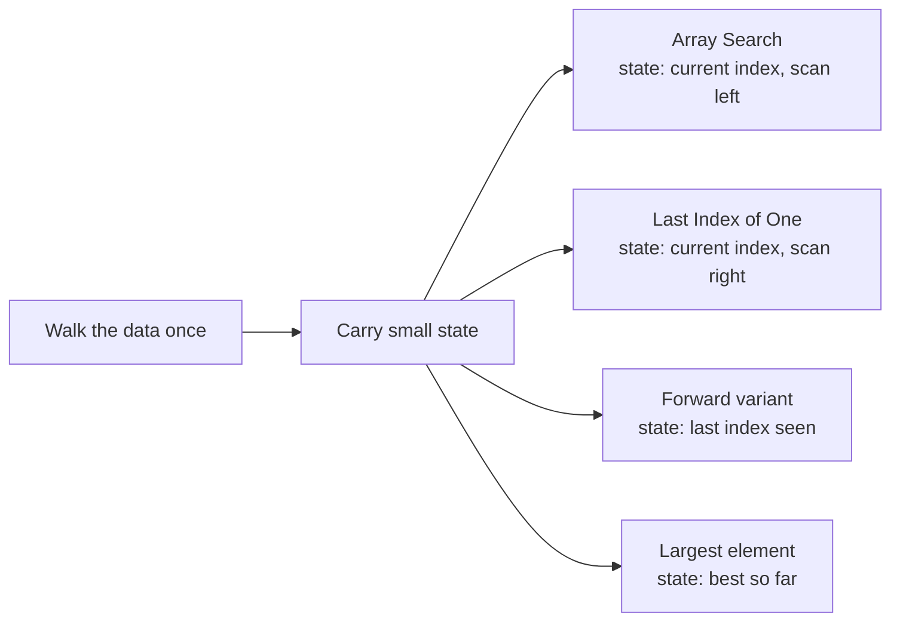

This problem shows both faces of the pattern. The forward version carries a real running state (`last`) and must finish the pass. The reverse version notices that the scan **direction** can turn "last" into "first", and then the state shrinks back to the loop index with an early exit. Before writing a running-state loop, ask whether scanning from the other end lets you stop early.

### Practice Next

| Problem | What changes |
|---|---|
| Array Search | First occurrence instead of last, so scan from the left. |
| First 1 in a Sorted Binary Array | The string is sorted, so binary search in `O(log n)`. |
| Value Equal to Position | Compare each value with its 1-based index. |
| Remove Consonants | Same single pass, but the state is an output string. |
| Count Zeros in a Sorted Matrix | Sorted rows and columns let a staircase walk skip cells. |

## 10. Summary

```python
class Solution:

    # Return the 0-based index of the last '1' in s, or -1 if s has no '1'.
    def lastIndex(self, s: str) -> int:

        # Visit every index from right to left, down to and including 0.
        for i in range(len(s) - 1, -1, -1):

            # The first '1' met while walking right to left is the last '1'.
            if s[i] == '1':

                # Stop at once and return this index.
                return i

        # The loop finished without a '1', so there is none.
        return -1
```

**Key takeaways**

1. **An unsorted string has no shortcut.** An all-zero string forces you to read all `n` characters.
2. **Scan from the right and return at the first `'1'`.** That `'1'` is the last one.
3. **The forward scan with `last` is correct and `O(1)` space**, but it can never stop early; it is the right tool only for forward-only streams.
4. **The stop value is `-1`**: `range(len(s) - 1, -1, -1)`, so index `0` is checked.
5. **Compare with `'1'`, not `1`**, and return `-1` only after the loop.
6. **Time `O(n)` worst, `O(1)` best · Space `O(1)`.**

> [!TIP]
> **To find the last occurrence, read from the end: the first match from the right is the answer, so stop there.**
