# Elements in the Range

| Topic | Difficulty | Submissions | Accuracy | Companies | Related Tags | Problem Link |
|---|---|---|---|---|---|---|
| Searching | Basics | 95,112 | 37.28% | Amazon | Arrays, Searching | [https://www.geeksforgeeks.org/problems/elements-in-the-range2834/1](https://www.geeksforgeeks.org/problems/elements-in-the-range2834/1) |

> [!IMPORTANT]
> **TL;DR.** The range `[start, end]` holds `m = end - start + 1` integers. Because the array's values are **distinct**, each of those integers can appear at most once, so the array contains the whole range exactly when **`m` of its elements fall inside the range**. Count them in one pass and compare with `m`. **Time `O(n)` · Space `O(1)` · Pattern: Missing / Repeated via Hashing, Math or Index Marking.**

## Contents

1. [Problem](#1-problem)
2. [Key Insight](#2-key-insight)
3. [Approaches](#3-approaches)
4. [Walkthrough](#4-walkthrough)
5. [Complexity Analysis](#5-complexity-analysis)
6. [Comparing the Approaches](#6-comparing-the-approaches)
7. [Edge Cases and Pitfalls](#7-edge-cases-and-pitfalls)
8. [Interview Guide](#8-interview-guide)
9. [Pattern: Missing / Repeated via Hashing, Math or Index Marking](#9-pattern-missing--repeated-via-hashing-math-or-index-marking)
10. [Summary](#10-summary)

## 1. Problem

> Given an array `arr[]` containing distinct positive integers, and two integers `start` and `end` defining a range. Find if the array contains all elements within inclusive range `[start, end]`.

*Problem statement, examples and constraints as given on GeeksforGeeks.*

### Examples

```text
Input: start = 2, end = 5, arr[] =  [1, 4, 5, 2, 7, 8, 3]
Output: true
Explanation: All integers within the range [2, 5] are 2, 3, 4, and 5, and all of them are present in the array. Therefore, the answer is true for this test case.
```

```text
Input: start = 2, end = 6, arr[] = [1, 4, 5, 2, 7, 8, 3]
Output: false
Explanation: The array does not contain 6; hence, it does not contain all the elements in the range [2, 6]. Therefore, the output is false.
```

### Constraints

```text
0 ≤ start ≤ end
end ≤ 10^5
1 ≤ arr.size() ≤ 10^5
0 ≤ arr[i] ≤ 10^5
```

### Function Signature

```python
class Solution:

    # Return True if arr contains every integer in [start, end], else False.
    def checkElements(self, start, end, arr):
        ...
```

The range is **inclusive** on both ends, the array is **unsorted**, and its values are **distinct**. The function returns a Python boolean.

## 2. Key Insight

The question "is every integer from `start` to `end` present?" sounds like `m` separate searches. Distinctness turns it into **one count**.

| Fact | Consequence |
|---|---|
| The range holds `m = end - start + 1` integers. | We need `m` different values from the array. |
| Array values are distinct. | Each in-range integer appears **at most once**. |
| So the in-range elements are `m'` **different** integers, with `m' ≤ m`. | `m' == m` exactly when **none** is missing. |

```text
arr = [6, 1, 4, 9, 3, 8]        range [3, 6]  ->  m = 4

in range: 6, 4, 3   ->  count = 3  !=  4   ->  one value (5) is missing  ->  False
```

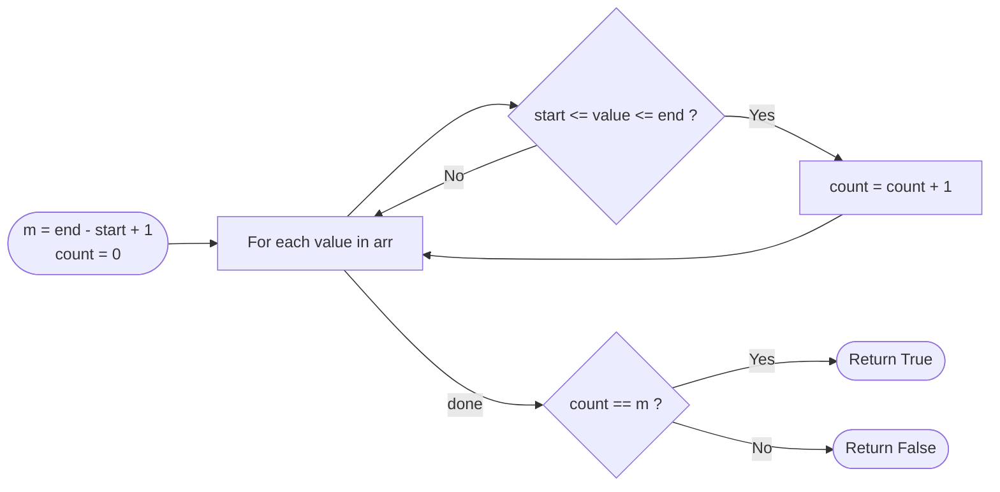

> [!NOTE]
> A quick reject comes for free: if `m > len(arr)`, the array cannot hold `m` distinct values, so the answer is `False` before reading anything.

## 3. Approaches

Four approaches, from the most literal to the optimal. All four use the same input:

```text
arr = [6, 1, 4, 9, 3, 8]        start = 3        end = 6        expected output: False (5 is missing)
```

### 3.1 Brute Force: Linear Search for Every Value

**Idea.** Take the problem literally: for each integer `v` from `start` to `end`, scan the array for `v`. The first `v` that is not found makes the answer `False`.

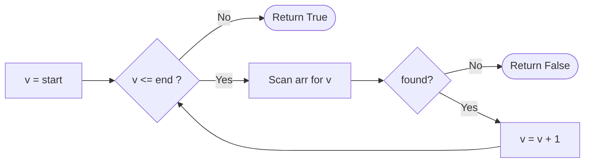

```python
class Solution:

    # Return True if every integer in [start, end] is found by a linear search.
    def checkElements(self, start, end, arr):

        # Try every integer of the range, smallest first.
        for value in range(start, end + 1):

            # Assume this value is missing until the scan finds it.
            found = False

            # Scan the whole array looking for the value.
            for element in arr:

                # Check whether this element is the value we need.
                if element == value:

                    # Record that the value is present.
                    found = True

                    # Stop scanning; one occurrence is enough.
                    break

            # A value that was never found means the range is incomplete.
            if not found:

                # Report that the array misses part of the range.
                return False

        # Every value of the range was found.
        return True
```

**Walkthrough.**

| Step | `v` | Elements read | Found at | Action |
|---|---|---|---|---|
| 1 | 3 | 6, 1, 4, 9, 3 | index 4 | next value |
| 2 | 4 | 6, 1, 4 | index 2 | next value |
| 3 | 5 | 6, 1, 4, 9, 3, 8 | — | **return False** ✔ |

14 element reads to reach the answer.

**Cost.** `O(m · n)` time, `O(1)` space. With `m` and `n` both up to `10^5` that is `10^10` reads in the worst case: far too slow.

### 3.2 Brute Force: Sort a Copy, Then Binary Search Each Value

**Idea.** Searching is faster on sorted data. Sort a **copy** (so the caller's array is untouched) and binary search for each value of the range.

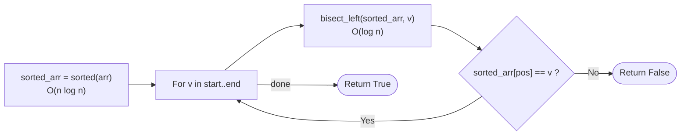

```python
from bisect import bisect_left


class Solution:

    # Return True if every integer in [start, end] is found in a sorted copy.
    def checkElements(self, start, end, arr):

        # Sort a copy so the caller's array is not modified.
        sorted_arr = sorted(arr)

        # Try every integer of the range, smallest first.
        for value in range(start, end + 1):

            # Find where the value would sit in the sorted copy.
            position = bisect_left(sorted_arr, value)

            # The value is missing if that position is past the end or holds another number.
            if position == len(sorted_arr) or sorted_arr[position] != value:

                # Report that the array misses part of the range.
                return False

        # Every value of the range was found.
        return True
```

**Walkthrough.**

```text
sorted_arr = [1, 3, 4, 6, 8, 9]
index      :  0  1  2  3  4  5
```

| Step | `v` | `bisect_left` | `sorted_arr[pos]` | Action |
|---|---|---|---|---|
| 1 | 3 | 1 | 3 | present, next value |
| 2 | 4 | 2 | 4 | present, next value |
| 3 | 5 | 3 | 6 | `6 != 5`, **return False** ✔ |

**Cost.** `O(n log n + m log n)` time and `O(n)` extra space for the copy. Faster than 3.1, but the sort costs more than the whole problem needs.

### 3.3 Brute Force: Hash Set of Values

**Idea.** Put every array value into a set, then check each value of the range in `O(1)` on average.

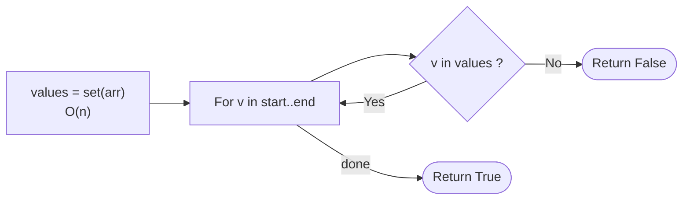

```python
class Solution:

    # Return True if every integer in [start, end] is in a set of the array's values.
    def checkElements(self, start, end, arr):

        # Store every array value for O(1) average membership tests.
        values = set(arr)

        # Try every integer of the range, smallest first.
        for value in range(start, end + 1):

            # A value missing from the set means the range is incomplete.
            if value not in values:

                # Report that the array misses part of the range.
                return False

        # Every value of the range was found.
        return True
```

**Walkthrough.**

```text
values = {1, 3, 4, 6, 8, 9}
```

| Step | `v` | `v in values` | Action |
|---|---|---|---|
| 1 | 3 | Yes | next value |
| 2 | 4 | Yes | next value |
| 3 | 5 | No | **return False** ✔ |

**Cost.** `O(n + m)` average time and `O(n)` extra space. Fast, and it would also work **with** duplicates, but it spends memory the distinct-values guarantee makes unnecessary.

### 3.4 Optimal: Count In-Range Values

**Idea.** Because values are distinct, counting the elements that fall inside `[start, end]` is enough: the count equals `m` exactly when every integer of the range is present. Reject early when `m > n`.

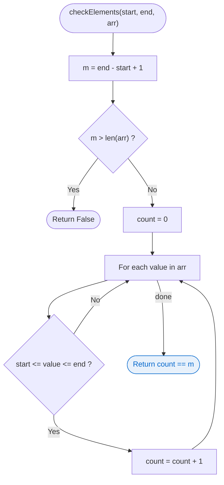

**Algorithm.**

1. Compute `m = end - start + 1`. If `m > len(arr)`, return `False`.
2. Count the elements with `start <= value <= end`.
3. Return `count == m`.

```python
class Solution:

    # Return True if arr contains every integer in [start, end], else False.
    def checkElements(self, start, end, arr):

        # Number of integers the range contains.
        needed = end - start + 1

        # Fewer elements than needed values can never cover the range.
        if needed > len(arr):

            # Reject without scanning.
            return False

        # Count how many array values fall inside the range.
        count = 0

        # Visit every value of the array once.
        for value in arr:

            # Distinct values: each in-range value is a different integer of the range.
            if start <= value <= end:

                # Count this value toward the range.
                count += 1

        # The range is complete exactly when every one of its integers was counted.
        return count == needed
```

**Walkthrough.** `needed = 6 - 3 + 1 = 4`, and `4 <= 6`, so scan:

| Step | `value` | In `[3, 6]`? | `count` |
|---|---|---|---|
| 1 | 6 | Yes | 1 |
| 2 | 1 | No | 1 |
| 3 | 4 | Yes | 2 |
| 4 | 9 | No | 2 |
| 5 | 3 | Yes | 3 |
| 6 | 8 | No | 3 |

`count = 3 != 4`, so it returns `False`. ✔

## 4. Walkthrough

### 4.1 Shared Input: One Value Missing

![Scanning [6, 1, 4, 9, 3, 8] counts three values inside [3, 6]; the range needs four, so 5 is missing and the answer is False](assets/elements-in-the-range-dry-run.png)

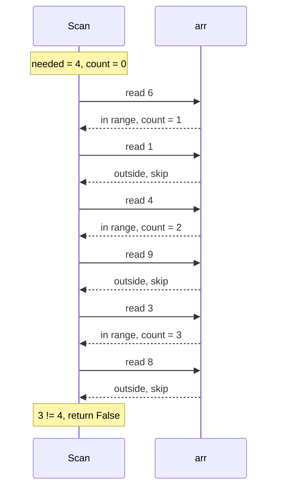

### 4.2 GfG Example 1: Range Complete

```text
start = 2, end = 5, arr[] = [1, 4, 5, 2, 7, 8, 3]        needed = 4
```

| Step | `value` | In `[2, 5]`? | `count` |
|---|---|---|---|
| 1 | 1 | No | 0 |
| 2 | 4 | Yes | 1 |
| 3 | 5 | Yes | 2 |
| 4 | 2 | Yes | 3 |
| 5 | 7 | No | 3 |
| 6 | 8 | No | 3 |
| 7 | 3 | Yes | 4 |

`count = 4 == needed`, so the answer is **`True`**.

### 4.3 GfG Example 2: Range Incomplete

```text
start = 2, end = 6, arr[] = [1, 4, 5, 2, 7, 8, 3]        needed = 5
```

The same scan counts `4, 5, 2, 3` inside `[2, 6]`, so `count = 4`. `4 != 5`, so the answer is **`False`**: the missing value is `6`.

### 4.4 Brute Force vs Optimal on the Same Input

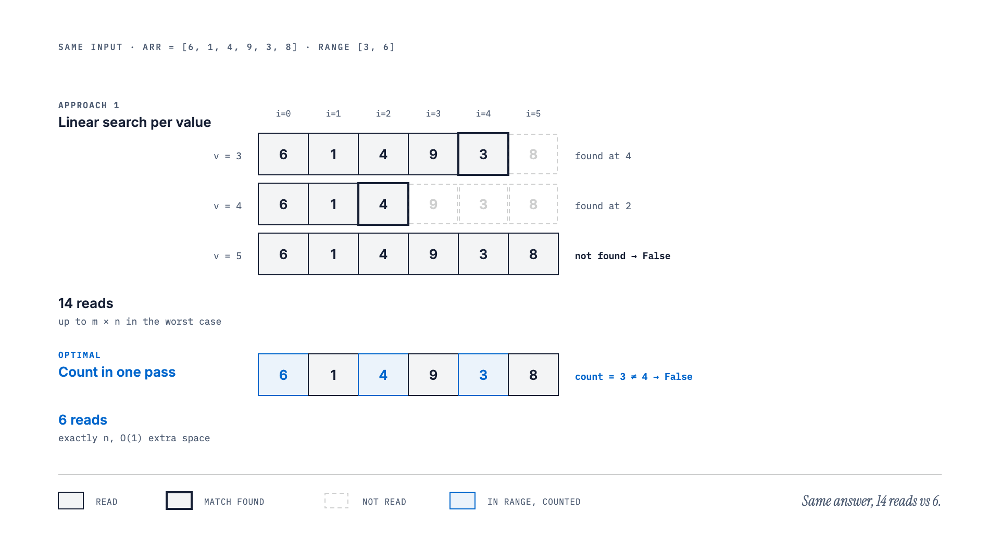

## 5. Complexity Analysis

Let `n = len(arr)` and `m = end - start + 1`.

| Case | When | Elements read | Time |
|---|---|---|---|
| Best | `m > n` (quick reject) | 0 | `O(1)` |
| Typical | any other input | `n` | `O(n)` |
| Worst | any other input | `n` | `O(n)` |

| Metric | Complexity |
|---|---|
| Time | `O(n)` |
| Extra Space | `O(1)` — two integers: `needed`, `count` |

### Why `O(n)` Is Optimal

When `m <= n`, any correct algorithm must read every element in the worst case. Take an input where the range is complete and suppose the algorithm answers `True` without reading position `j`, where `arr[j]` holds a range value `v`. Change `arr[j]` to a number outside the range: `v` is now missing and the correct answer is `False`, yet the algorithm sees exactly the same elements and still answers `True`. So `n` reads are unavoidable, and the counting scan does exactly `n`.

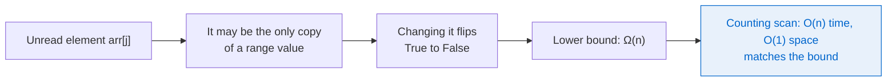

## 6. Comparing the Approaches

| Approach | Time | Extra Space | Needs distinct values? | Best used for |
|---|---|---|---|---|
| 3.1 Linear search per value | `O(m · n)` | `O(1)` | No | Tiny inputs only |
| 3.2 Sort copy + binary search | `O(n log n + m log n)` | `O(n)` | No | Many range queries on one array |
| 3.3 Hash set of values | `O(n + m)` average | `O(n)` | No | Arrays that may contain duplicates |
| **3.4 Count in-range values** | **`O(n)`** | **`O(1)`** | **Yes** | **This problem (distinct values)** |

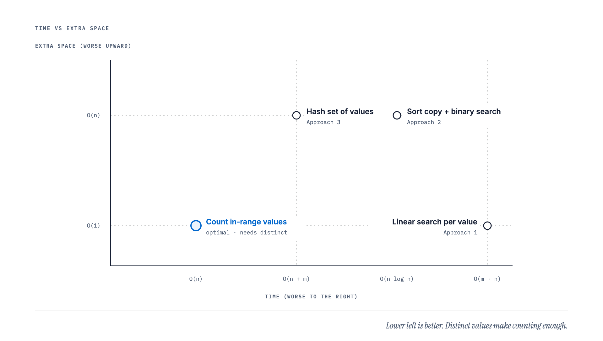

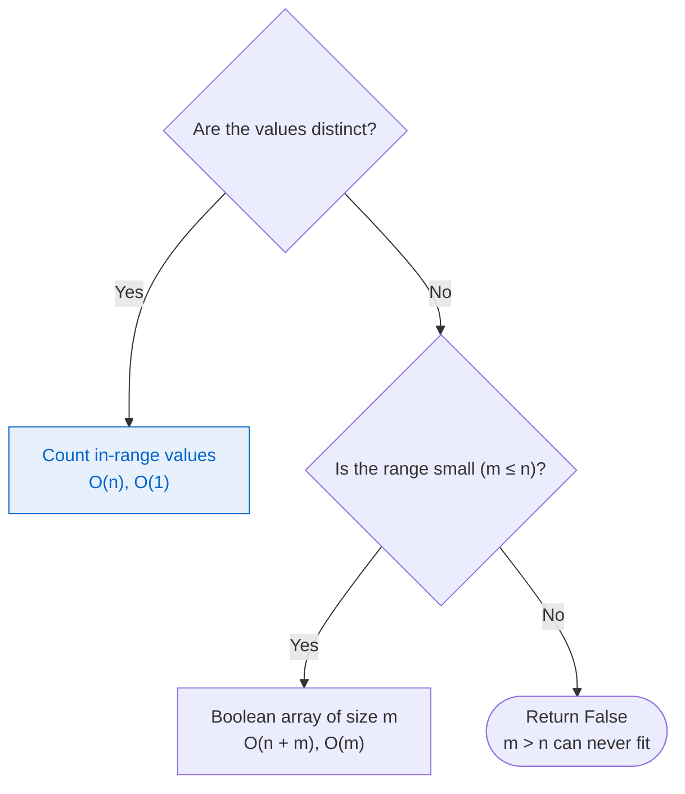

## 7. Edge Cases and Pitfalls

### 7.1 Edge Cases

| Case | Input | Expected | What it tests |
|---|---|---|---|
| Range of one value, present | `start = end = 4`, `arr = [4, 9]` | `True` | `needed = 1`, inclusive bounds. |
| Range of one value, absent | `start = end = 5`, `arr = [4, 9]` | `False` | Count stays `0`. |
| Range starts at 0 | `start = 0`, `end = 2`, `arr = [2, 0, 1]` | `True` | `0` is a valid value (constraints allow it). |
| Range wider than the array | `start = 1`, `end = 10`, `arr = [1, 2, 3]` | `False` | Quick reject `needed > n`. |
| Array exactly the range | `start = 3`, `end = 5`, `arr = [5, 3, 4]` | `True` | `count == needed == n`. |
| No value in range | `start = 50`, `end = 52`, `arr = [1, 2, 3]` | `False` | Count `0`. |
| Range end above every value | `start = 7`, `end = 9`, `arr = [7, 8]` | `False` | Quick reject (`3 > 2`). |

> [!NOTE]
> The constraints say `0 ≤ start ≤ end`, so the range is never empty and `needed ≥ 1`.

### 7.2 Common Pitfalls

| # | Pitfall | Buggy code | Fix |
|---|---|---|---|
| 1 | Off-by-one range size | `needed = end - start` | The range is inclusive: `end - start + 1`. |
| 2 | Exclusive comparisons | `start < value < end` | Use `start <= value <= end`; both ends belong to the range. |
| 3 | Counting with duplicates | `arr = [2, 2, 3]`, range `[2, 4]` gives `count = 3 == 3` | Counting is only valid for **distinct** values; with duplicates use a set or a boolean array. |
| 4 | Sorting the input in place | `arr.sort()` | Sort a copy (`sorted(arr)`) or avoid sorting; callers may not expect their array to change. |
| 5 | `v in arr` inside the range loop | `all(v in arr for v in range(start, end + 1))` | Each `in` on a list is a linear scan, so this is the `O(m · n)` brute force. |
| 6 | Returning a string | `return "true"` | Return the boolean `True` / `False`; the GfG driver prints it. |

## 8. Interview Guide

### 8.1 The 30-Second Explanation

> The range has `m = end - start + 1` integers. Since the array's values are distinct, each integer of the range can show up at most once, so the array covers the range exactly when `m` of its elements fall inside it. I reject immediately if `m` is larger than the array, otherwise I count the elements with `start <= value <= end` in one pass and return whether the count equals `m`. That is `O(n)` time and `O(1)` space, and `O(n)` is necessary because any unread element could be the only copy of a range value.

### 8.2 Follow-Up Questions

**Q1. What if the array could contain duplicates?** Counting breaks (`[2, 2, 3]` over `[2, 4]` counts 3). Mark which range values appear in a boolean array of size `m` and check that every slot is marked: `O(n + m)` time, `O(m)` space.

**Q2. What if you get many range queries on the same array?** Build a presence array over the value domain (`0..10^5`) and its prefix sums once. A query `[start, end]` is complete when `prefix[end + 1] - prefix[start] == end - start + 1`, answered in `O(1)`.

**Q3. Can you avoid even a counter?** Not meaningfully: one integer is `O(1)` space. The interesting `O(1)`-space trick is index marking (Q5), which matters when you must also report **which** value is missing.

**Q4. What if the values arrive as a stream you cannot store?** The counting approach already works on a stream: it reads each value once and keeps only `count`.

<details>
<summary><b>Q5. How would you find which value is missing, in O(1) extra space?</b></summary>

Use the array itself as the marker table. For each in-range value `v`, mark slot `v - start` by making it negative. Values can be `0`, and `-0 == 0`, so shift every value by `+1` first. This **modifies the array**, so work on a copy unless the caller allows it. It needs `needed <= len(arr)`.

```python
class Solution:

    # Return the smallest missing value of [start, end], or -1 if the range is complete.
    def firstMissing(self, start, end, arr):

        # Number of integers the range contains.
        needed = end - start + 1

        # A range wider than the array always misses its largest values.
        if needed > len(arr):

            # Start from the first value the array cannot fully cover.
            needed = len(arr)

        # Work on a copy shifted by one, so a value of 0 can still carry a negative mark.
        marks = [value + 1 for value in arr]

        # Visit every slot of the copy.
        for i in range(len(marks)):

            # Recover the original value even if this slot was already marked.
            value = abs(marks[i]) - 1

            # Only in-range values whose slot exists can be marked.
            if start <= value <= end and value - start < needed:

                # Mark the slot that represents this value.
                marks[value - start] = -abs(marks[value - start])

        # Look for the first slot that was never marked.
        for j in range(needed):

            # An unmarked slot means its value never appeared.
            if marks[j] > 0:

                # Report the missing value.
                return start + j

        # Every slot was marked; any value beyond the array's length is missing.
        if needed < end - start + 1:

            # The first value the array could not cover.
            return start + needed

        # The whole range is present.
        return -1
```

</details>

<details>
<summary><b>Q6. Show the boolean-array version that tolerates duplicates.</b></summary>

```python
class Solution:

    # Return True if arr contains every integer in [start, end], even with duplicates.
    def checkElements(self, start, end, arr):

        # Number of integers the range contains.
        needed = end - start + 1

        # One flag per integer of the range.
        seen = [False] * needed

        # Visit every value of the array once.
        for value in arr:

            # Only values inside the range matter.
            if start <= value <= end:

                # Flag the slot for this value; duplicates just set it again.
                seen[value - start] = True

        # The range is complete when every flag is set.
        return all(seen)
```

</details>

## 9. Pattern: Missing / Repeated via Hashing, Math or Index Marking

**Recognize it when:**

- the question is about which values of a **known small range** are present, missing or repeated,
- a guarantee such as **distinct values** or values in `1..n` lets a count, a sum or the indices themselves stand in for a full hash set,
- the expected solution is `O(n)` time and often `O(1)` extra space.

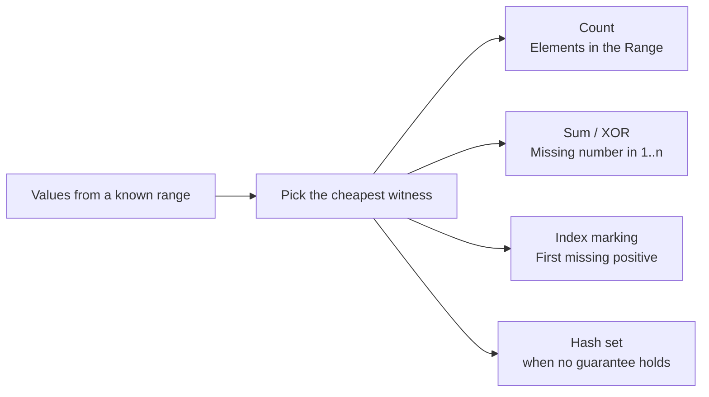

Here distinctness makes a plain **count** a complete witness. Other problems in this pattern swap the count for a sum, an XOR, or sign marks in the array itself, but the idea is the same: let arithmetic on the values prove what is present.

### Practice Next

| Problem | What changes |
|---|---|
| Missing Number in Array | Values `1..n` with one missing: sum or XOR finds it. |
| Find Duplicate in 1..n-1 | One value repeats: sum, XOR or Floyd's cycle detection. |
| Check if Array Contains Contiguous Integers | Duplicates allowed: min, max and a set. |
| First Missing Positive | Index marking inside the array, `O(1)` extra space. |
| Missing and Repeating | One value missing and one repeated at once. |

## 10. Summary

```python
class Solution:

    # Return True if arr contains every integer in [start, end], else False.
    def checkElements(self, start, end, arr):

        # Number of integers the range contains.
        needed = end - start + 1

        # Fewer elements than needed values can never cover the range.
        if needed > len(arr):

            # Reject without scanning.
            return False

        # Count how many array values fall inside the range.
        count = 0

        # Visit every value of the array once.
        for value in arr:

            # Distinct values: each in-range value is a different integer of the range.
            if start <= value <= end:

                # Count this value toward the range.
                count += 1

        # The range is complete exactly when every one of its integers was counted.
        return count == needed
```

**Key takeaways**

1. **The range holds `m = end - start + 1` integers**; both ends are included.
2. **Distinct values make a count a full proof**: `count == m` means nothing is missing.
3. **Reject early when `m > n`**: there are not enough elements to cover the range.
4. **Searching per value is `O(m · n)`**; a set is fast but costs `O(n)` memory.
5. **With duplicates, counting breaks**: switch to a boolean array or a set.
6. **Time `O(n)` · Space `O(1)`**, and `O(n)` reads are unavoidable.

> [!TIP]
> **When values are distinct, you don't need to know which ones you saw: counting how many landed in the range is already proof that none is missing.**
