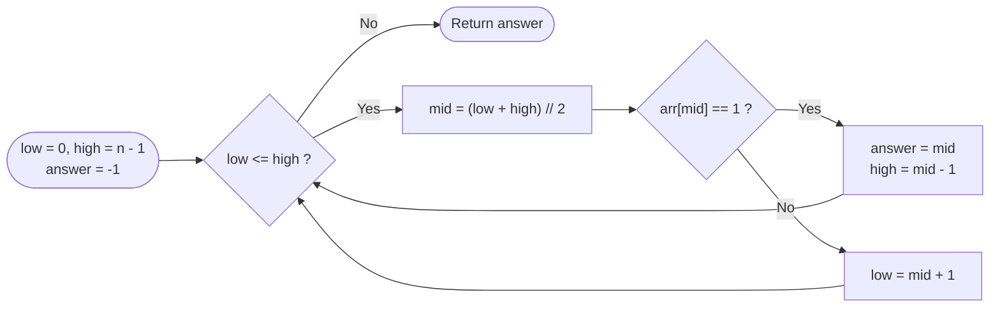
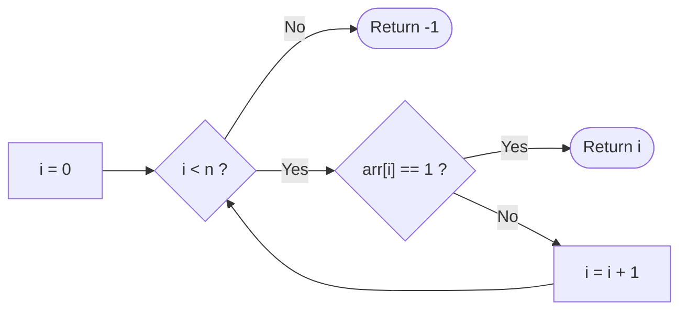
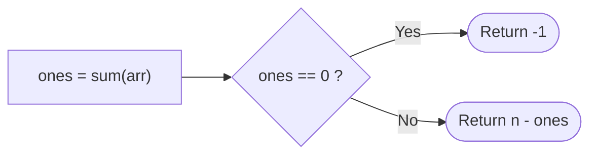
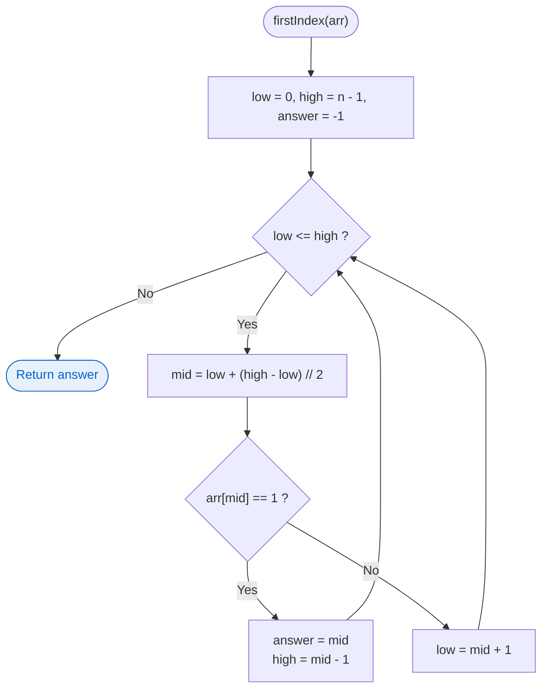
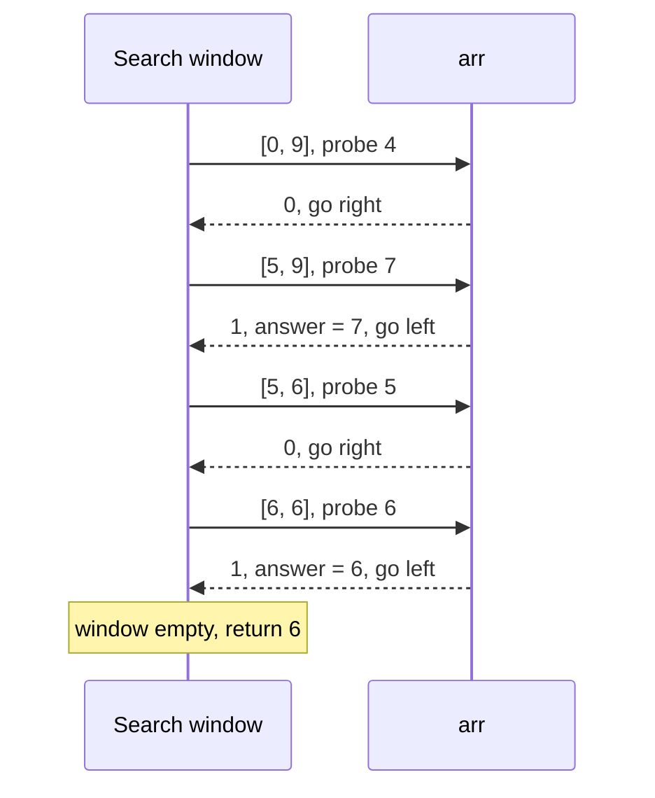
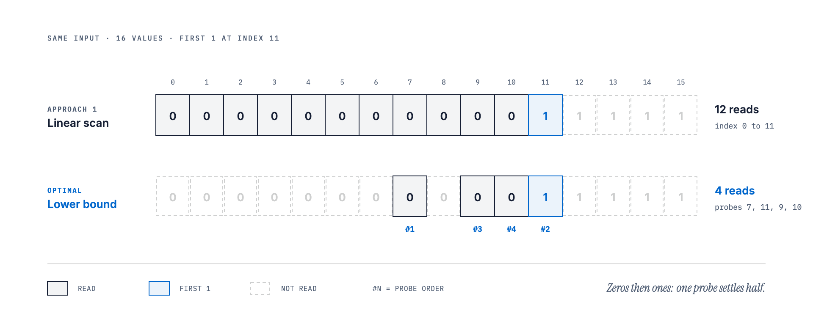
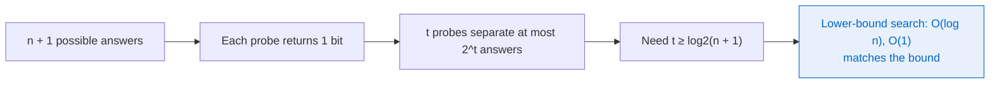
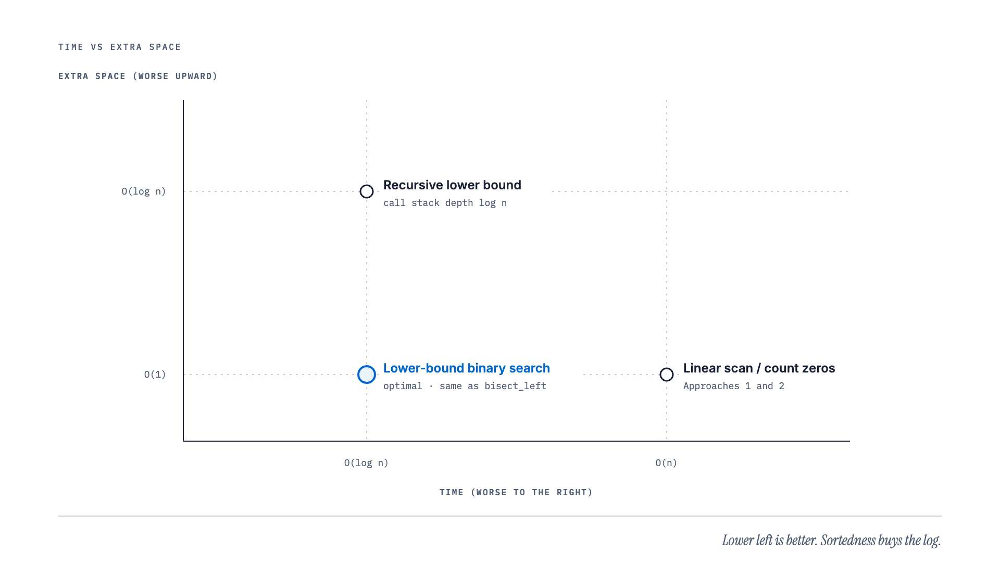
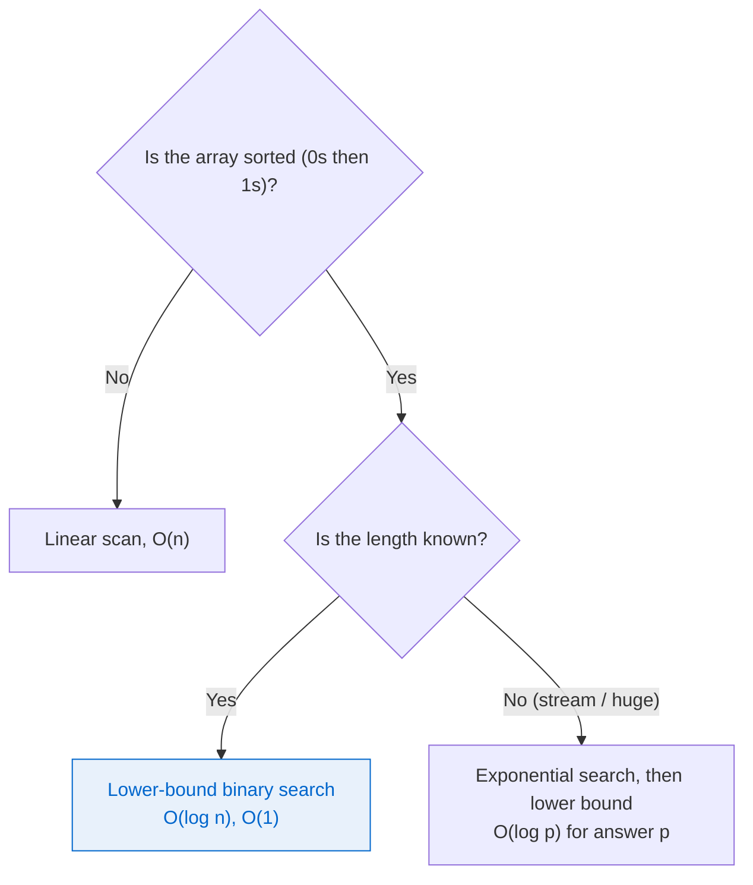
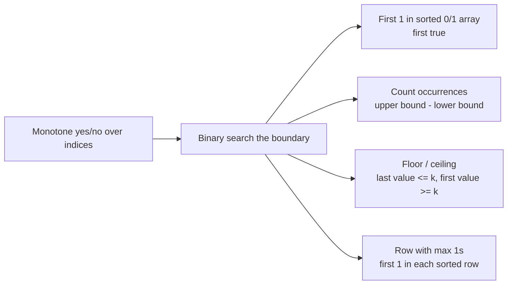

# First 1 in a Sorted Binary Array

| Topic | Difficulty | Submissions | Accuracy | Companies | Related Tags | Problem Link |
|---|---|---|---|---|---|---|
| Searching | Basics | 61,917 | 49.11% | Amazon, MakeMyTrip | Arrays, Binary Search, Searching | [https://www.geeksforgeeks.org/problems/index-of-first-1-in-a-sorted-array-of-0s-and-1s4048/1](https://www.geeksforgeeks.org/problems/index-of-first-1-in-a-sorted-array-of-0s-and-1s4048/1) |

> [!IMPORTANT]
> **TL;DR.** A sorted binary array is all `0`s followed by all `1`s, so "is `arr[i]` a `1`?" flips from no to yes exactly once. Binary search for that flip: on a `1`, record the index and keep searching **left**; on a `0`, search **right**. The last recorded index is the answer. **Time `O(log n)` · Space `O(1)` · Pattern: Lower / Upper Bound Binary Search.**

## Contents

1. [Problem](#1-problem)
2. [Key Insight](#2-key-insight)
3. [Approaches](#3-approaches)
4. [Walkthrough](#4-walkthrough)
5. [Complexity Analysis](#5-complexity-analysis)
6. [Comparing the Approaches](#6-comparing-the-approaches)
7. [Edge Cases and Pitfalls](#7-edge-cases-and-pitfalls)
8. [Interview Guide](#8-interview-guide)
9. [Pattern: Lower / Upper Bound Binary Search](#9-pattern-lower--upper-bound-binary-search)
10. [Summary](#10-summary)

## 1. Problem

> Given a sorted array `arr` consisting of 0s and 1s. The task is to find the index (0-based indexing) of the first 1 in the given array.
>
> **NOTE:** If one is not present then, return -1.

*Problem statement, examples and constraints as given on GeeksforGeeks.*

### Examples

```text
Input : arr[] = [0, 0, 0, 0, 0, 0, 1, 1, 1, 1]
Output : 6
Explanation: The index of first 1 in the array is 6.
```

```text
Input : arr[] = [0, 0, 0, 0]
Output : -1
Explanation: 1's are not present in the array.
```

### Constraints

```text
1 ≤ arr.size() ≤ 10^6
0 ≤ arr[i] ≤ 1
```

### Function Signature

```python
class Solution:

    # Return the 0-based index of the first 1 in the sorted binary array, or -1.
    def firstIndex(self, arr):
        ...
```

Indexing is **0-based**. "Sorted" means every `0` comes before every `1`.

## 2. Key Insight

A sorted binary array has exactly one shape: a block of `0`s, then a block of `1`s (either block may be empty). The answer is the boundary between them.

```text
index :  0  1  2  3  4  5  6  7  8  9
arr   :  0  0  0  0  0  0  1  1  1  1
         no no no no no no YES YES YES YES     <- "is arr[i] == 1 ?"
                           ^
                     first YES = answer 6
```

The question "is `arr[i] == 1`?" is **monotone**: once it becomes true it stays true. Probing any index tells you which side of the boundary it is on:

| Probe result | What it proves | Next move |
|---|---|---|
| `arr[mid] == 0` | The boundary is to the right of `mid`. | `low = mid + 1` |
| `arr[mid] == 1` | `mid` is a candidate; an earlier `1` may still exist. | record `mid`, `high = mid - 1` |



> [!NOTE]
> This is **not** the exact-match binary search. Finding *a* `1` is not enough; the search must keep going left until no earlier `1` can exist. That "record, then keep searching" step is what makes it a **lower bound**.

## 3. Approaches

Three approaches: a plain scan, a counting trick, and the lower-bound binary search. All three use the same input:

```text
arr = [0, 0, 0, 1, 1, 1, 1]        expected output: 3
```

### 3.1 Brute Force: Linear Scan

**Idea.** Walk from the left and return the first index that holds a `1`.



```python
class Solution:

    # Return the index of the first 1 by scanning from the left.
    def firstIndex(self, arr):

        # Visit every index from left to right.
        for i in range(len(arr)):

            # The first 1 met from the left is the answer.
            if arr[i] == 1:

                # Return its index.
                return i

        # No 1 was found anywhere.
        return -1
```

**Walkthrough.**

| Step | `i` | `arr[i]` | Action |
|---|---|---|---|
| 1 | 0 | 0 | move on |
| 2 | 1 | 0 | move on |
| 3 | 2 | 0 | move on |
| 4 | 3 | 1 | **return 3** ✔ |

**Cost.** `O(n)` time, `O(1)` space. It never uses the fact that the array is sorted.

### 3.2 Brute Force: Count the Zeros

**Idea.** All `0`s come first, so the first `1` sits right after the last `0`. The number of `0`s is `n - sum(arr)`, which is therefore the answer, unless there are no `1`s at all.



```python
class Solution:

    # Return the index of the first 1 as the number of zeros before it.
    def firstIndex(self, arr):

        # Count the 1s; in a 0/1 array their sum is their count.
        ones = sum(arr)

        # With no 1s there is no first 1.
        if ones == 0:

            # Report that 1 is absent.
            return -1

        # All zeros come first, so the first 1 sits right after them.
        return len(arr) - ones
```

**Walkthrough.**

| Step | Value |
|---|---|
| `ones = sum([0, 0, 0, 1, 1, 1, 1])` | `4` |
| `ones == 0`? | No |
| `n - ones = 7 - 4` | **`3`** ✔ |

**Cost.** `O(n)` time, `O(1)` space. Neat, and it uses sortedness, but `sum` still reads every element.

### 3.3 Optimal: Lower-Bound Binary Search

**Idea.** Binary search for the first index where `arr[i] == 1`. On a `1`, record it and search the left half for an earlier one; on a `0`, search the right half. When the window is empty, the last recorded index is the first `1`.



**Algorithm.**

1. Set `low = 0`, `high = n - 1`, `answer = -1`.
2. While `low <= high`, compute `mid`.
3. If `arr[mid] == 1`: set `answer = mid` and `high = mid - 1`.
4. Otherwise: set `low = mid + 1`.
5. Return `answer`.

```python
class Solution:

    # Return the 0-based index of the first 1 in the sorted binary array, or -1.
    def firstIndex(self, arr):

        # Start the window at the first index.
        low = 0

        # End the window at the last index.
        high = len(arr) - 1

        # No 1 has been seen yet.
        answer = -1

        # Keep searching while the window still holds at least one element.
        while low <= high:

            # Pick the middle index of the window.
            mid = low + (high - low) // 2

            # A 1 here is a candidate, but an earlier 1 may still exist.
            if arr[mid] == 1:

                # Remember this index as the best answer so far.
                answer = mid

                # Keep looking in the left half for an earlier 1.
                high = mid - 1

            # A 0 here means the first 1 must be to the right.
            else:

                # Discard the left half including mid.
                low = mid + 1

        # The last recorded index is the first 1, or -1 if none was seen.
        return answer
```

**Walkthrough.**

| Step | `low` | `high` | `mid` | `arr[mid]` | Action | `answer` |
|---|---|---|---|---|---|---|
| 1 | 0 | 6 | 3 | 1 | record, go left | `3` |
| 2 | 0 | 2 | 1 | 0 | go right | `3` |
| 3 | 2 | 2 | 2 | 0 | go right | `3` |
| — | 3 | 2 | — | — | window empty | **return 3** ✔ |

The very first probe already lands on the answer, but only the remaining probes **prove** that no earlier `1` exists.

## 4. Walkthrough

### 4.1 GfG Example 1: `1` Present

```text
arr[] = [0, 0, 0, 0, 0, 0, 1, 1, 1, 1]
```

| Step | `low` | `high` | `mid` | `arr[mid]` | Action | `answer` |
|---|---|---|---|---|---|---|
| 1 | 0 | 9 | 4 | 0 | go right | `-1` |
| 2 | 5 | 9 | 7 | 1 | record, go left | `7` |
| 3 | 5 | 6 | 5 | 0 | go right | `7` |
| 4 | 6 | 6 | 6 | 1 | record, go left | `6` |
| — | 6 | 5 | — | — | window empty | **return 6** |

![Lower-bound binary search on [0, 0, 0, 0, 0, 0, 1, 1, 1, 1] probes indices 4, 7, 5 and 6, records 7 then 6 as the answer, and returns 6 when the window empties](assets/first-1-sorted-binary-dry-run.png)



### 4.2 GfG Example 2: No `1`

```text
arr[] = [0, 0, 0, 0]
```

| Step | `low` | `high` | `mid` | `arr[mid]` | Action | `answer` |
|---|---|---|---|---|---|---|
| 1 | 0 | 3 | 1 | 0 | go right | `-1` |
| 2 | 2 | 3 | 2 | 0 | go right | `-1` |
| 3 | 3 | 3 | 3 | 0 | go right | `-1` |
| — | 4 | 3 | — | — | window empty | **return -1** |

`answer` was never updated, so `-1` comes back without any special case.

### 4.3 Linear Scan vs Lower Bound

On 11 zeros followed by 5 ones, the scan reads 12 cells; the lower bound reads 4.



## 5. Complexity Analysis

Let `n = len(arr)`. Unlike exact-match search, the lower bound never stops early: it always runs until the window is empty.

| Case | When | Probes | Time |
|---|---|---|---|
| Best | any input | about `log2 n` | `O(log n)` |
| Average | any input | about `log2 n` | `O(log n)` |
| Worst | any input | `⌊log2 n⌋ + 1` | `O(log n)` |

| `n` | Worst-case probes |
|---|---|
| 1,000 | 10 |
| 1,000,000 (the constraint) | 20 |

| Metric | Complexity |
|---|---|
| Time | `O(log n)` |
| Extra Space | `O(1)` — `low`, `high`, `mid`, `answer` |

### Why `O(log n)` Is Optimal

The answer can be any of `n + 1` values: index `0` to `n - 1`, or `-1` for an all-zero array. Each probe reads one bit (`0` or `1`), so `t` probes can tell apart at most `2^t` cases. Distinguishing `n + 1` answers needs `2^t ≥ n + 1`, so `t ≥ log2(n + 1)`. Binary search meets this bound.



## 6. Comparing the Approaches

| Approach | Time | Extra Space | Uses sorted order? | Best used for |
|---|---|---|---|---|
| 3.1 Linear scan | `O(n)` | `O(1)` | No | Unsorted 0/1 data |
| 3.2 Count the zeros | `O(n)` | `O(1)` | Yes, for the formula | One-liners when `n` is small |
| **3.3 Lower-bound binary search** | **`O(log n)`** | **`O(1)`** | **Fully** | **This problem** |
| Recursive lower bound | `O(log n)` | `O(log n)` stack | Fully | When recursion reads more clearly |





## 7. Edge Cases and Pitfalls

### 7.1 Edge Cases

| Case | Input | Expected | What it tests |
|---|---|---|---|
| All zeros | `[0, 0, 0, 0]` | `-1` | `answer` never updated. |
| All ones | `[1, 1, 1]` | `0` | The search keeps going left down to index `0`. |
| Single `0` | `[0]` | `-1` | One-element window. |
| Single `1` | `[1]` | `0` | One-element window. |
| `1` only at the end | `[0, 0, 0, 1]` | `3` | `low` climbs to `n - 1`. |
| Half and half | `[0, 0, 1, 1]` | `2` | Boundary in the middle. |

### 7.2 Common Pitfalls

| # | Pitfall | Buggy code | Fix |
|---|---|---|---|
| 1 | Returning the first `1` you hit | `if arr[mid] == 1: return mid` | That returns *a* `1`, not the first. Record it and keep going left. |
| 2 | `low < high` with a closed window | `while low < high:` | Use `low <= high` with `high = n - 1`; otherwise the last candidate is skipped. |
| 3 | Not moving past `mid` | `high = mid` with `low <= high` | Infinite loop when `low == high`; use `high = mid - 1` (the answer is already recorded). |
| 4 | Forgetting the "no 1" case | `return low` after the loop | `low` is `n` for an all-zero array; return the recorded `answer` (`-1`). |
| 5 | Counting trick without the zero check | `return len(arr) - sum(arr)` | Returns `n` for all zeros; the problem wants `-1`. |
| 6 | Assuming the first probe's `1` is final | stopping after step 1 of 3.3 | A `1` only bounds the answer from above; keep searching until the window is empty. |

## 8. Interview Guide

### 8.1 The 30-Second Explanation

> A sorted binary array is zeros then ones, so "is `arr[i]` a 1?" switches from false to true exactly once, and I need the first true. I binary search with `answer = -1`: if the middle is 1, I record it and move `high` to `mid - 1` to look for an earlier 1; if it is 0, I move `low` to `mid + 1`. When the window empties, `answer` holds the first 1, or `-1` if none exists. That is `O(log n)` time and `O(1)` space, which is optimal because each probe reveals only one bit and there are `n + 1` possible answers.

### 8.2 Follow-Up Questions

**Q1. How do you count the 1s?** The ones occupy `first .. n - 1`, so the count is `n - firstIndex(arr)`, or `0` when there is no `1`. Still `O(log n)`.

**Q2. How would you find the last 0?** It is `firstIndex(arr) - 1` when a `1` exists, and `n - 1` otherwise. Or run the mirror search: on a `0`, record and go right.

**Q3. Can Python do this for you?** `bisect.bisect_left(arr, 1)` returns the first position where `1` could be inserted, which is exactly the first `1` when it exists. Check `index < n` to detect the all-zero case.

**Q4. What if the array is a stream, or too large to know its length?** Use **exponential search**: probe indices `1, 2, 4, 8, ...` until you see a `1` (or run out), then run the lower bound inside the last doubled range. It costs `O(log p)` for answer `p`, independent of `n`.

<details>
<summary><b>Q5. Show the half-open [low, high) template.</b></summary>

Many people prefer a half-open window that ends with `low == high` at the answer. Here `high` starts at `n`, the loop runs while `low < high`, and `high = mid` is safe because `mid < high`.

```python
class Solution:

    # Return the index of the first 1 using a half-open window [low, high).
    def firstIndex(self, arr):

        # Start the window at the first index.
        low = 0

        # The window ends just past the last index.
        high = len(arr)

        # Shrink the window until it is empty.
        while low < high:

            # Pick the middle index; it is always strictly below high.
            mid = (low + high) // 2

            # A 1 here means the first 1 is at mid or to its left.
            if arr[mid] == 1:

                # Keep mid inside the window.
                high = mid

            # A 0 here means the first 1 is strictly to the right.
            else:

                # Discard mid and everything left of it.
                low = mid + 1

        # low is the first 1, or n when the array has no 1.
        if low == len(arr):

            # Report that 1 is absent.
            return -1

        # Return the index of the first 1.
        return low
```

</details>

<details>
<summary><b>Q6. Show the library version with bisect_left.</b></summary>

```python
from bisect import bisect_left


class Solution:

    # Return the index of the first 1 using the standard library's lower bound.
    def firstIndex(self, arr):

        # Find the leftmost position where 1 could be inserted.
        index = bisect_left(arr, 1)

        # Position n means every element is 0.
        if index == len(arr):

            # Report that 1 is absent.
            return -1

        # Otherwise that position holds the first 1.
        return index
```

</details>

## 9. Pattern: Lower / Upper Bound Binary Search

**Recognize it when:**

- a yes/no question about index `i` is **monotone**: false, false, ..., true, true,
- you need the **first true** (lower bound) or the **last false / last true** (upper bound),
- finding *some* match is not enough: the position of the boundary is the answer.



This problem is the purest lower bound: the predicate is the value itself. Every other lower-bound problem swaps in a different predicate (`arr[i] >= k`, `arr[i] > k`, "can we finish in `i` days?") and keeps the same "record, then keep searching" loop.

### Practice Next

| Problem | What changes |
|---|---|
| Binary Search | Exact match: stop as soon as `arr[mid] == k`. |
| Number of Occurrences | First and last position of `k`, then subtract. |
| Floor in a Sorted Array | Last index with `arr[i] <= k`. |
| Row with Max 1s | Lower bound for the first `1` in every sorted row. |
| Count Zeros in a Sorted Matrix | The boundary moves monotonically across rows. |

## 10. Summary

```python
class Solution:

    # Return the 0-based index of the first 1 in the sorted binary array, or -1.
    def firstIndex(self, arr):

        # Start the window at the first index.
        low = 0

        # End the window at the last index.
        high = len(arr) - 1

        # No 1 has been seen yet.
        answer = -1

        # Keep searching while the window still holds at least one element.
        while low <= high:

            # Pick the middle index of the window.
            mid = low + (high - low) // 2

            # A 1 here is a candidate, but an earlier 1 may still exist.
            if arr[mid] == 1:

                # Remember this index as the best answer so far.
                answer = mid

                # Keep looking in the left half for an earlier 1.
                high = mid - 1

            # A 0 here means the first 1 must be to the right.
            else:

                # Discard the left half including mid.
                low = mid + 1

        # The last recorded index is the first 1, or -1 if none was seen.
        return answer
```

**Key takeaways**

1. **Sorted 0/1 means one boundary**: zeros, then ones.
2. **"Is it a 1?" is monotone**, so binary search can find where it flips.
3. **On a 1, record and go left; on a 0, go right.** Never stop at the first `1` you see.
4. **`answer = -1` handles the all-zero case** with no extra branch.
5. **The count-zeros trick is `O(n)`**: correct, but it still reads everything.
6. **Time `O(log n)` · Space `O(1)`**, matching the `log2(n + 1)` lower bound.

> [!TIP]
> **When you need where something starts, a match is only a candidate: record it, keep searching toward the start, and let the empty window prove you are done.**
