# Remove Consonants

| Topic | Difficulty | Submissions | Accuracy | Companies | Related Tags | Problem Link |
|---|---|---|---|---|---|---|
| Searching | Basics | 37,513 | 22.63% | — | Searching, Strings | [https://www.geeksforgeeks.org/problems/c-program-to-remove-consonants-from-a-string1945/1](https://www.geeksforgeeks.org/problems/c-program-to-remove-consonants-from-a-string1945/1) |

> [!IMPORTANT]
> **TL;DR.** Walk the string once and keep a character only if it is in the constant set `{a, e, i, o, u, A, E, I, O, U}`. Collect the kept characters in a list and build the answer with one `"".join`, because Python strings are immutable and repeated `+=` can copy the result again and again. **Time `O(n)` · Space `O(n)` · Pattern: Linear Scan with Running State.**

## Contents

1. [Problem](#1-problem)
2. [Key Insight](#2-key-insight)
3. [Approaches](#3-approaches)
4. [Walkthrough](#4-walkthrough)
5. [Complexity Analysis](#5-complexity-analysis)
6. [Comparing the Approaches](#6-comparing-the-approaches)
7. [Edge Cases and Pitfalls](#7-edge-cases-and-pitfalls)
8. [Interview Guide](#8-interview-guide)
9. [Pattern: Linear Scan with Running State](#9-pattern-linear-scan-with-running-state)
10. [Summary](#10-summary)

## 1. Problem

> Given a string s, remove all consonants and return the modified string containing only vowels.
>
> If the string does not contain any vowels, return an empty string.

*Problem statement, examples and constraints as given on GeeksforGeeks.*

### Examples

```text
Input: s = "abEkipo"
Output: "aEio"
Explanation: a, E, i, o are only vowels in the string.
```

```text
Input: s = "rrty"
Output: ""
Explanation: There are no vowels.
```

### Constraints

```text
1 ≤ n ≤ 10^5, n is length of the string
The string should consist of only alphabets.
```

### Function Signature

```python
class Solution:

    # Return s with every consonant removed, keeping the vowels in order.
    def remConsonants(self, s):
        ...
```

The vowels are `a, e, i, o, u` in **either case**, the kept vowels stay in their **original order**, and `y` counts as a consonant.

## 2. Key Insight

Every character is either a vowel or a consonant, and that decision depends on **the character alone**, not on its neighbours or its position. So one left-to-right pass decides every character, and the only thing to carry along is the output built so far.

```text
s      = a  b  E  k  i  p  o
vowel? = Y  N  Y  N  Y  N  Y
keep   = a     E     i     o      ->  "aEio"
```

Two details turn this into the optimal solution:

| Detail | Why it matters |
|---|---|
| Test membership in a **constant set** of 10 vowels | Each test is `O(1)`, with no `lower()` call and no chain of `==` comparisons. |
| **Collect into a list, `"".join` once** | Python strings are immutable, so `result += ch` may build a new string each time; a list append never copies the kept characters. |

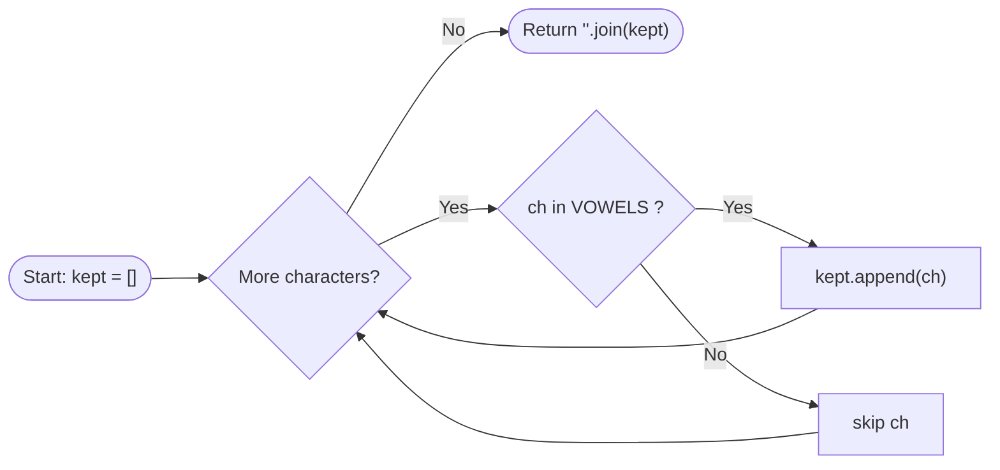

## 3. Approaches

Three approaches, from the most literal to the optimal. All three are tested and correct; they differ in how much copying they do. The two brute-force approaches use the same input so you can compare them directly:

```text
s = "abEkipo"        expected output: "aEio"
```

### 3.1 Brute Force: Delete Consonants by Rebuilding the String

**Idea.** Read "remove all consonants" literally: walk through the string and, whenever the current character is a consonant, cut it out. A Python string cannot be changed in place, so every cut builds a **new** string from the part before and the part after the consonant. After a cut, do not advance `i`, because the next character has just slid into position `i`.

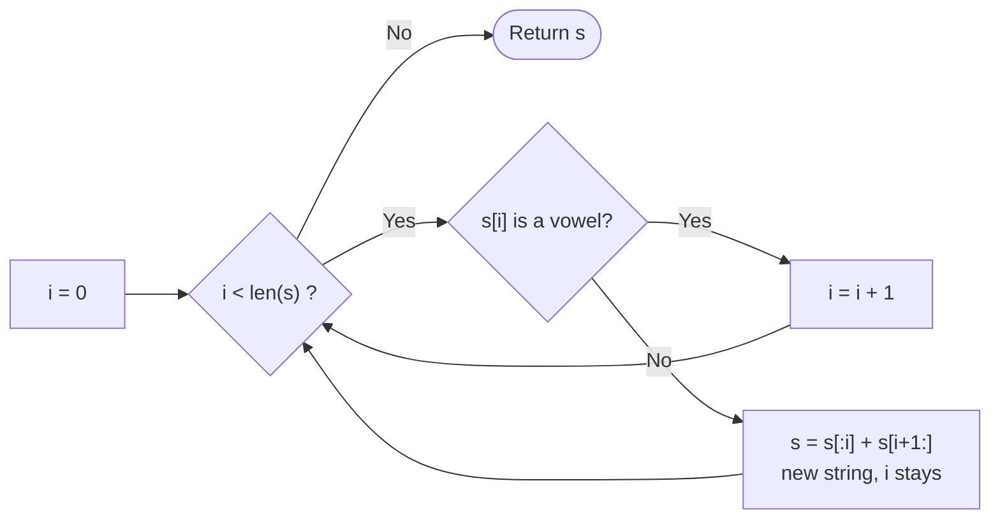

```python
class Solution:

    # Return s without consonants by cutting each consonant out of the string.
    def remConsonants(self, s):

        # Start at the first character.
        i = 0

        # Keep going until i passes the end of the current, shrinking string.
        while i < len(s):

            # A vowel stays where it is.
            if s[i] in "aeiouAEIOU":

                # Move on to the next character.
                i += 1

            # Otherwise the character is a consonant.
            else:

                # Build a new string without position i; the next character slides into i.
                s = s[:i] + s[i + 1:]

        # Only vowels are left, in their original order.
        return s
```

**Walkthrough.**

| Step | `i` | `s[i]` | Vowel? | Action | `s` after the step |
|---|---|---|---|---|---|
| 1 | 0 | `a` | Yes | `i = 1` | `"abEkipo"` |
| 2 | 1 | `b` | No | cut, copy 6 chars | `"aEkipo"` |
| 3 | 1 | `E` | Yes | `i = 2` | `"aEkipo"` |
| 4 | 2 | `k` | No | cut, copy 5 chars | `"aEipo"` |
| 5 | 2 | `i` | Yes | `i = 3` | `"aEipo"` |
| 6 | 3 | `p` | No | cut, copy 4 chars | `"aEio"` |
| 7 | 3 | `o` | Yes | `i = 4` | `"aEio"` |
| — | 4 | — | — | `i == len(s)`, stop | `"aEio"` |

It returns `"aEio"`. ✔

**Cost.** Each cut copies the whole remaining string: here `6 + 5 + 4 = 15` characters for only 3 consonants. If every character is a consonant, the cuts copy `(n - 1) + (n - 2) + ... + 0 ≈ n² / 2` characters, so the time is `O(n²)`: about `5 × 10^9` character copies at `n = 10^5`. Extra space is `O(n)` for the temporary slices.

### 3.2 Brute Force: Build the Answer with `result += ch`

**Idea.** Instead of deleting consonants, build a new string from the vowels: start with `""` and append each vowel with `+=`. Check for a vowel by lowering the character and looking it up in `"aeiou"`.

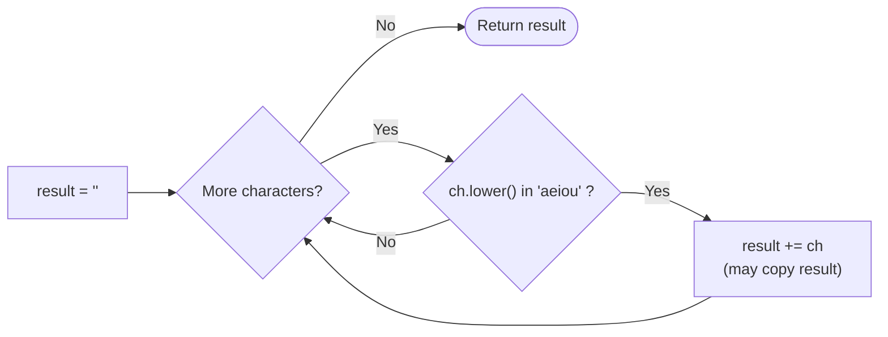

```python
class Solution:

    # Return the vowels of s by appending each one to a growing string.
    def remConsonants(self, s):

        # Start with an empty answer.
        result = ""

        # Visit every character from left to right.
        for ch in s:

            # Lowercase the character so one check covers both cases.
            if ch.lower() in "aeiou":

                # Append the vowel to the answer.
                result += ch

        # The answer holds the vowels in their original order.
        return result
```

**Walkthrough.**

| Step | `ch` | `ch.lower()` | Vowel? | `result` | Characters copied (no in-place trick) |
|---|---|---|---|---|---|
| 1 | `a` | `a` | Yes | `"a"` | 1 |
| 2 | `b` | `b` | No | `"a"` | 0 |
| 3 | `E` | `e` | Yes | `"aE"` | 2 |
| 4 | `k` | `k` | No | `"aE"` | 0 |
| 5 | `i` | `i` | Yes | `"aEi"` | 3 |
| 6 | `p` | `p` | No | `"aEi"` | 0 |
| 7 | `o` | `o` | Yes | `"aEio"` | 4 |

It returns `"aEio"`. ✔

**Cost.** Strings are immutable, so by the language rules `result += ch` creates a **new** string and copies the old one into it: `1 + 2 + ... + k ≈ k² / 2` copies for `k` vowels, `O(n²)` when every character is a vowel. In practice, CPython often avoids the copy: when `result` has no other references, it resizes the string in place, and the loop runs in amortized `O(n)`. That is an implementation detail, not a guarantee: PyPy and other interpreters do not promise it, and PEP 8 says not to rely on it. The vowel check also creates a one-character string with `lower()` on every step.

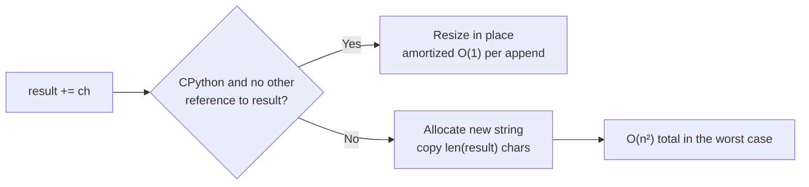

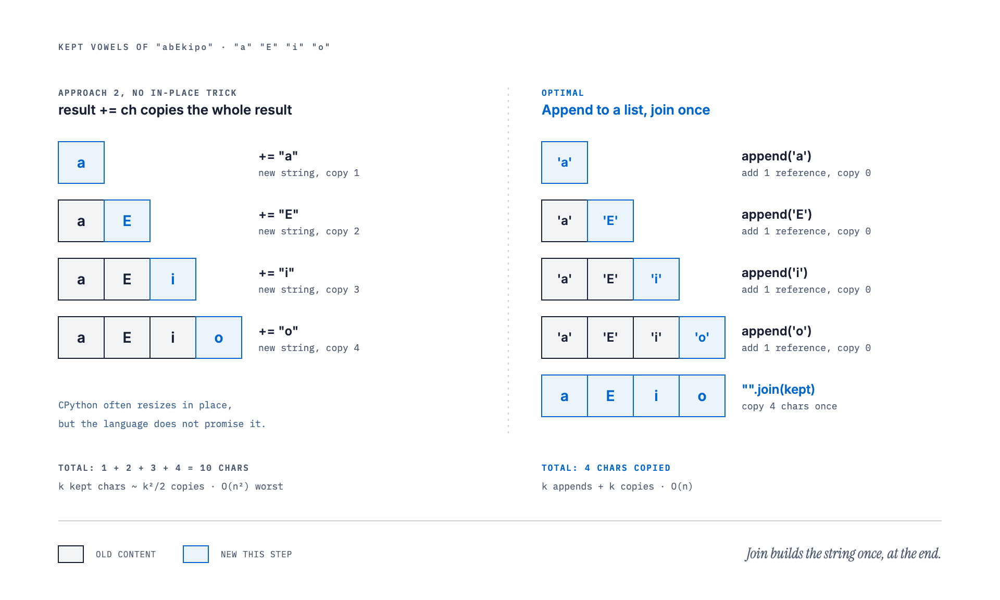

### 3.3 Optimal: One Pass, Set Membership, List + Join

**Idea.** Keep the one-pass shape of 3.2 and fix both costs. Look each character up in a constant `frozenset` that already holds both cases, and append kept characters to a list, which never copies them. Build the string once at the end with `"".join`, which measures the total length first and copies each character exactly once.

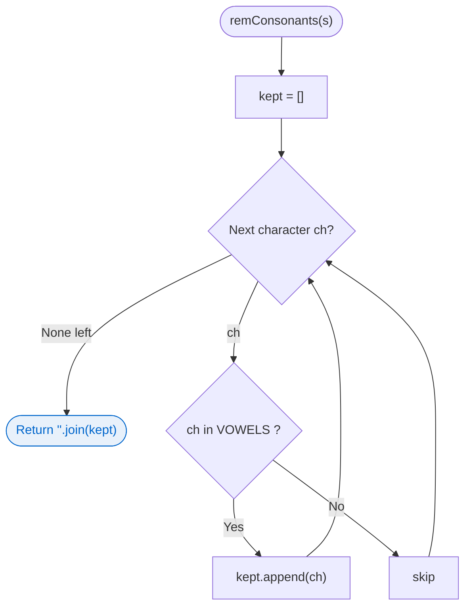

**Algorithm.**

1. Store the 10 vowels, both cases, in a constant set.
2. Walk the string once; append every character found in the set to a list.
3. Return `"".join` of the list. An empty list gives `""`, which covers the no-vowel case for free.

```python
class Solution:

    # Store both cases of every vowel once, so each lookup is a single O(1) test.
    VOWELS = frozenset("aeiouAEIOU")

    # Return s with every consonant removed, keeping the vowels in order.
    def remConsonants(self, s):

        # Collect the kept characters in a list, which grows without copying them.
        kept = []

        # Visit every character from left to right.
        for ch in s:

            # Keep the character only if it is a vowel.
            if ch in self.VOWELS:

                # Append the vowel; order is preserved because we scan left to right.
                kept.append(ch)

        # Build the answer once; an empty list gives the empty string.
        return "".join(kept)
```

## 4. Walkthrough

### 4.1 Mixed Vowels and Consonants

```text
s = "abEkipo"
```

| Step | `ch` | `ch in VOWELS` | Action | `kept` |
|---|---|---|---|---|
| 1 | `a` | Yes | append | `['a']` |
| 2 | `b` | No | skip | `['a']` |
| 3 | `E` | Yes | append | `['a', 'E']` |
| 4 | `k` | No | skip | `['a', 'E']` |
| 5 | `i` | Yes | append | `['a', 'E', 'i']` |
| 6 | `p` | No | skip | `['a', 'E', 'i']` |
| 7 | `o` | Yes | append | `['a', 'E', 'i', 'o']` |
| — | — | — | join | **return `"aEio"`** |

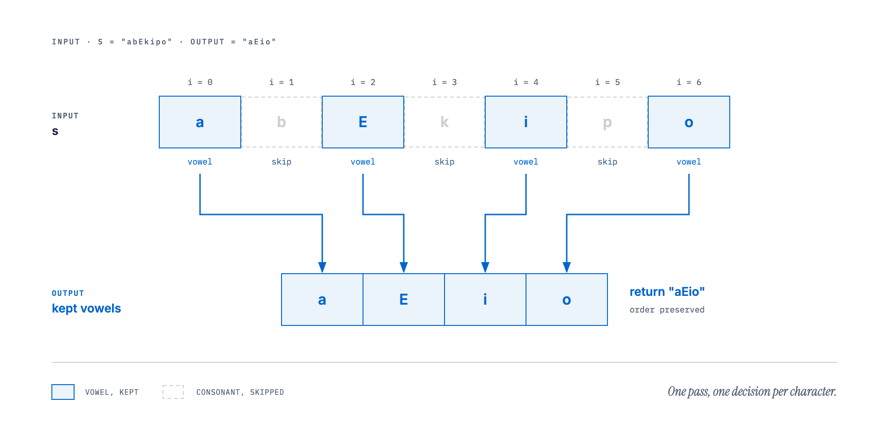

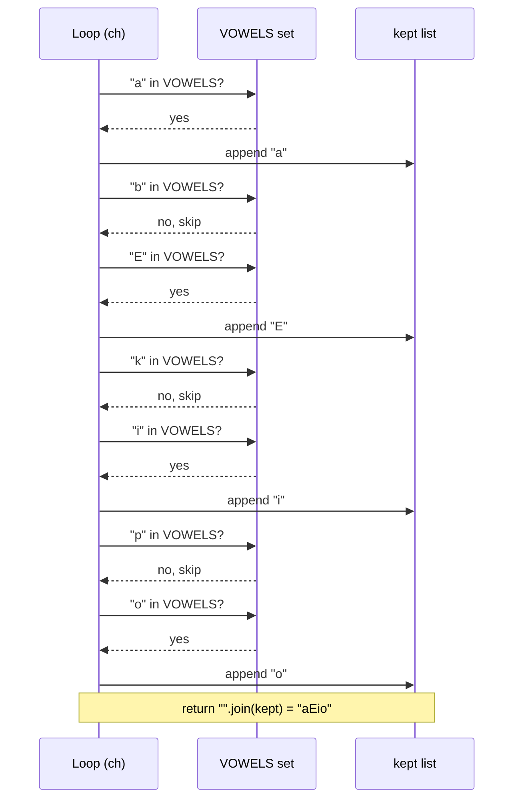

### 4.2 No Vowels

```text
s = "rrty"
```

| Step | `ch` | `ch in VOWELS` | Action | `kept` |
|---|---|---|---|---|
| 1 | `r` | No | skip | `[]` |
| 2 | `r` | No | skip | `[]` |
| 3 | `t` | No | skip | `[]` |
| 4 | `y` | No | skip | `[]` |
| — | — | — | join | **return `""`** |

`y` is not in the set, so it is skipped like any other consonant. `"".join([])` is `""`, so no special case is needed.

### 4.3 Repeated Vowels and an Uppercase Consonant

```text
s = "Queue"
```

| Step | `ch` | `ch in VOWELS` | Action | `kept` |
|---|---|---|---|---|
| 1 | `Q` | No | skip | `[]` |
| 2 | `u` | Yes | append | `['u']` |
| 3 | `e` | Yes | append | `['u', 'e']` |
| 4 | `u` | Yes | append | `['u', 'e', 'u']` |
| 5 | `e` | Yes | append | `['u', 'e', 'u', 'e']` |
| — | — | — | join | **return `"ueue"`** |

Repeated vowels are all kept; nothing is deduplicated. On the shared input `"abEkipo"`, Approach 3.1 copied 15 characters to delete 3 consonants; the optimal pass copied only the 4 kept characters, once.

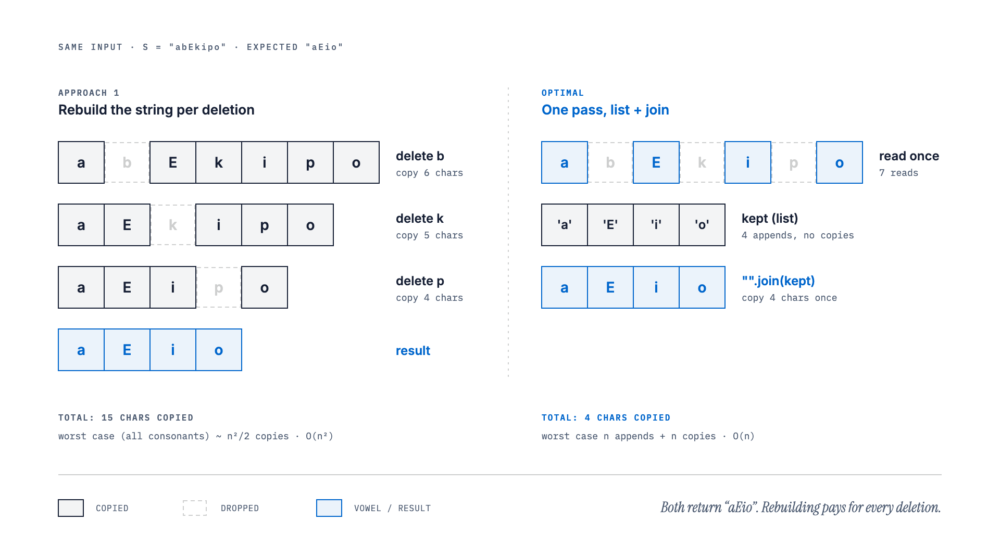

## 5. Complexity Analysis

Let `n = len(s)` and `k` = number of vowels in `s` (`0 ≤ k ≤ n`).

| Step | Work | Time |
|---|---|---|
| Scan | one set lookup per character | `O(n)` |
| Append | one list append per vowel, amortized `O(1)` | `O(k)` |
| Join | one pass to size the result, one to copy `k` characters | `O(k)` |

| Metric | Complexity |
|---|---|
| Time | `O(n)` in every case |
| Extra Space | `O(k)` for the list, `O(n)` in the worst case (all vowels); the returned string is another `O(k)` |

### Why `O(n)` Is Optimal

Any correct algorithm must read every character. Suppose an algorithm never reads position `j`. Changing `s[j]` from a consonant to a vowel (say `b` to `a`) changes the correct answer, because that vowel must now appear in the output, but nothing the algorithm read has changed, so it returns the same string as before and is wrong on one of the two inputs. Reading `n` characters takes `Ω(n)` time, and the one-pass solution reads each character exactly once.

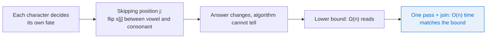

## 6. Comparing the Approaches

| Approach | Time (guaranteed) | Time (typical CPython) | Extra Space | Characters copied on `"abEkipo"` |
|---|---|---|---|---|
| 3.1 Rebuild per deletion | `O(n²)` | `O(n²)` | `O(n)` | 15 |
| 3.2 `result += ch` | `O(n²)` | amortized `O(n)` | `O(n)` | up to 10 |
| **3.3 Set + list + join** | **`O(n)`** | **`O(n)`** | **`O(n)`** | **4** |

All three need `O(n)` memory somewhere, because the answer itself can be as long as `s`. The difference is time: only 3.3 is linear on every Python implementation, for every input.

The right tool depends on where the code runs:

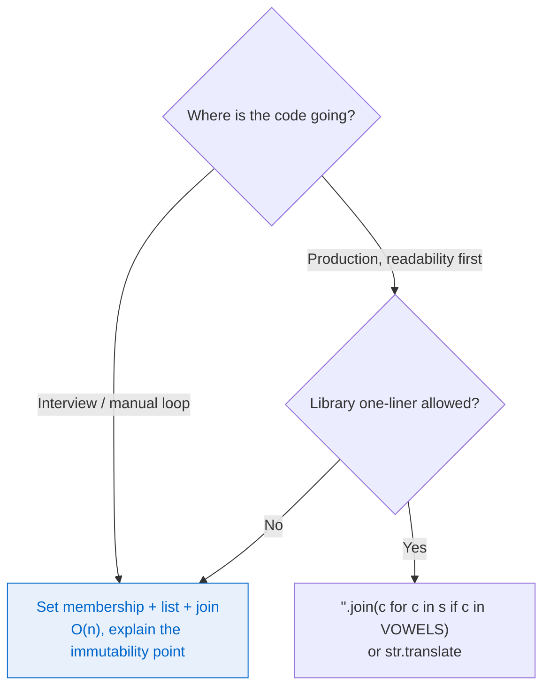

## 7. Edge Cases and Pitfalls

### 7.1 Edge Cases

| Case | Input | Expected | What it tests |
|---|---|---|---|
| No vowels | `"rrty"` | `""` | Empty result without a special case. |
| Only vowels | `"aEiOu"` | `"aEiOu"` | Every character kept, case unchanged. |
| Uppercase vowels | `"ABCDE"` | `"AE"` | Uppercase vowels are vowels too. |
| `y` in the string | `"rhythm"` | `""` | `y` is a consonant here. |
| Repeated vowels | `"Queue"` | `"ueue"` | Order and duplicates kept. |
| Single vowel | `"a"` | `"a"` | Smallest input that keeps something. |
| Single consonant | `"z"` | `""` | Smallest input that keeps nothing. |

> [!NOTE]
> The constraints guarantee `n >= 1` and letters only. The optimal solution also returns `""` for an empty string, and any non-letter character is simply not a vowel, so it is dropped.

### 7.2 Common Pitfalls

| # | Pitfall | Buggy code | Fix |
|---|---|---|---|
| 1 | Checking only lowercase | `if ch in "aeiou":` | `"abEkipo"` would lose `E`; include both cases or test `ch.lower()`. |
| 2 | Chained `or` without repeating the comparison | `if ch == "a" or "e" or "i":` | `"e"` is truthy, so every character passes; write `ch == "a" or ch == "e" ...` or use a set. |
| 3 | Returning `None` or `"-1"` for no vowels | `if not kept: return -1` | The problem asks for `""`; `"".join([])` already gives it. |
| 4 | Advancing `i` after a deletion | `s = s[:i] + s[i+1:]` then `i += 1` | The next character slid into `i`; on `"bc"` it would skip `c` and return `"c"`. |
| 5 | Treating `y` as a vowel | `VOWELS = set("aeiouy")` | Only `a, e, i, o, u` count; `"rrty"` must give `""`. |
| 6 | Deduplicating with a set | `return "".join(set(kept))` | Sets lose order and duplicates; `"Queue"` must give `"ueue"`. |

## 8. Interview Guide

### 8.1 The 30-Second Explanation

> Whether a character stays depends only on that character, so one pass decides everything. I keep the 10 vowels, both cases, in a constant set so each check is `O(1)`, and I append every vowel to a list as I scan from left to right, which keeps them in order. At the end I return `"".join(kept)`. I use a list instead of `result += ch` because Python strings are immutable, so repeated concatenation can copy the result on every step and become `O(n²)`; join copies each character once. That is `O(n)` time and `O(n)` space, and if there are no vowels the join of an empty list is already `""`.

### 8.2 Follow-Up Questions

**Q1. Why not just use `result += ch`?** It is correct, and CPython often makes it fast by resizing in place, but the language does not guarantee that. On other interpreters, or when `result` has another reference, each `+=` copies the whole string, giving `O(n²)` ([3.2](#32-brute-force-build-the-answer-with-result--ch)).

**Q2. Is a set really faster than `"aeiouAEIOU"` for a membership test?** Both are `O(1)` here, because the vowel string has a fixed length of 10. The set gives a single hash lookup and states the intent clearly; the string scans up to 10 characters. The asymptotic cost is the same.

**Q3. How would you remove the vowels instead?** Flip the test to `ch not in VOWELS`. Everything else, including the list and join, stays the same.

**Q4. What if the string could be huge or streamed?** Read it in chunks and write each chunk's vowels straight to the output. The state carried between chunks is nothing at all, because each character is decided on its own.

<details>
<summary><b>Q5. Can you do it in one line with the standard library?</b></summary>

`str.translate` deletes every character mapped to `None` in a single C-level pass. Build the table once from the consonants.

```python
class Solution:

    # Map every consonant, both cases, to None so translate deletes it.
    DELETE_CONSONANTS = str.maketrans("", "", "bcdfghjklmnpqrstvwxyzBCDFGHJKLMNPQRSTVWXYZ")

    # Return s with every consonant removed, using one translate pass.
    def remConsonants(self, s):

        # translate copies each kept character once and drops every mapped one.
        return s.translate(self.DELETE_CONSONANTS)
```

A regular expression works too: `re.sub(r"[^aeiouAEIOU]", "", s)`. Both are `O(n)`. Note that the `translate` table above only lists letters, so it keeps non-letters; that is fine here because the constraints promise letters only.

</details>

<details>
<summary><b>Q6. How would you return the count of each vowel as well?</b></summary>

Carry a dictionary of counters as extra running state in the same pass.

```python
class Solution:

    # Store both cases of every vowel once, so each lookup is a single O(1) test.
    VOWELS = frozenset("aeiouAEIOU")

    # Return the vowels of s and how many times each one appears.
    def vowelsWithCounts(self, s):

        # Collect the kept characters in order.
        kept = []

        # Count each vowel exactly as it appears, case included.
        counts = {}

        # Visit every character from left to right.
        for ch in s:

            # Keep the character only if it is a vowel.
            if ch in self.VOWELS:

                # Append the vowel to the output list.
                kept.append(ch)

                # Increase this vowel's count, starting from 0 the first time.
                counts[ch] = counts.get(ch, 0) + 1

        # Return the joined vowels together with their counts.
        return "".join(kept), counts
```

</details>

## 9. Pattern: Linear Scan with Running State

**Recognize it when:**

- each element can be **decided on its own**, or with a small amount of state,
- the answer is built from what you have **seen so far** in one pass,
- each element needs only **`O(1)` work**.

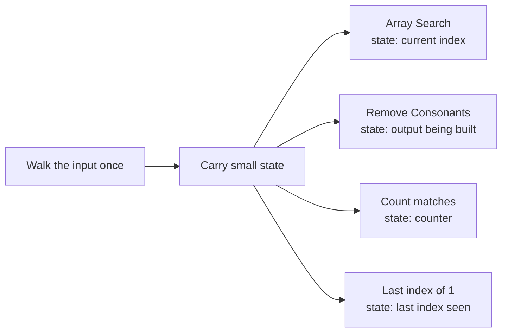

Here the running state is the **output being built**: a list of kept characters. The loop shape is the same as in Array Search; the only new lesson is string-specific: when the state is a growing string in Python, keep it as a list and join once.

### Practice Next

| Problem | What changes |
|---|---|
| Remove Vowels | The same filter with the test flipped. |
| Remove Spaces | Drop one specific character instead of a class of characters. |
| Remove All Except Alphabets | The keep test becomes `ch.isalpha()`. |
| Count Types of Characters | A set of running counters instead of an output list. |
| Reverse Vowels | Vowels move, so the single pass becomes two pointers. |

## 10. Summary

```python
class Solution:

    # Store both cases of every vowel once, so each lookup is a single O(1) test.
    VOWELS = frozenset("aeiouAEIOU")

    # Return s with every consonant removed, keeping the vowels in order.
    def remConsonants(self, s):

        # Collect the kept characters in a list, which grows without copying them.
        kept = []

        # Visit every character from left to right.
        for ch in s:

            # Keep the character only if it is a vowel.
            if ch in self.VOWELS:

                # Append the vowel; order is preserved because we scan left to right.
                kept.append(ch)

        # Build the answer once; an empty list gives the empty string.
        return "".join(kept)
```

**Key takeaways**

1. **Each character decides its own fate,** so one left-to-right pass is enough, and every character must be read.
2. **Put both cases of the vowels in a constant set.** Each membership test is `O(1)`.
3. **Python strings are immutable.** Deleting from or appending to a string can copy it every time.
4. **Collect into a list and `"".join` once.** Each kept character is copied exactly once.
5. **No vowels needs no special case:** `"".join([])` is `""`.
6. **Time `O(n)` · Space `O(n)`.**

> [!TIP]
> **Decide each character on its own with a constant vowel set, collect the keepers in a list, and build the string once with `join`.**
