# Count Zeros in a Sorted Matrix

| Topic | Difficulty | Submissions | Accuracy | Companies | Related Tags | Problem Link |
|---|---|---|---|---|---|---|
| Searching | Basics | 34,114 | 75.99% | — | Searching, Matrix | [https://www.geeksforgeeks.org/problems/count-zeros-in-a-sorted-matrix/1](https://www.geeksforgeeks.org/problems/count-zeros-in-a-sorted-matrix/1) |

> [!IMPORTANT]
> **TL;DR.** Each row is zeros then ones, and because columns are sorted too, the zero/one boundary only moves **left** as you go down. Start at the top-right cell: on a `1` step left, on a `0` add `col + 1` zeros for this row and step down. The walk ends after at most `2n - 1` reads. **Time `O(n)` · Space `O(1)` · Pattern: Search in Sorted Matrix.**

## Contents

1. [Problem](#1-problem)
2. [Key Insight](#2-key-insight)
3. [Approaches](#3-approaches)
4. [Walkthrough](#4-walkthrough)
5. [Complexity Analysis](#5-complexity-analysis)
6. [Comparing the Approaches](#6-comparing-the-approaches)
7. [Edge Cases and Pitfalls](#7-edge-cases-and-pitfalls)
8. [Interview Guide](#8-interview-guide)
9. [Pattern: Search in Sorted Matrix](#9-pattern-search-in-sorted-matrix)
10. [Summary](#10-summary)

## 1. Problem

> Given a binary Square matrix `mat[][]`, where each row and column of the matrix is sorted in ascending order. Find the total number of zeros present in the matrix.

*Problem statement, examples and constraints as given on GeeksforGeeks.*

### Examples

```text
Input: mat[][] = [[0, 0, 0], [0, 0, 1], [0, 1, 1]]
Output: 6
Explanation: The first, second and third row contains 3, 2 and 1 zeroes respectively.
```

```text
Input: mat[][] = [[1, 1], [1, 1]]
Output: 0
Explanation: There are no zeroes in any of the rows.
```

### Constraints

```text
1 ≤ mat.size(), mat[i].size() ≤ 10^3
0 ≤ mat[i][j] ≤ 1
```

### Function Signature

```python
class Solution:

    # Return the total number of 0s in a binary matrix sorted by rows and columns.
    def countZeros(self, mat):
        ...
```

The matrix holds only `0`s and `1`s. "Sorted in ascending order" means every row is `0`s then `1`s, and every column is `0`s then `1`s from top to bottom.

## 2. Key Insight

Two sort orders give two facts, and together they shape the matrix like a staircase.

| Fact | Comes from | Consequence |
|---|---|---|
| Row `r` is `0`s then `1`s. | Rows sorted | Its zeros are a **prefix**: zeros in row `r` = index of its first `1`. |
| If `mat[r][c] == 1`, then `mat[r + 1][c] == 1`. | Columns sorted | The first `1` of row `r + 1` is **at or left of** the first `1` of row `r`. |

```text
        c=0 c=1 c=2 c=3
r=0  [   0   0   0   0 ]    4 zeros
r=1  [   0   0   0 | 1 ]    3 zeros      the boundary "|" only moves left
r=2  [   0 | 1   1   1 ]    1 zero       as r increases
r=3  [ | 1   1   1   1 ]    0 zeros
```

So the boundary is one staircase line from the top-right toward the bottom-left. Start at the top-right cell and follow it: every read either moves one column left or one row down, and neither move is ever undone.

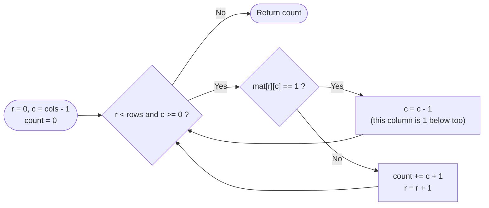

> [!NOTE]
> When `mat[r][c] == 0`, every cell left of it in row `r` is also `0` (row sorted), so row `r` has exactly `c + 1` zeros up to here, and nothing to the right of `c` can be `0` because the walk only reached column `c` by passing `1`s.

## 3. Approaches

Three approaches: read everything, binary search each row, then the staircase. All three use the same input:

```text
mat = [[0, 0, 0, 0],
       [0, 0, 0, 1],
       [0, 1, 1, 1],
       [1, 1, 1, 1]]        expected output: 8
```

### 3.1 Brute Force: Read Every Cell

**Idea.** Ignore both sort orders and count the zeros cell by cell.

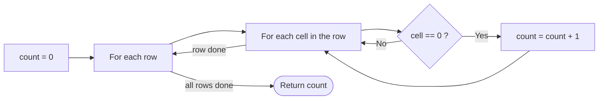

```python
class Solution:

    # Return the number of zeros by checking every cell of the matrix.
    def countZeros(self, mat):

        # Running total of zeros seen so far.
        count = 0

        # Visit every row of the matrix.
        for row in mat:

            # Visit every cell of the current row.
            for value in row:

                # Count the cell if it holds a zero.
                if value == 0:

                    # Add this zero to the total.
                    count += 1

        # Return the total number of zeros.
        return count
```

**Walkthrough.**

| Row | Cells | Zeros in row | Running `count` |
|---|---|---|---|
| 0 | `0 0 0 0` | 4 | 4 |
| 1 | `0 0 0 1` | 3 | 7 |
| 2 | `0 1 1 1` | 1 | 8 |
| 3 | `1 1 1 1` | 0 | **8** ✔ |

**Cost.** `O(n²)` time (16 reads here, a million at `n = 1000`), `O(1)` space.

### 3.2 Brute Force: Binary Search in Each Row

**Idea.** Each row is sorted, so its zero count is the index of its first `1`. Find it with a lower-bound binary search per row.

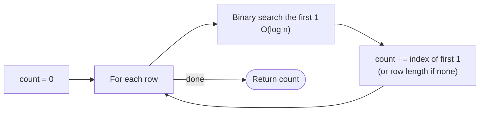

```python
class Solution:

    # Return the number of zeros by binary searching each row for its first 1.
    def countZeros(self, mat):

        # Running total of zeros seen so far.
        count = 0

        # Process each row on its own.
        for row in mat:

            # Start the window at the first column.
            low = 0

            # End the window at the last column.
            high = len(row) - 1

            # If the row has no 1, all of its cells are zeros.
            first_one = len(row)

            # Lower-bound binary search for the first 1 in this row.
            while low <= high:

                # Pick the middle column of the window.
                mid = (low + high) // 2

                # A 1 here is a candidate; an earlier 1 may still exist.
                if row[mid] == 1:

                    # Remember this column as the first 1 so far.
                    first_one = mid

                    # Keep looking to the left.
                    high = mid - 1

                # A 0 here means the first 1 is to the right.
                else:

                    # Discard the left part including mid.
                    low = mid + 1

            # Every column before the first 1 holds a zero.
            count += first_one

        # Return the total number of zeros.
        return count
```

**Walkthrough.**

| Row | Probes (`mid`: value) | First `1` | Zeros added | Running `count` |
|---|---|---|---|---|
| 0 | 1: 0, 2: 0, 3: 0 | none → 4 | 4 | 4 |
| 1 | 1: 0, 2: 0, 3: 1 | 3 | 3 | 7 |
| 2 | 1: 1, 0: 0 | 1 | 1 | 8 |
| 3 | 1: 1, 0: 1 | 0 | 0 | **8** ✔ |

10 reads instead of 16.

**Cost.** `O(n log n)` time, `O(1)` space. Uses the row order only; the column order would let it do better.

### 3.3 Optimal: Staircase Walk from the Top-Right

**Idea.** Use both orders. Start at `(0, cols - 1)`. A `1` means this whole column is `1` from here down, so step left. A `0` means row `r` has `c + 1` zeros, so add them and step down. Stop when you leave the matrix.

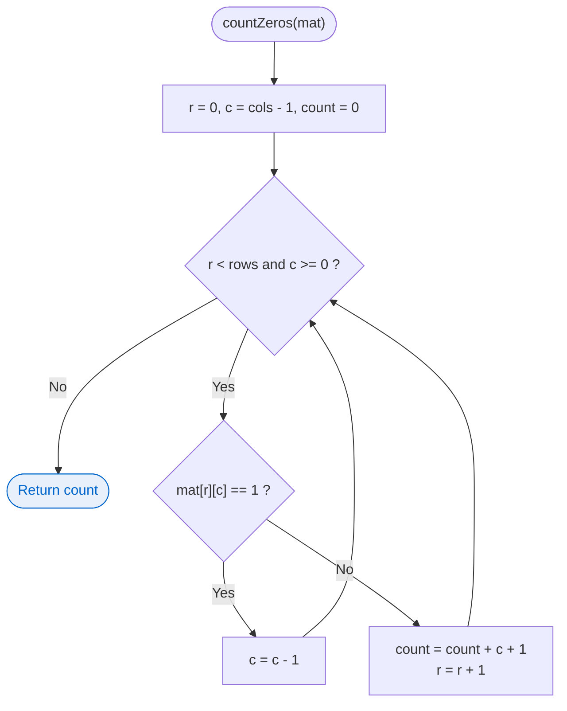

**Algorithm.**

1. Set `r = 0`, `c = cols - 1`, `count = 0`.
2. While `r < rows` and `c >= 0`:
   - if `mat[r][c] == 1`, set `c = c - 1`;
   - otherwise add `c + 1` to `count` and set `r = r + 1`.
3. Return `count`. (Rows left when `c < 0` have no zeros.)

```python
class Solution:

    # Return the total number of 0s in a binary matrix sorted by rows and columns.
    def countZeros(self, mat):

        # Number of rows in the matrix.
        rows = len(mat)

        # Number of columns in the matrix.
        cols = len(mat[0])

        # Start in the top row.
        r = 0

        # Start in the rightmost column.
        c = cols - 1

        # Running total of zeros.
        count = 0

        # Walk until the position leaves the matrix.
        while r < rows and c >= 0:

            # A 1 here is also 1 in every row below, so this column has no more zeros.
            if mat[r][c] == 1:

                # Step one column to the left.
                c -= 1

            # A 0 here means columns 0..c of this row are all zeros.
            else:

                # Add this row's zeros to the total.
                count += c + 1

                # Step down to the next row.
                r += 1

        # Any rows not reached have no zeros left, so the total is complete.
        return count
```

**Walkthrough.**

| Step | `r` | `c` | `mat[r][c]` | Action | `count` |
|---|---|---|---|---|---|
| 1 | 0 | 3 | 0 | add 4, go down | 4 |
| 2 | 1 | 3 | 1 | go left | 4 |
| 3 | 1 | 2 | 0 | add 3, go down | 7 |
| 4 | 2 | 2 | 1 | go left | 7 |
| 5 | 2 | 1 | 1 | go left | 7 |
| 6 | 2 | 0 | 0 | add 1, go down | 8 |
| 7 | 3 | 0 | 1 | go left → `c = -1`, stop | **8** ✔ |

7 reads instead of 16.

## 4. Walkthrough

### 4.1 Shared Input: The Staircase

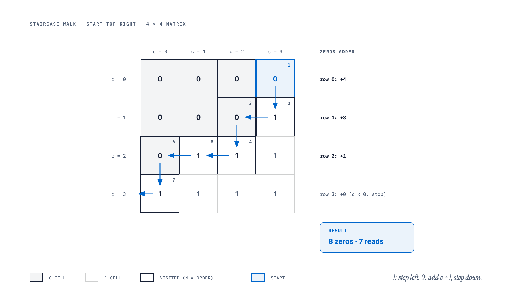

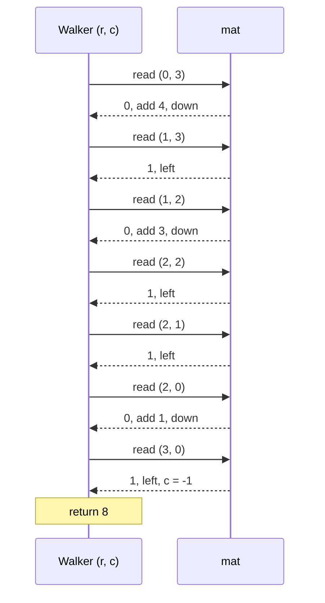

### 4.2 GfG Example 1

```text
mat[][] = [[0, 0, 0], [0, 0, 1], [0, 1, 1]]
```

| Step | `r` | `c` | `mat[r][c]` | Action | `count` |
|---|---|---|---|---|---|
| 1 | 0 | 2 | 0 | add 3, go down | 3 |
| 2 | 1 | 2 | 1 | go left | 3 |
| 3 | 1 | 1 | 0 | add 2, go down | 5 |
| 4 | 2 | 1 | 1 | go left | 5 |
| 5 | 2 | 0 | 0 | add 1, go down → `r = 3`, stop | **6** |

The rows contribute `3`, `2` and `1`, matching the GfG explanation.

### 4.3 GfG Example 2

```text
mat[][] = [[1, 1], [1, 1]]
```

| Step | `r` | `c` | `mat[r][c]` | Action | `count` |
|---|---|---|---|---|---|
| 1 | 0 | 1 | 1 | go left | 0 |
| 2 | 0 | 0 | 1 | go left → `c = -1`, stop | **0** |

The walk leaves through the left edge in row `0`: no row has a zero.

### 4.4 Cells Read by Each Approach

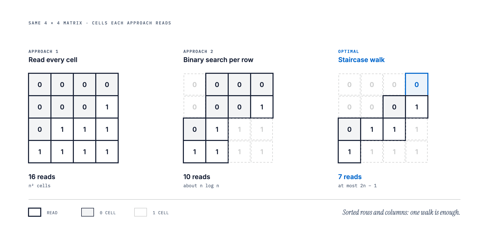

## 5. Complexity Analysis

Let the matrix be `n × n` (the code also works for `rows × cols`). Each step moves down one row or left one column. There are `n` rows to go down and `n` columns to go left, and the walk stops when either runs out, so it takes at most `2n - 1` steps.

| Case | When | Reads | Time |
|---|---|---|---|
| Best | row `0` is all `1`s, or the last column is all `0`s | `n` | `O(n)` |
| Typical | any staircase | between `n` and `2n - 1` | `O(n)` |
| Worst | boundary zig-zags every step | `2n - 1` | `O(n)` |

| Metric | Complexity |
|---|---|
| Time | `O(n)` (`O(rows + cols)` in general) |
| Extra Space | `O(1)` — `r`, `c`, `count` |

### Why `O(n)` Is Optimal

Look at the anti-diagonal cells `(r, n - 1 - r)`. Fill everything above-left of that diagonal with `0` and everything below-right with `1`. Now **each anti-diagonal cell can be `0` or `1` independently** and the matrix stays sorted in rows and columns. The zero count depends on all `n` of those cells, so an algorithm that skips one of them cannot tell two inputs with different answers apart. At least `n` reads are necessary, and the staircase uses at most `2n - 1`.

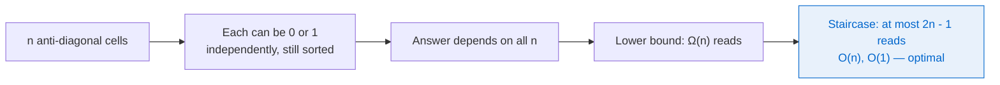

## 6. Comparing the Approaches

| Approach | Time | Extra Space | Uses row order? | Uses column order? |
|---|---|---|---|---|
| 3.1 Read every cell | `O(n²)` | `O(1)` | No | No |
| 3.2 Binary search per row | `O(n log n)` | `O(1)` | Yes | No |
| **3.3 Staircase walk** | **`O(n)`** | **`O(1)`** | **Yes** | **Yes** |

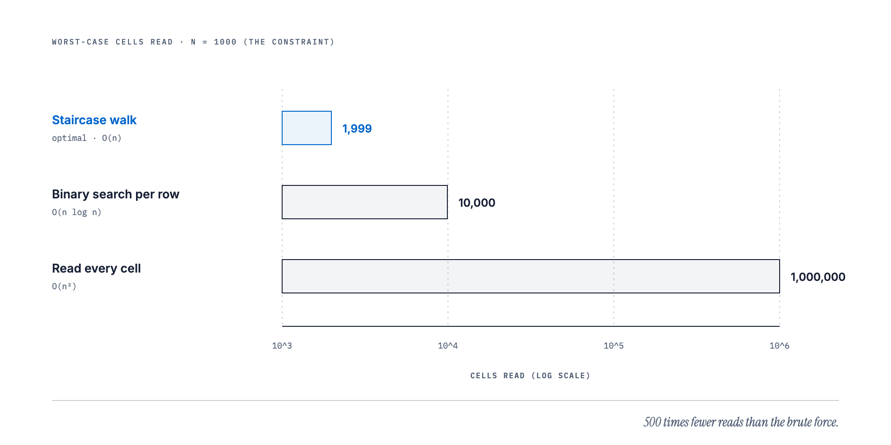

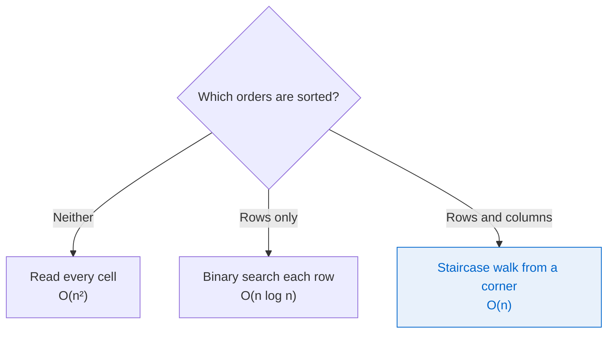

## 7. Edge Cases and Pitfalls

### 7.1 Edge Cases

| Case | Input | Expected | What it tests |
|---|---|---|---|
| All zeros | `[[0, 0], [0, 0]]` | `4` | Walk goes straight down the last column. |
| All ones | `[[1, 1], [1, 1]]` | `0` | Walk goes straight left along row `0`. |
| `1 × 1` zero | `[[0]]` | `1` | Smallest matrix, one `0`. |
| `1 × 1` one | `[[1]]` | `0` | Smallest matrix, one `1`. |
| Only the last cell is `1` | `[[0, 0], [0, 1]]` | `3` | One left step at the bottom. |
| Only the first cell is `0` | `[[0, 1], [1, 1]]` | `1` | Boundary hugs the left edge. |
| Rectangular (constraints allow it) | `[[0, 0, 1]]` | `2` | Uses `len(mat[0])` for columns. |

### 7.2 Common Pitfalls

| # | Pitfall | Buggy code | Fix |
|---|---|---|---|
| 1 | Starting at the top-left | `r, c = 0, 0` | From top-left both moves (right and down) can increase, so there is no single rule. Start at top-right or bottom-left. |
| 2 | Adding `c` instead of `c + 1` | `count += c` | Columns `0..c` are `c + 1` cells. |
| 3 | Adding when you see a `1` | `if mat[r][c] == 1: count += c` | Add only on a `0`; a `1` just means "step left". |
| 4 | Wrong loop guard | `while r < rows:` | Also stop when `c < 0`, otherwise `mat[r][-1]` silently reads the last column in Python. |
| 5 | Assuming square in the code | `cols = len(mat)` | Use `len(mat[0])`; the constraints list rows and columns separately. |
| 6 | Counting rows after `c < 0` | adding leftover rows' lengths | Once `c < 0`, every remaining row starts with a `1`: it has no zeros. |

## 8. Interview Guide

### 8.1 The 30-Second Explanation

> Rows are sorted, so each row's zeros form a prefix; columns are sorted, so the first `1` can only move left as I go down. I start at the top-right corner. If I see a `1`, every cell below it is also `1`, so I step left. If I see a `0`, the whole row up to here is zeros, so I add `c + 1` and step down. Each step moves left or down and never back, so it is at most `2n - 1` reads: `O(n)` time and `O(1)` space. That is optimal because the `n` anti-diagonal cells can each be `0` or `1` independently.

### 8.2 Follow-Up Questions

**Q1. Can you start from the bottom-left instead?** Yes. At `(r, c)`: a `0` means every cell above it in this column is `0` too, so add `r + 1` and step right; a `1` means step up. Same `O(n)` bound.

**Q2. How would you count the ones?** `rows × cols - countZeros(mat)`, or run the same walk and add `cols - c - 1` on each row.

**Q3. How do you find the row with the most zeros (or most ones)?** Walk the same staircase and track which row produced the largest `c + 1`. This is the classic *Row with Max 1s* problem in mirror form.

**Q4. How does this relate to searching for a value in a sorted matrix?** The same corner start solves *Search in a Row-wise and Column-wise Sorted Matrix*: at the top-right, a value larger than the target rules out its column, a smaller one rules out its row. Each step discards one row or one column.

<details>
<summary><b>Q5. Show the bottom-left version.</b></summary>

```python
class Solution:

    # Count zeros by walking the staircase from the bottom-left corner.
    def countZeros(self, mat):

        # Number of rows in the matrix.
        rows = len(mat)

        # Number of columns in the matrix.
        cols = len(mat[0])

        # Start in the bottom row.
        r = rows - 1

        # Start in the leftmost column.
        c = 0

        # Running total of zeros.
        count = 0

        # Walk until the position leaves the matrix.
        while r >= 0 and c < cols:

            # A 0 here means every cell above it in this column is also 0.
            if mat[r][c] == 0:

                # Add the zeros of this column, rows 0..r.
                count += r + 1

                # Step one column to the right.
                c += 1

            # A 1 here means this row has no more zeros from column c onward.
            else:

                # Step up to the previous row.
                r -= 1

        # Columns not reached have no zeros left, so the total is complete.
        return count
```

</details>

<details>
<summary><b>Q6. What if only the rows are sorted, not the columns?</b></summary>

Then the boundary can jump right as well as left, and the staircase is no longer valid. Fall back to a binary search in each row (Approach 3.2), `O(n log n)`. Here is a compact version with `bisect_left`:

```python
from bisect import bisect_left


class Solution:

    # Count zeros when only the rows are sorted, using a lower bound per row.
    def countZeros(self, mat):

        # Running total of zeros.
        count = 0

        # Process each row on its own.
        for row in mat:

            # The first 1 sits at the leftmost insertion point of 1.
            count += bisect_left(row, 1)

        # Return the total number of zeros.
        return count
```

</details>

## 9. Pattern: Search in Sorted Matrix

**Recognize it when:**

- a matrix is sorted along **both** rows and columns,
- the question asks to find, count or locate a boundary (a value, the zeros, the ones, `k`-th smallest),
- an `O(n log n)` per-row approach exists, and the interviewer asks for better.

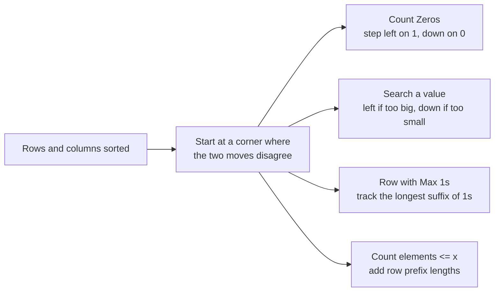

The key is the corner: at the top-right, moving left makes values smaller and moving down makes them larger, so every comparison has exactly one useful move. Each move discards a whole row or a whole column.

### Practice Next

| Problem | What changes |
|---|---|
| Row with Max 1s | Same staircase; track the row with the longest run of `1`s. |
| Search in a Row-wise and Column-wise Sorted Matrix | Compare with a target instead of `0`/`1`. |
| Count Elements Less Than or Equal to x in a Sorted Matrix | Add prefix lengths along the staircase. |
| Kth Smallest in a Sorted Matrix | Binary search on the value, staircase count as the check. |
| First 1 in a Sorted Binary Array | The one-row version of this problem. |

## 10. Summary

```python
class Solution:

    # Return the total number of 0s in a binary matrix sorted by rows and columns.
    def countZeros(self, mat):

        # Number of rows in the matrix.
        rows = len(mat)

        # Number of columns in the matrix.
        cols = len(mat[0])

        # Start in the top row.
        r = 0

        # Start in the rightmost column.
        c = cols - 1

        # Running total of zeros.
        count = 0

        # Walk until the position leaves the matrix.
        while r < rows and c >= 0:

            # A 1 here is also 1 in every row below, so this column has no more zeros.
            if mat[r][c] == 1:

                # Step one column to the left.
                c -= 1

            # A 0 here means columns 0..c of this row are all zeros.
            else:

                # Add this row's zeros to the total.
                count += c + 1

                # Step down to the next row.
                r += 1

        # Any rows not reached have no zeros left, so the total is complete.
        return count
```

**Key takeaways**

1. **Sorted rows make each row's zeros a prefix.**
2. **Sorted columns make the boundary move only left** as rows go down.
3. **Start at the top-right**: on `1` step left, on `0` add `c + 1` and step down.
4. **Each step removes a row or a column**, so at most `2n - 1` reads.
5. **Use `len(mat[0])` for columns** and stop when `c < 0`.
6. **Time `O(n)` · Space `O(1)`**, matching the `Ω(n)` anti-diagonal lower bound.

> [!TIP]
> **In a matrix sorted both ways, start at the corner where one move shrinks values and the other grows them: every comparison then discards a whole row or column.**
